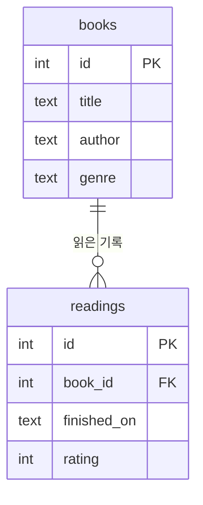
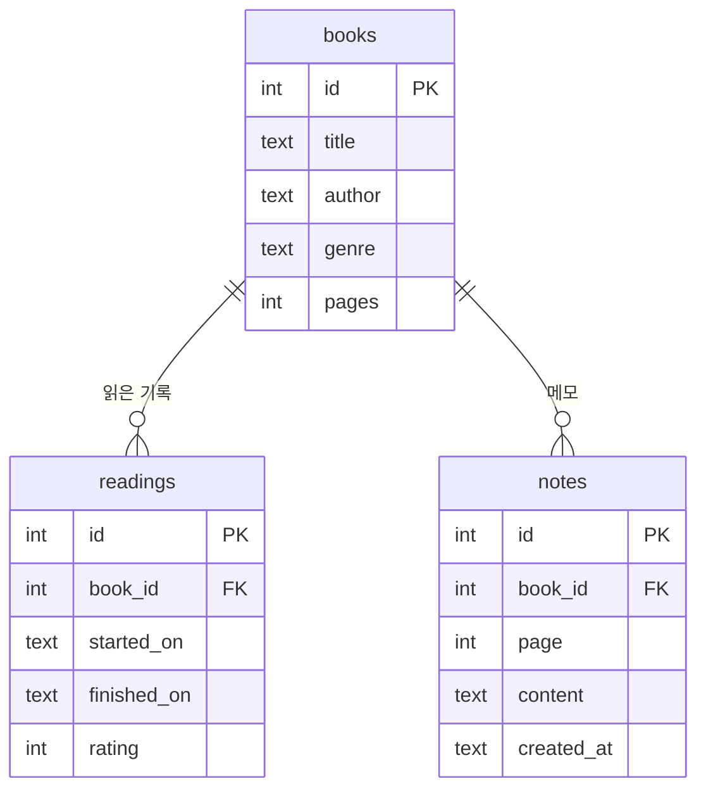

# 2장. 데이터 설계와 활용

> 이 장에서는 데이터를 **여러 테이블로 나누어 설계**하는 방법을 배운다. 기본키·외래키로 테이블을 연결하고, `JOIN`과 `GROUP BY`로 흩어진 데이터를 합치고 집계한다. 코드를 쓰기 전에 Plan 모드와 ERD로 설계부터 검토하는 습관을 들이고, 웹 앱을 만들 때 꼭 알아야 할 **SQL 인젝션**을 직접 공격해 보며 막는 방법을 익힌다. 실습으로 Streamlit과 SQLite를 연결한 독서 기록 웹 앱을 만든다.

## 이 장에서 배울 것

- 한 테이블에 모든 것을 넣으면 생기는 문제를 알고, 테이블을 나누는 이유를 설명한다.
- **기본키**와 **외래키**로 테이블 사이의 **1:N 관계**를 만든다.
- **ERD**(테이블 관계 그림)를 mermaid로 그리고 읽는다.
- `JOIN`으로 여러 테이블을 합치고, `GROUP BY`와 집계 함수(`COUNT`, `SUM`, `AVG`)로 통계를 낸다.
- **SQL 인젝션**이 무엇인지 직접 확인하고, **파라미터 바인딩**(`?`)으로 막는다.
- **Plan 모드**로 테이블 설계를 먼저 검토하고, 마음에 들 때만 구현을 승인한다.

### 이 장의 결과물

```
📚 나의 독서 기록
┌──────┬────────┬──────┬──────┐
│ 책장 │ 기록하기 │ 메모 │ 통계 │
└──────┴────────┴──────┴──────┘
장르별 통계

 장르   완독 권수(책 기준)   평균 별점(완독 기록 기준)
 소설                   2                       4.0
 과학                   1                       4.0

 소설  ████████████████████
 과학  ██████████
```

책 정보·읽은 기록·메모를 세 개의 테이블로 나눠 SQLite 데이터베이스(`reading.db`)에 저장하고, Streamlit 화면에서 기록하고 통계를 보는 독서 기록 웹 앱 `reading-log` 프로젝트

---

## 1. 지난 과제 돌아보기

1장 과제(카테고리별 검색, 이번 달 지출 보기)를 공유하면서 다음 질문에 답해 본다.

| 질문 | 생각해 볼 점 |
|---|---|
| 카테고리 검색에 `=`를 썼나, `LIKE`를 썼나? | `=`는 정확히 같은 값만, `LIKE '%식%'`은 일부만 같아도 찾는다. |
| "이번 달"을 어떻게 계산했나? | 파이썬 `datetime`으로 계산했는지, SQLite의 `date('now', 'start of month')`를 썼는지 비교한다. |
| 카테고리 값이 깔끔하게 모여 있나? | `식비`, `식 비`, `외식`, `밥값`처럼 같은 뜻이 다른 글자로 섞여 있지 않은가? |

세 번째 질문이 이 장의 출발점이다. 카테고리를 매번 **글자로 직접 입력**하면 오타와 표기 차이가 생기고, 카테고리별 합계가 여러 줄로 쪼개진다. 이 문제는 "카테고리 목록을 **별도의 테이블**로 만들고, 지출에는 카테고리 **번호**만 저장하는" 방법으로 해결한다. 이것이 테이블 나누기다.

---

## 2. 데이터 설계: 테이블을 나누는 이유

### 2-1. 한 테이블에 다 넣으면 생기는 문제

독서 기록을 엑셀처럼 표 하나에 모두 적었다고 해 보자.

**`reading_log` 테이블 (한 테이블에 모두 저장)**

| id | title | author | genre | finished_on | rating |
|---|---|---|---|---|---|
| 1 | 어린 왕자 | 생텍쥐페리 | 소설 | 2026-09-14 | 5 |
| 2 | 코스모스 | 칼 세이건 | 과학 | 2026-10-03 | 4 |
| 3 | 어린 왕자 | 생텍쥐베리 | 소설 | 2026-10-20 | 4 |
| 4 | 데미안 | 헤르만 헤세 | 소설 | 2026-11-08 | 3 |

`어린 왕자`를 두 번 읽었더니 책 정보(제목·지은이·장르)가 **두 번 저장**되었다. 이 표에는 네 가지 문제가 숨어 있다.

| 문제 | 위 표에서 | 결과 |
|---|---|---|
| **중복** | 같은 책 정보가 읽을 때마다 반복 저장된다 | 저장 공간이 낭비되고, 입력할 때마다 똑같은 내용을 다시 쓴다 |
| **불일치** | 3번 행의 지은이가 `생텍쥐베리`로 잘못 입력됐다 | "지은이별 읽은 권수"를 내면 같은 사람이 두 줄로 나온다 |
| **수정의 어려움** | 장르를 `소설`에서 `고전 소설`로 바꾸고 싶다 | 그 책이 나오는 **모든 행**을 찾아 고쳐야 한다. 하나라도 빠뜨리면 불일치가 생긴다 |
| **삭제의 부작용** | 4번 기록(데미안)을 지운다 | 데미안을 읽은 기록이 하나뿐이라, **책 정보까지 함께 사라진다** |

### 2-2. 테이블 나누기

해결 방법은 간단하다. **"무엇에 대한 정보인가"** 에 따라 표를 나눈다.

- 제목·지은이·장르는 **책**에 대한 정보다 → `books` 테이블
- 읽은 날짜·별점은 **읽은 기록**에 대한 정보다 → `readings` 테이블

**`books` 테이블 (책 정보)**

| id | title | author | genre |
|---|---|---|---|
| 1 | 어린 왕자 | 생텍쥐페리 | 소설 |
| 2 | 코스모스 | 칼 세이건 | 과학 |
| 3 | 사피엔스 | 유발 하라리 | 인문 |
| 4 | 데미안 | 헤르만 헤세 | 소설 |

**`readings` 테이블 (읽은 기록)**

| id | book_id | finished_on | rating |
|---|---|---|---|
| 1 | 1 | 2026-09-14 | 5 |
| 2 | 2 | 2026-10-03 | 4 |
| 3 | 1 | 2026-10-20 | 4 |
| 4 | 4 | 2026-11-08 | 3 |

`readings`에는 책 제목 대신 **책 번호(`book_id`)** 만 적는다. 이제 앞의 문제가 모두 사라진다.

- 책 정보는 `books`에 **한 번만** 저장된다. 지은이 오타가 생길 자리가 없다.
- 장르를 바꾸려면 `books`의 **한 행만** 고치면 된다.
- 읽은 기록을 지워도 `books`의 책 정보는 남는다. `사피엔스`처럼 **아직 읽지 않은 책**도 등록해 둘 수 있다.

> 💡 이렇게 중복을 없애도록 테이블을 나누는 일을 **정규화**라고 부른다. 용어는 몰라도 된다. **"같은 정보를 두 군데 적고 있지 않은가?"** 라는 질문 하나만 기억한다.

### 2-3. 기본키와 외래키

나눈 테이블을 다시 연결하려면 두 가지 열이 필요하다.

| 용어 | 뜻 | 위 예에서 |
|---|---|---|
| **기본키**(Primary Key, PK) | 테이블 안에서 행 하나를 콕 집어 가리키는 **고유 번호**. 겹치지 않고 비어 있지 않다. | `books.id`, `readings.id` |
| **외래키**(Foreign Key, FK) | **다른 테이블의 기본키**를 가리키는 열. 테이블 사이의 연결 고리다. | `readings.book_id` → `books.id` |

`readings`의 1번 행에 있는 `book_id = 1`은 "이 기록은 `books`의 1번 책(어린 왕자)에 대한 것"이라는 뜻이다. 주민등록번호로 사람을 가리키듯, 번호로 다른 테이블의 행을 가리킨다.

```sql
CREATE TABLE books (
    id     INTEGER PRIMARY KEY,
    title  TEXT NOT NULL,
    author TEXT NOT NULL,
    genre  TEXT NOT NULL
);

CREATE TABLE readings (
    id          INTEGER PRIMARY KEY,
    book_id     INTEGER NOT NULL REFERENCES books(id),
    finished_on TEXT,
    rating      INTEGER CHECK (rating BETWEEN 1 AND 5)
);
```

| 부분 | 의미 |
|---|---|
| `id INTEGER PRIMARY KEY` | 기본키. 값을 넣지 않으면 번호가 자동으로 붙는다(1장에서 배운 것). |
| `book_id INTEGER NOT NULL` | 책 번호를 저장한다. 어떤 책인지 모르는 기록은 받지 않는다. |
| `REFERENCES books(id)` | 외래키. "이 값은 반드시 `books` 테이블의 `id` 중 하나여야 한다." |
| `CHECK (rating BETWEEN 1 AND 5)` | 별점은 1~5만 받는다. 데이터베이스가 직접 지켜 주는 규칙이다. |

외래키를 정해 두면 데이터베이스가 **잘못된 연결을 막아 준다.**

- `books`에 없는 `book_id = 99`로 기록을 저장하려 하면 → 거부한다.
- 읽은 기록이 남아 있는 책을 `books`에서 지우려 하면 → 거부한다(기록이 주인 없는 데이터가 되지 않게).

### 2-4. 관계의 종류

테이블 사이의 관계는 "한쪽의 행 하나가 다른 쪽의 행 몇 개와 연결되는가"로 나눈다.

| 관계 | 뜻 | 예 | 만드는 방법 |
|---|---|---|---|
| **1:N** (일대다) | 하나에 여러 개가 딸린다 | 책 1권 ↔ 읽은 기록 여러 개 | "여러 개" 쪽 테이블에 외래키를 둔다 |
| **N:M** (다대다) | 양쪽 모두 여러 개와 연결된다 | 책 ↔ 태그 (책 하나에 태그 여러 개, 태그 하나에 책 여러 권) | 가운데에 **연결 테이블**(`book_tags`)을 하나 더 만든다 |
| **1:1** (일대일) | 딱 하나씩 짝지어진다 | 회원 ↔ 회원 상세 정보 | 자주 쓰이지 않는다. 대부분 한 테이블로 합친다 |

이 과정에서 가장 많이 만나는 관계는 **1:N**이다. 4장의 Django 게시판도 "모임 1개 ↔ 게시글 여러 개", "게시글 1개 ↔ 댓글 여러 개"로 이루어진다.

> 💡 **외래키는 "여러 개" 쪽에 둔다.** 책 한 권에 기록이 여러 개이므로 `readings`에 `book_id`를 둔다. 반대로 `books`에 `reading_id`를 두면 기록이 하나만 들어갈 자리밖에 없다.

### 2-5. ERD: 테이블 관계를 그림으로 보기

**ERD**(Entity Relationship Diagram)는 테이블과 관계를 그림으로 나타낸 것이다. 테이블이 세 개만 넘어도 글로 설명하기보다 그림이 훨씬 잘 보인다.

**mermaid**는 글자로 쓴 설명을 그림으로 바꿔 주는 도구다. Claude Code에게 "mermaid ERD로 보여 줘"라고 하면 다음과 같은 글자를 만들어 준다.

````markdown

````

이 글자가 GitHub나 VS Code 미리보기에서는 상자와 선으로 이루어진 그림으로 보인다(보는 방법은 5-3에서 다룬다). 선 양 끝의 기호가 관계를 나타낸다.

| 기호 | 뜻 |
|---|---|
| `\|\|` | 정확히 하나 |
| `o\|` | 없거나 하나 |
| `o{` | 없거나 여러 개 |
| `\|{` | 하나 이상 여러 개 |

`books ||--o{ readings`는 **"책 하나에 읽은 기록이 없거나 여러 개, 기록 하나는 정확히 책 하나에 속한다"** 라고 읽는다. 기호 모양이 까마귀 발처럼 생겨서 "까마귀 발 표기법"이라고도 부른다.

### 2-6. SQLite에서 외래키 켜기

> ⚠️ **SQLite는 외래키 검사가 기본으로 꺼져 있다.** `REFERENCES`를 써 두어도, 연결할 때마다 다음 명령을 실행하지 않으면 없는 책 번호도 그냥 저장된다.

```python
conn = sqlite3.connect("reading.db")
conn.execute("PRAGMA foreign_keys = ON")   # 이 연결에서 외래키 검사를 켠다
```

이 설정은 파일에 저장되지 않고 **연결할 때마다** 다시 켜야 한다. 그래서 연결하는 함수 한 곳에 넣어 두고 항상 그 함수로 연결한다.

부모 행(책)을 지울 때 자식 행(기록)을 어떻게 할지도 정할 수 있다.

| 쓰는 법 | 책을 지우려 하면 |
|---|---|
| `REFERENCES books(id)` (기본) | 그 책의 기록이 남아 있으면 **거부한다** (`FOREIGN KEY constraint failed`) |
| `REFERENCES books(id) ON DELETE CASCADE` | 그 책의 기록도 **함께 지운다** |

독서 기록처럼 소중한 데이터는 기본값(거부)이 안전하다. 함께 지워도 되는 데이터(예: 임시 메모)에만 `CASCADE`를 쓴다.

---

## 3. SQL 읽기: 합치고 집계하기

이 절의 예는 모두 2-2의 `books`(4권)와 `readings`(4건) 데이터를 사용한다. 결과를 원본 표와 직접 비교하며 읽는다.

### 3-1. 테이블 합치기: `JOIN`

테이블을 나누면 "읽은 기록을 책 제목과 함께 보고 싶다"는 요청에 답하려면 두 표를 **다시 합쳐야** 한다. 이것이 `JOIN`이다.

```sql
SELECT b.title, r.finished_on, r.rating
FROM readings AS r
JOIN books AS b ON r.book_id = b.id
ORDER BY r.finished_on;
```

| 부분 | 의미 |
|---|---|
| `FROM readings AS r` | `readings` 테이블에서 시작한다. 앞으로 `r`이라는 짧은 이름(별칭)으로 부른다. |
| `JOIN books AS b` | `books` 테이블을 `b`라는 이름으로 붙인다. |
| `ON r.book_id = b.id` | **기록의 책 번호와 책의 번호가 같은 행끼리** 짝을 짓는다. |
| `b.title`, `r.rating` | 어느 테이블의 열인지 별칭으로 밝힌다. |

**결과**

| title | finished_on | rating |
|---|---|---|
| 어린 왕자 | 2026-09-14 | 5 |
| 코스모스 | 2026-10-03 | 4 |
| 어린 왕자 | 2026-10-20 | 4 |
| 데미안 | 2026-11-08 | 3 |

`readings`의 `book_id` 숫자가 `books`의 제목으로 바뀌어 보인다. 짝이 없는 `사피엔스`(읽은 기록 없음)는 결과에 나오지 않는다.

> 💡 `ON` 조건을 빠뜨리거나 잘못 쓰면 **모든 책 × 모든 기록**(4 × 4 = 16줄)이 짝지어져 나온다. JOIN 결과의 행 수가 이상하게 많으면 가장 먼저 `ON`을 확인한다.

### 3-2. 짝이 없는 행도 보기: `LEFT JOIN`

"아직 안 읽은 책도 목록에 보여 줘"처럼 짝이 없는 행도 남기고 싶을 때는 `LEFT JOIN`을 쓴다. **왼쪽(`FROM` 쪽) 테이블의 행은 모두** 남기고, 짝이 없으면 빈 값(`NULL`)으로 채운다.

```sql
SELECT b.title, r.finished_on
FROM books AS b
LEFT JOIN readings AS r ON r.book_id = b.id
ORDER BY b.id, r.finished_on;
```

| title | finished_on |
|---|---|
| 어린 왕자 | 2026-09-14 |
| 어린 왕자 | 2026-10-20 |
| 코스모스 | 2026-10-03 |
| 사피엔스 | NULL |
| 데미안 | 2026-11-08 |

| 종류 | 남는 행 | 언제 쓰나 |
|---|---|---|
| `JOIN` (`INNER JOIN`) | 양쪽에 짝이 있는 행만 | 읽은 기록 목록, 기록 기준 통계 |
| `LEFT JOIN` | 왼쪽 테이블의 모든 행 + 짝이 있으면 오른쪽 값 | 전체 책 목록, "한 번도 안 읽은 책 찾기" |

> 💡 **`NULL`은 "값이 없음"이다.** 0이나 빈 글자와 다르다. `NULL`인 행을 찾을 때는 `= NULL`이 아니라 **`IS NULL`** 을 쓴다. 예: `WHERE r.id IS NULL` → 한 번도 읽지 않은 책.

### 3-3. 집계 함수: 여러 행을 숫자 하나로

**집계 함수**는 여러 행을 계산해 값 하나로 만든다. `readings` 전체에 적용하면 다음과 같다.

| 함수 | 의미 | SQL | 결과 |
|---|---|---|---|
| `COUNT(*)` | 행의 개수 | `SELECT COUNT(*) FROM readings` | 4 |
| `SUM(열)` | 합계 | `SELECT SUM(rating) FROM readings` | 16 |
| `AVG(열)` | 평균 | `SELECT AVG(rating) FROM readings` | 4.0 |
| `MIN(열)`, `MAX(열)` | 가장 작은 값, 큰 값 | `SELECT MIN(rating), MAX(rating) FROM readings` | 3, 5 |

- `COUNT(*)`는 행 수를 모두 세고, `COUNT(열)`은 그 열이 `NULL`이 **아닌** 행만 센다. 이 차이가 3-5에서 중요해진다.
- 평균이 `3.6666666666666665`처럼 길게 나오면 `ROUND(AVG(rating), 1)`로 소수 첫째 자리까지 반올림한다.

### 3-4. 묶어서 집계하기: `GROUP BY`

"**장르별로** 읽은 횟수와 평균 별점"처럼 묶음마다 집계하려면 `GROUP BY`를 쓴다.

```sql
SELECT b.genre,
       COUNT(*)                AS reading_count,
       ROUND(AVG(r.rating), 1) AS avg_rating
FROM readings AS r
JOIN books AS b ON r.book_id = b.id
GROUP BY b.genre
ORDER BY reading_count DESC;
```

**결과**

| genre | reading_count | avg_rating |
|---|---|---|
| 소설 | 3 | 4.0 |
| 과학 | 1 | 4.0 |

원본으로 검증해 보자. 소설 기록은 1번(어린 왕자, 5점), 3번(어린 왕자, 4점), 4번(데미안, 3점)이다. 3건이고 평균은 (5 + 4 + 3) ÷ 3 = 4.0이다. 맞다.

`COUNT(*)`는 `readings`의 **행**을 세므로 이 숫자는 **읽은 기록 건수**다. 그래서 별칭도 `reading_count`로 붙였다. 그런데 소설을 **3권** 읽었다고 할 수 있을까? `어린 왕자`를 두 번 읽었으니 **서로 다른 책은 2권**이다. 원하는 것이 "읽은 책 권수"라면 같은 책을 한 번만 세야 한다.

```sql
COUNT(DISTINCT b.id) AS book_count   -- 같은 책 번호는 한 번만 센다 → 소설 2
```

| 질문 | 세는 단위 | SQL | 소설 |
|---|---|---|---|
| 소설을 몇 번 읽었나? | 읽은 기록(행) | `COUNT(*)` | 3건 |
| 소설을 몇 권 읽었나? | 책 번호(`b.id`) | `COUNT(DISTINCT b.id)` | 2권 |
| 소설 평균 별점은? | 읽은 기록(행) | `AVG(r.rating)` | 4.0점 |

두 숫자 모두 맞다. **질문이 무엇을 세라고 하는지**에 따라 답이 달라질 뿐이다. 같은 표에 권수와 평균 별점을 함께 보여 줄 때는 위 표처럼 세는 단위가 서로 다를 수 있으므로, 화면의 열 이름에 **무엇을 기준으로 셌는지** 밝혀 둔다.

> 💡 `COUNT(DISTINCT b.id)`는 **책 번호**가 같아야 같은 책으로 센다. 같은 책을 다시 읽을 때 책을 **새로 등록하면** 번호가 달라져 두 권으로 세어진다. 다시 읽은 책은 이미 등록된 책을 골라 기록을 추가해야 한다.

> ⚠️ SQL은 문법이 맞으면 **조용히** 결과를 낸다. "읽은 횟수"와 "읽은 권수"처럼 질문을 조금 다르게 이해해도 오류 없이 그럴듯한 숫자가 나온다. 집계 결과는 반드시 **원본 데이터 몇 줄과 직접 비교**해 검증한다.

**`GROUP BY` 읽기 규칙**

- `SELECT`에 쓰는 열은 **`GROUP BY`에 쓴 열**이거나 **집계 함수로 감싼 열**이어야 한다. `b.title`처럼 묶음 안에서 값이 여러 개인 열을 그냥 쓰면, SQLite는 오류 없이 아무 값이나 하나 골라 보여 준다.
- 묶은 결과에 조건을 걸 때는 `WHERE`가 아니라 **`HAVING`** 을 쓴다.

```sql
SELECT b.genre, COUNT(*) AS reading_count
FROM readings AS r
JOIN books AS b ON r.book_id = b.id
GROUP BY b.genre
HAVING COUNT(*) >= 2;      -- 2건 이상 읽은 장르만 → 소설
```

| 조건 | 언제 걸리나 | 예 |
|---|---|---|
| `WHERE` | 묶기 **전**, 행 하나하나에 | `WHERE r.rating >= 4` (별점 4 이상인 기록만 묶는다) |
| `HAVING` | 묶은 **후**, 묶음 하나하나에 | `HAVING COUNT(*) >= 2` (2건 이상인 장르만 남긴다) |

### 3-5. `LEFT JOIN`과 `COUNT`를 함께 쓸 때

"책마다 몇 번 읽었는지"를 안 읽은 책까지 포함해 보고 싶다.

```sql
SELECT b.title, COUNT(r.id) AS times_read
FROM books AS b
LEFT JOIN readings AS r ON r.book_id = b.id
GROUP BY b.id
ORDER BY b.id;
```

| title | times_read |
|---|---|
| 어린 왕자 | 2 |
| 코스모스 | 1 |
| 사피엔스 | 0 |
| 데미안 | 1 |

여기서 `COUNT(r.id)` 대신 `COUNT(*)`를 쓰면 `사피엔스`가 **1**로 나온다. `LEFT JOIN`이 `사피엔스` 행을 `NULL`과 함께 한 줄 남기기 때문이다. `COUNT(r.id)`는 `NULL`을 세지 않으므로 0이 된다. AI가 만든 통계 SQL에서 자주 나오는 실수다.

### 3-6. SQL 문장의 순서

긴 `SELECT` 문장은 **쓰는 순서**와 **데이터베이스가 처리하는 순서**가 다르다. 처리 순서로 읽으면 이해하기 쉽다.

| 처리 순서 | 부분 | 하는 일 |
|---|---|---|
| 1 | `FROM ... JOIN ... ON` | 어떤 테이블을 어떻게 합칠지 |
| 2 | `WHERE` | 행을 거른다 |
| 3 | `GROUP BY` | 묶는다 |
| 4 | `HAVING` | 묶음을 거른다 |
| 5 | `SELECT` | 보여 줄 열과 집계를 계산한다 |
| 6 | `ORDER BY` | 정렬한다 |

> 💡 AI가 만든 긴 SQL이 어렵게 느껴지면 "이 SQL을 처리 순서대로 한 단계씩 설명해 주고, 각 단계에서 남는 행을 보여 줘"라고 요청한다.

---

## 4. 보안 수업: SQL 인젝션

### 4-1. 문자열을 이어 붙이면 생기는 일

1장에서 "값은 항상 `?`로 넘긴다"고만 기억했다. 이제 그 이유를 직접 확인한다. 다음은 제목으로 책을 찾는 **위험한** 코드다.

```python
# ❌ 위험한 코드: 사용자 입력을 SQL 문자열에 직접 이어 붙인다
title = input("찾을 책 제목: ")
sql = f"SELECT id, title, author FROM books WHERE title = '{title}'"
rows = conn.execute(sql).fetchall()
```

평범하게 `어린 왕자`를 입력하면 문제가 없다.

```sql
SELECT id, title, author FROM books WHERE title = '어린 왕자'
```

그런데 누군가 `' OR '1'='1` 을 입력하면 SQL이 이렇게 바뀐다.

```sql
SELECT id, title, author FROM books WHERE title = '' OR '1'='1'
```

입력에 들어 있던 작은따옴표(`'`)가 **글자를 닫아 버리고**, 뒤에 붙은 `OR '1'='1'`이 **SQL 명령으로** 실행된다. `'1'='1'`은 항상 참이므로 **모든 책이** 나온다. 입력한 값이 데이터가 아니라 명령의 일부가 된 것이다. 이것이 **SQL 인젝션**(SQL 주입)이다.

조회는 그나마 낫다. 지우는 코드라면 피해가 훨씬 크다.

```python
# ❌ 위험한 코드
note_id = input("삭제할 메모 번호: ")
conn.execute(f"DELETE FROM notes WHERE id = {note_id}")
```

`3 OR 1=1` 을 입력하면 `DELETE FROM notes WHERE id = 3 OR 1=1`이 되어 **메모가 전부 지워진다.** 1장에서 배운 "`WHERE` 없는 `DELETE`"와 같은 결과를 사용자가 마음대로 만들어 낸 것이다.

### 4-2. 왜 웹 앱에서 특히 위험한가

1장의 가계부는 내 컴퓨터에서 나만 썼다. 이 장부터 만드는 웹 앱은 다르다.

| 구분 | 1장 가계부 (터미널) | 웹 앱 |
|---|---|---|
| 입력하는 사람 | 나 | 주소를 아는 **누구나** |
| 입력 칸 | 내 터미널 | 브라우저의 검색창, 로그인 칸, 글쓰기 칸 |
| 피해 | 내 데이터 | 다른 사용자의 개인정보, 서비스 전체 데이터 |

실제로 SQL 인젝션은 회원 정보 유출 사고의 대표적인 원인으로 오랫동안 꼽혀 왔다. 로그인 칸에 위와 같은 입력을 넣어 비밀번호 없이 로그인하는 공격도 같은 원리다.

> 💡 파이썬 `sqlite3`의 `execute()`는 한 번에 SQL 문장 **하나만** 실행한다. 그래서 `'; DROP TABLE books; --`처럼 세미콜론으로 문장을 하나 더 붙이는 공격은 오류가 나며 실행되지 않는다. 그렇다고 안전한 것은 아니다. 위의 `OR 1=1`처럼 **문장 하나 안에서도** 충분히 공격할 수 있다.

### 4-3. 해결책: 파라미터 바인딩

해결책은 1장에서 이미 쓰고 있던 **`?` 자리 표시자**다. 이렇게 값을 따로 넘기는 방식을 **파라미터 바인딩**이라고 한다.

```python
# ✅ 안전한 코드
rows = conn.execute(
    "SELECT id, title, author FROM books WHERE title = ?",
    (title,),
).fetchall()

conn.execute("DELETE FROM notes WHERE id = ?", (note_id,))
```

`?`를 쓰면 데이터베이스는 SQL 문장의 **구조를 먼저 확정**한 뒤, 넘겨받은 값을 **오직 값으로만** 끼워 넣는다. 이제 `' OR '1'='1`을 입력하면 제목이 정말로 `' OR '1'='1`인 책을 찾고, 그런 책은 없으므로 결과는 0건이다.

| 방식 | 비유 |
|---|---|
| 문자열 이어 붙이기 | 손님이 주문서 **양식 자체를** 고쳐 쓸 수 있다 |
| 파라미터 바인딩(`?`) | 손님은 주문서의 **빈칸에만** 쓸 수 있다. 무엇을 써도 빈칸 내용으로만 취급된다 |

**`LIKE` 검색도 `?`로**

제목 일부로 검색할 때도 `%`를 붙인 값을 통째로 넘긴다.

```python
# ✅ 안전한 코드
keyword = input("제목에 들어간 글자: ")
rows = conn.execute(
    "SELECT id, title FROM books WHERE title LIKE ?",
    (f"%{keyword}%",),          # %는 값 쪽에 붙인다
).fetchall()
```

> ⚠️ 여기서 쓴 f-string은 **값**을 만드는 데만 쓰였다. SQL 문장 자체(`"... LIKE ?"`)에는 f-string이 없다. **SQL 문장을 만드는 문자열에 `f"..."`, `+`, `.format()`, `%`가 보이면 일단 의심한다.**

### 4-4. `?`를 쓸 수 없는 곳: 허용 목록

`?`는 **값** 자리에만 쓸 수 있다. 테이블 이름, 열 이름, `ASC`/`DESC` 같은 SQL 단어에는 쓸 수 없다. 예를 들어 사용자가 정렬 기준(제목순, 지은이순)을 고르게 하려면 열 이름을 바꿔 넣어야 한다. 이때는 **미리 정해 둔 목록에 있는 값만** 쓰게 한다.

```python
# ✅ 허용 목록(화이트리스트): 정해 둔 값만 SQL에 들어간다
SORT_COLUMNS = {"제목순": "title", "지은이순": "author"}

choice = st.selectbox("정렬", list(SORT_COLUMNS))   # 사용자가 고른 화면 글자
column = SORT_COLUMNS[choice]                         # 목록에 있는 열 이름으로 바꾼다
rows = conn.execute(f"SELECT title, author FROM books ORDER BY {column}").fetchall()
```

사용자가 고른 글자를 SQL에 그대로 넣지 않고, 내가 정해 둔 열 이름(`title`, `author`) 중 하나로 **바꿔서** 넣는다. 목록에 없는 값은 `KeyError`가 나서 SQL까지 가지 못한다.

### 4-5. 규칙으로 만들고 AI에게 검사시킨다

Claude Code는 대부분 `?`를 써서 코드를 만든다. 하지만 "검색 기능을 빨리 붙여 줘"처럼 급하게 요청하거나, 인터넷의 오래된 예제를 참고하면 문자열 이어 붙이기가 섞일 수 있다. 그래서 두 가지를 습관으로 만든다.

1. **CLAUDE.md에 규칙으로 적는다** (6-1에서 실제로 적는다).
   ```markdown
   - SQL에 값을 넣을 때는 반드시 ? 자리 표시자(파라미터 바인딩)를 사용해.
     SQL 문장을 f-string, +, format()으로 만들지 마.
   - 열 이름처럼 ?를 쓸 수 없는 곳은 미리 정한 허용 목록에서만 골라.
   ```
2. **기능을 만든 뒤 검사를 요청한다.**
   ```
   이 코드에 SQL 인젝션 위험이 있는지 검사해 줘. 있다면 어떤 입력으로 공격할 수 있는지 보여 주고 고쳐 줘.
   ```

> 💡 4장부터 쓰는 Django의 ORM은 내부에서 파라미터 바인딩을 자동으로 해 준다. 그래도 ORM 대신 SQL을 직접 쓰는 기능(`raw()` 등)에서는 같은 위험이 그대로 있다. 원리를 알아 두면 어떤 도구를 쓰든 위험한 코드를 알아볼 수 있다.

---

## 5. Claude Code 기능 익히기: Plan 모드로 설계하고 ERD로 확인하기

### 5-1. Plan 모드로 설계부터 검토하기

기본 과정 3장에서 Plan 모드를 배웠다. Plan 모드에서 Claude Code는 **파일을 바꾸지 않고** 코드를 읽고 계획만 세운다. 테이블 설계처럼 **나중에 바꾸기 어려운 결정**을 할 때 특히 유용하다.

| 방법 | 터미널(CLI) | VS Code 확장 |
|---|---|---|
| Plan 모드 켜기 | `Shift+Tab`을 눌러 입력창 아래에 **plan mode**가 보일 때까지 바꾼다 | 입력창의 모드 선택에서 **Plan**을 고른다(또는 `Shift+Tab`) |
| 계획 승인 | 계획이 나오면 진행할지 묻는다 → 승인하면 구현을 시작한다 | 계획 아래의 승인 버튼을 누른다 |
| 계획 수정 | 승인하지 않고 고칠 점을 입력한다 | 승인하지 않고 고칠 점을 입력한다 |

**설계 작업 흐름**

1. Plan 모드를 켜고 만들 프로그램과 저장할 정보를 설명한다.
2. Claude Code가 테이블 구조와 ERD를 계획으로 보여 준다.
3. 5-2의 체크리스트로 검토하고, 고칠 점이 있으면 **승인하지 않고** 말로 고쳐 달라고 한다.
4. 설계가 마음에 들 때만 승인한다.

> 💡 "아직 코드는 쓰지 말고"라는 말을 프롬프트에 넣어도 비슷한 효과가 있다. Plan 모드는 AI가 실수로 파일을 만들거나 고치는 것까지 **도구 차원에서** 막아 준다는 점이 다르다.

### 5-2. 설계 검토 체크리스트

AI가 보여 준 테이블 설계를 그냥 승인하지 말고 다음을 확인한다.

- [ ] **같은 정보를 두 군데 적고 있지 않은가?** (예: `readings`에 책 제목이 또 들어 있다)
- [ ] 모든 테이블에 **기본키**(`id`)가 있는가?
- [ ] 1:N 관계에서 **외래키가 "여러 개" 쪽**에 있는가?
- [ ] 꼭 있어야 하는 칸에 `NOT NULL`이, 값의 범위가 정해진 칸에 `CHECK`가 있는가?
- [ ] 날짜는 `TEXT`(`'YYYY-MM-DD'`), 금액·별점·쪽수는 `INTEGER`인가?
- [ ] 연결할 때 `PRAGMA foreign_keys = ON`을 켜는가?
- [ ] 나중에 생길 수 있는 기능(예: 같은 책 다시 읽기, 태그 붙이기)을 넣을 때 **구조를 크게 바꾸지 않아도** 되는가?

마지막 항목은 직접 판단하기 어렵다. 그럴 때는 AI에게 묻는다.

```
나중에 "같은 책을 여러 번 읽은 기록"과 "책에 태그 붙이기" 기능을 추가한다면, 이 설계에서 무엇을 바꿔야 해? 아직 고치지는 마.
```

### 5-3. mermaid ERD를 그림으로 보기

Claude Code가 만든 mermaid 글자는 **그림으로 봐야** 검토하기 쉽다.

| 보는 곳 | 방법 |
|---|---|
| VS Code | mermaid가 들어 있는 `.md` 파일을 열고 미리보기(`Cmd+Shift+V` / `Ctrl+Shift+V`)를 연다. **VS Code 1.121 이상**은 Mermaid 기능이 기본으로 들어 있어 바로 그림으로 보인다. 그보다 낮은 버전이라면 VS Code를 업데이트하거나, 확장 화면에서 **Markdown Preview Mermaid Support**를 설치한다 |
| GitHub | `.md` 파일에 mermaid 블록을 넣어 올리면 **자동으로** 그림으로 보인다 |
| 웹 브라우저 | https://mermaid.live 에 mermaid 글자를 붙여 넣으면 바로 그림이 보인다 |

ERD는 대화 화면에만 두지 말고 **프로젝트 파일(`docs/erd.md`)로 저장**한다. 테이블 구조가 바뀔 때마다 이 파일도 함께 고치게 하면, 나중에 나도 AI도 프로젝트의 데이터 구조를 한눈에 볼 수 있다.

### 5-4. 터미널(CLI)과 VS Code 확장의 사용법 비교

| 기능 | 터미널(CLI) | VS Code 확장 |
|---|---|---|
| Plan 모드 켜기 | `Shift+Tab` (모드가 순서대로 바뀐다) | 입력창의 모드 선택 또는 `Shift+Tab` |
| ERD 요청 | 입력창에 요청 | 입력창에 요청 |
| ERD 그림 보기 | `docs/erd.md`를 VS Code 미리보기나 GitHub에서 열기 | 같은 창에서 `docs/erd.md` 미리보기 |
| SQL로 데이터 확인 | 입력창에 요청 | 입력창에 요청 |

---

## 6. 실습: 독서 기록 웹 앱

### 6-1. 프로젝트 준비

1장의 `vibe-advanced` 폴더 안에 `reading-log` 프로젝트 폴더를 만든다.

**macOS**
```bash
mkdir -p ~/vibe-advanced/reading-log
cd ~/vibe-advanced/reading-log
code .
```

**Windows (PowerShell)**
```powershell
mkdir ~\vibe-advanced\reading-log
cd ~\vibe-advanced\reading-log
code .
```

Claude Code를 시작하고 프로젝트 준비를 요청한다. 1장의 규칙에 이 장에서 배운 규칙을 더했다.

```
이 폴더를 uv init --no-package로 uv 프로젝트로 만들고 streamlit 패키지를 추가해 줘. 그다음 /init으로 CLAUDE.md를 만들고 아래 규칙을 추가해 줘.
- 나는 코딩 초보자야. 설명은 쉬운 한국어로 해 줘.
- 파이썬 실행은 uv run을, 패키지 설치는 uv add를 사용해.
- Streamlit 앱과 사용자 입력을 받는 프로그램은 네가 실행하지 말고, 내가 실행할 명령만 알려 줘.
- 데이터는 SQLite(파이썬 sqlite3 모듈)로 reading.db 파일에 저장해. 연결할 때마다 PRAGMA foreign_keys = ON을 실행해.
- SQL에 값을 넣을 때는 반드시 ? 자리 표시자(파라미터 바인딩)를 사용해. SQL 문장을 f-string, +, format()으로 만들지 마.
- 열 이름처럼 ?를 쓸 수 없는 곳은 미리 정한 허용 목록에서만 골라.
- UPDATE와 DELETE 문에는 반드시 WHERE 조건을 넣어.
- 테이블 구조를 바꾸기 전에는 먼저 커밋하고 reading.db를 backups 폴더에 복사해. 테이블을 지우고 다시 만드는 방법은 쓰지 마.
- 테이블 설계는 docs/erd.md에 mermaid ERD로 기록하고, 구조가 바뀌면 함께 고쳐.
```

이어서 `.gitignore`를 점검하고 첫 커밋을 만든다.

```
.gitignore에 *.db, *.db-journal, backups/를 추가해 줘. 독서 기록과 메모는 내 개인 데이터라서 Git에 올리면 안 돼. 그다음 지금 상태를 "프로젝트 준비"로 커밋해 줘.
```

### 6-2. 1단계: Plan 모드로 테이블 설계하기

**Plan 모드를 켠 상태에서** 다음과 같이 요청한다.

```
독서 기록 앱을 만들려고 해. 책 정보, 읽은 기록, 메모를 저장하고 싶어.
- 책 정보: 제목, 지은이, 장르, 쪽수
- 읽은 기록: 어떤 책을, 언제 시작해서 언제 다 읽었는지, 별점(1~5). 같은 책을 여러 번 읽을 수도 있어.
- 메모: 어떤 책의 몇 쪽에 대한 메모인지, 내용, 쓴 날짜
아직 코드는 쓰지 말고, 테이블 구조와 관계를 표와 mermaid ERD로 보여 줘. 각 테이블을 왜 나눴는지도 설명해 줘.
```

Claude Code가 제안하는 설계는 대략 다음과 같다. AI마다 열 이름이나 세부 사항이 조금씩 다를 수 있다.



| 테이블 | 저장하는 것 | 관계 |
|---|---|---|
| `books` | 책 정보. 책 한 권당 한 행 | — |
| `readings` | 읽은 기록. 읽을 때마다 한 행. 읽는 중이면 `finished_on`과 `rating`이 비어 있다(`NULL`) | 책 1권 ↔ 기록 여러 개 (1:N) |
| `notes` | 메모. 메모 한 개당 한 행 | 책 1권 ↔ 메모 여러 개 (1:N) |

5-2의 체크리스트로 검토한다. 특히 다음을 확인한다.

- [ ] `readings`와 `notes`에 책 제목이 **또** 들어 있지 않고 `book_id`만 있는가?
- [ ] "같은 책을 여러 번 읽는다"는 조건이 `readings`의 **여러 행**으로 표현되는가?
- [ ] `rating`에 1~5 범위 검사(`CHECK`)가 있는가?

**설계에 대해 질문해 보기**

설계에는 정답이 하나만 있지 않다. 궁금한 점은 승인하기 전에 묻는다.

```
메모를 책(books)에 연결하는 것과 읽은 기록(readings)에 연결하는 것은 어떤 차이가 있어? 장단점을 비교해 줘.
```

```
장르를 books의 글자 열로 두는 것과 genres 테이블을 따로 만드는 것은 어떤 차이가 있어?
```

> 💡 장르를 글자로 두면 1장 과제에서 본 "표기가 섞이는" 문제가 생길 수 있다. 이 실습에서는 화면에서 **정해진 목록 중에서만 고르게**(`st.selectbox`) 해서 막는다. 장르를 자주 추가·변경해야 한다면 별도 테이블이 낫다.

> 💡 **이 실습의 범위**: 테이블은 "읽는 중" 기록(`finished_on`이 `NULL`)도 저장할 수 있게 설계한다. 다만 80분 안에 끝내기 위해 화면에서는 **다 읽은 기록만** 등록한다. 읽는 중 기록은 6-3의 공통 데이터에 들어 있으며, `NULL`과 집계 조건(`IS NOT NULL`)을 확인하는 데 쓴다. 읽는 중 기록을 나중에 완독으로 바꾸는 화면은 9절의 도전 과제로 남겨 둔다.

설계가 마음에 들면 승인한다.

### 6-3. 2단계: 데이터베이스 코드와 샘플 데이터

승인한 설계로 데이터베이스 코드와 ERD 문서를 만든다.

```
승인한 설계로 다음 파일을 만들어 줘.
- docs/erd.md: 테이블 설명 표와 mermaid ERD
- db.py: 연결 함수(외래키 켜기 포함), 테이블 만들기 함수, 책·기록·메모를 저장하고 조회하는 함수
- 저장이 성공하면 커밋하고, 오류가 나면 롤백하고, 어느 경우든 연결은 반드시 닫히게 해 줘.
아직 화면(app.py)은 만들지 마.
```

> ⚠️ **오류가 나도 연결은 닫혀야 한다.** 1장의 코드처럼 `conn.execute()` → `conn.commit()` → `conn.close()` 순서로만 쓰면, 중간에 제약 조건 오류가 났을 때 `close()`까지 가지 못한다. 그 연결이 쓰기 작업을 붙잡은 채 남아 있으면, 이어서 다른 연결로 저장할 때 `database is locked` 오류가 난다. 6-5의 `db.py`처럼 `closing()`과 `with conn:`을 함께 쓰면 성공하면 커밋, 실패하면 롤백, 그리고 두 경우 모두 연결 닫기가 보장된다.

**공통 검증 데이터 넣기**

학습자마다 AI가 샘플 데이터를 다르게 만들면, 수업 중에 "이 숫자가 맞는가?"를 함께 확인하기 어렵다. 그래서 이 장에서는 **모두 같은 데이터**로 시작한다. 2-2의 데이터에 읽는 중 기록 1건과 메모를 더한 것이다.

**`books`**

| id | title | author | genre | pages |
|---|---|---|---|---|
| 1 | 어린 왕자 | 생텍쥐페리 | 소설 | 136 |
| 2 | 코스모스 | 칼 세이건 | 과학 | 719 |
| 3 | 사피엔스 | 유발 하라리 | 인문 | 636 |
| 4 | 데미안 | 헤르만 헤세 | 소설 | 248 |

**`readings`**

| id | book_id | started_on | finished_on | rating |
|---|---|---|---|---|
| 1 | 1 | 2026-09-01 | 2026-09-14 | 5 |
| 2 | 2 | 2026-09-15 | 2026-10-03 | 4 |
| 3 | 1 | 2026-10-12 | 2026-10-20 | 4 |
| 4 | 4 | 2026-10-25 | 2026-11-08 | 3 |
| 5 | 2 | 2026-11-20 | NULL | NULL |

**`notes`**

| id | book_id | page | content | created_at |
|---|---|---|---|---|
| 1 | 1 | 70 | 여우와 길들이기 이야기가 인상 깊다. | 2026-09-10 |
| 2 | 2 | 35 | 우주 달력 비유가 이해하기 쉽다. | 2026-09-20 |
| 3 | 4 | 120 | 알을 깨고 나오는 장면을 다시 읽어 보기. | 2026-11-01 |

> 💡 쪽수는 판본마다 다르다. 실습용 예시 값이다.

위 표를 그대로 Claude Code에게 붙여 넣고 요청한다. 1장과 마찬가지로 **기존 데이터를 지우지 않는** 조건을 붙인다.

```
(위의 books, readings, notes 표를 붙여 넣고)
이 데이터를 그대로 넣는 seed.py를 만들어 줘. 번호(id)와 값은 표와 똑같아야 해.
reading.db에 이미 데이터가 있으면 아무것도 지우지 말고 "이미 데이터가 있습니다"라고 알리고 멈춰.
실행 명령은 내가 직접 입력할게.
```

두 번째 터미널에서 실행한다.

```bash
uv run seed.py
```

이 데이터로 SQL을 실행하면 누구나 다음 결과가 나와야 한다. 6-4와 6-5에서 내 결과를 이 표와 비교한다.

| 확인 항목 | 기대 결과 |
|---|---|
| 등록된 책 | 4권 |
| 읽은 기록 | 5건 (다 읽은 기록 4건 + 읽는 중 1건) |
| 소설 완독 기록 건수 | 3건 |
| 완독한 서로 다른 소설 | 2권 |
| 소설 완독 기록의 평균 별점 | 4.0점 |
| 과학 완독 권수 | 1권 (코스모스. 읽는 중 기록도 같은 책이라 완독 조건이 없어도 1권이다) |
| 과학 완독 기록 건수 | 1건 (읽는 중 기록까지 세면 2건으로 잘못 나온다) |
| 독서 기록이 없는 책 | 사피엔스 1권 |
| 메모 | 3개 |

**검증하기**
1. DB Browser로 `reading.db`를 열고 **데이터베이스 구조** 탭에서 테이블 3개와 외래키를 확인한다.
2. **데이터 보기** 탭에서 세 테이블이 위 표와 똑같은지 확인한다.
3. 외래키가 정말 동작하는지 Claude Code에게 시험을 부탁한다.
   ```
   db.py의 함수로 books에 없는 book_id = 999로 readings에 기록을 저장해 보고 어떤 오류가 나는지 보여 줘. 저장되면 안 되는 게 맞는지도 설명해 줘. 시험이 끝나면 데이터는 원래대로 두어야 해.
   ```
   `FOREIGN KEY constraint failed` 오류가 나야 정상이다. 저장되어 버린다면 `PRAGMA foreign_keys = ON`이 빠진 것이다.
4. 오류가 난 뒤에도 연결이 깨끗하게 정리되는지 확인한다.
   ```
   db.py의 함수로 별점 9인 기록을 저장해서 CHECK 오류를 낸 직후, 같은 프로그램 안에서 정상 기록(별점 5)을 저장해 봐. database is locked 없이 저장되는지 확인하고, 시험으로 넣은 기록은 지워 줘.
   ```
   두 번째 저장이 `database is locked`로 실패하면 오류가 났을 때 연결이 닫히지 않은 것이다.
5. 시험으로 넣은 기록이 모두 지워져 세 테이블이 다시 위 표와 똑같은지 확인한다.

**공통 데이터 원본 보관하기**

6-5부터는 화면에서 기록을 추가해 보므로 `reading.db`의 내용이 계속 바뀐다. 그러면 나중에 9절 과제를 검증할 때 공통 데이터의 기대 결과와 비교할 수 없다. `seed.py`는 데이터가 이미 있으면 멈추므로 다시 실행해도 원래 상태로 돌아가지 않는다. 그래서 **지금 상태를 원본으로 보관**해 두고, 앞으로 화면 테스트는 그 **복사본**인 `reading.db`에서 한다.

```
reading.db를 backups/common.db로 복사해 줘. backups 폴더가 없으면 만들어 줘. 이 파일은 공통 데이터 원본이니까 앞으로 수정하지 마.
```

| 파일 | 역할 |
|---|---|
| `backups/common.db` | 공통 데이터만 들어 있는 **원본**. 9절 과제를 검증할 때 쓴다. 고치지 않는다. |
| `reading.db` | 앱이 실제로 읽고 쓰는 **작업용 복사본**. 6-5부터 화면 테스트와 내 독서 기록이 여기에 쌓인다. |

확인이 끝나면 커밋한다.

```
지금까지 만든 것을 "테이블 설계와 샘플 데이터"로 커밋해 줘.
```

### 6-4. 3단계: JOIN과 GROUP BY 연습

화면을 만들기 전에 **원하는 데이터를 SQL로 꺼낼 수 있는지** 먼저 확인한다. 화면에서 숫자가 이상하게 나오면 SQL이 틀렸는지 화면 코드가 틀렸는지 구분하기 어렵기 때문이다.

```
읽은 기록을 책 제목, 지은이와 함께 최신순으로 보여 주는 SQL을 만들어서 실행해 줘. 실행한 SQL도 보여 줘.
```

```
장르별로 읽은 책 수와 평균 별점을 구하는 SQL을 만들어 주고, 결과가 맞는지 확인할 수 있게 원본 데이터도 같이 보여 줘.
```

두 번째 요청의 결과를 6-3의 **기대 결과 표**와 비교하고, 3-4처럼 직접 검증한다.

- [ ] **다 읽은 기록만** 셌는가, 읽는 중인 기록도 셌는가? (`WHERE r.finished_on IS NOT NULL`이 있는가?) 권수(`COUNT(DISTINCT b.id)`)로는 차이가 드러나지 않는다. 코스모스의 읽는 중 기록도 같은 책이라 과학은 어느 쪽이든 1권이기 때문이다. 조건의 효과는 **기록 건수**(`COUNT(*)`)로 확인한다. 과학 기록이 1건이 아니라 2건으로 나오면 읽는 중 기록까지 센 것이다.
- [ ] 두 번 읽은 `어린 왕자`를 **2**로 셌는가, **1권**으로 셌는가? 소설이 3으로 나오면 기록 건수, 2로 나오면 권수다. 내가 원한 것은 어느 쪽인가?
- [ ] 결과의 열 이름이 **무엇을 셌는지**(기록 건수인지 권수인지) 드러내는가?
- [ ] 읽는 중이라 별점이 비어 있는(`NULL`) 기록이 평균에 어떻게 반영되었는가?

> 💡 `AVG()`는 `NULL`을 빼고 평균을 낸다. 별점 4, 5, `NULL`의 평균은 (4 + 5) ÷ 2 = 4.5다. `NULL`을 0으로 치지 않는다는 점을 기억한다.

원하는 것과 다르면 말로 고쳐 달라고 한다.

```
읽는 중인 기록은 빼고, 같은 책을 여러 번 읽었으면 한 권으로 세 줘. 열 이름은 "완독 권수(책 기준)", "평균 별점(완독 기록 기준)"처럼 무엇을 셌는지 알 수 있게 붙여 줘.
```

마지막으로 `LEFT JOIN`을 연습한다.

```
아직 한 번도 읽지 않은 책 목록을 보여 줘. 어떤 JOIN을 썼고 왜 그걸 썼는지 설명해 줘.
```

결과가 `사피엔스` 1권이면 맞다.

### 6-5. 4단계: Streamlit 화면 연결하기

기본 과정 8장에서 배운 Streamlit으로 화면을 만든다. 이번에는 엑셀 파일이 아니라 **데이터베이스에서** 데이터를 읽고 쓴다.

```
db.py의 함수를 사용해서 Streamlit 화면 app.py를 만들어 줘. 탭 4개로 나눠 줘.
- 책장: 읽은 기록을 책 제목, 지은이와 함께 표로 보여 줘.
- 기록하기: 새 책 등록 폼과 "다 읽은 책 기록" 폼. 책은 등록된 책 목록에서 골라. 다시 읽은 책은 새로 등록하지 말고 목록에서 고르라고 안내해 줘.
- 메모: 책을 고르면 그 책의 메모 목록을 보여 주고, 새 메모를 쓸 수 있게 해 줘.
- 통계: 장르별 완독 권수(책 기준)와 평균 별점(완독 기록 기준)을 표와 막대 차트로 보여 줘. 열 이름에 무엇을 기준으로 셌는지 써 줘.
장르는 정해진 목록에서만 고르게 해 줘.
다 읽은 날이 시작한 날보다 빠르면 안내를 보여 주고 저장하지 마.
저장에 성공하면 st.rerun()으로 화면을 다시 그려서 모든 탭에 바로 반영되게 해 줘. 성공 메시지는 다시 그린 뒤에 한 번만 보여 줘.
```

두 번째 터미널에서 앱을 켠다.

```bash
uv run streamlit run app.py
```

이 단계까지 만들면 코드는 대략 다음과 같다. AI마다 조금씩 다르게 만들기 때문에 똑같지 않아도 괜찮다.

**`db.py`**

```python
import sqlite3
from contextlib import closing
from datetime import date

DB_FILE = "reading.db"   # 데이터베이스 파일 이름

SCHEMA = """
CREATE TABLE IF NOT EXISTS books (
    id     INTEGER PRIMARY KEY,
    title  TEXT    NOT NULL,
    author TEXT    NOT NULL,
    genre  TEXT    NOT NULL,
    pages  INTEGER
);

CREATE TABLE IF NOT EXISTS readings (
    id          INTEGER PRIMARY KEY,
    book_id     INTEGER NOT NULL REFERENCES books(id),
    started_on  TEXT    NOT NULL,
    finished_on TEXT,
    rating      INTEGER CHECK (rating BETWEEN 1 AND 5)
);

CREATE TABLE IF NOT EXISTS notes (
    id         INTEGER PRIMARY KEY,
    book_id    INTEGER NOT NULL REFERENCES books(id),
    page       INTEGER,
    content    TEXT    NOT NULL,
    created_at TEXT    NOT NULL
);
"""


def get_connection():
    """데이터베이스에 연결하고 외래키 검사를 켠다."""
    conn = sqlite3.connect(DB_FILE)
    conn.row_factory = sqlite3.Row            # 결과를 열 이름으로 꺼낼 수 있게 한다
    conn.execute("PRAGMA foreign_keys = ON")  # 연결할 때마다 켜야 한다
    return conn


def create_tables():
    """테이블이 없을 때만 만든다."""
    with closing(get_connection()) as conn:
        conn.executescript(SCHEMA)


def query(sql, params=()):
    """SELECT를 실행하고 결과를 딕셔너리의 리스트로 돌려준다."""
    with closing(get_connection()) as conn:   # 오류가 나도 연결을 닫는다
        rows = conn.execute(sql, params).fetchall()
    return [dict(row) for row in rows]


def execute(sql, params=()):
    """INSERT·UPDATE·DELETE를 실행한다. 성공하면 커밋, 실패하면 롤백한다."""
    with closing(get_connection()) as conn:   # 오류가 나도 연결을 닫는다
        with conn:                            # 성공하면 commit, 오류가 나면 rollback
            conn.execute(sql, params)


def add_book(title, author, genre, pages):
    execute(
        "INSERT INTO books (title, author, genre, pages) VALUES (?, ?, ?, ?)",
        (title, author, genre, pages),
    )


def add_reading(book_id, started_on, finished_on, rating):
    execute(
        "INSERT INTO readings (book_id, started_on, finished_on, rating) "
        "VALUES (?, ?, ?, ?)",
        (book_id, started_on, finished_on, rating),
    )


def add_note(book_id, page, content):
    execute(
        "INSERT INTO notes (book_id, page, content, created_at) VALUES (?, ?, ?, ?)",
        (book_id, page, content, date.today().isoformat()),
    )


def get_books():
    return query("SELECT id, title, author FROM books ORDER BY title")


def get_reading_list():
    """읽은 기록을 책 정보와 합쳐서 최신순으로 가져온다."""
    return query("""
        SELECT b.title, b.author, b.genre, r.started_on, r.finished_on, r.rating
        FROM readings AS r
        JOIN books AS b ON r.book_id = b.id
        ORDER BY r.started_on DESC
    """)


def get_notes(book_id):
    return query(
        "SELECT page, content, created_at FROM notes WHERE book_id = ? ORDER BY page",
        (book_id,),
    )


def get_genre_stats():
    """장르별 완독 권수(책 번호 기준, 같은 책은 한 번)와 평균 별점(완독 기록 기준)을 구한다."""
    return query("""
        SELECT b.genre,
               COUNT(DISTINCT b.id)    AS book_count,
               ROUND(AVG(r.rating), 1) AS avg_rating
        FROM readings AS r
        JOIN books AS b ON r.book_id = b.id
        WHERE r.finished_on IS NOT NULL
        GROUP BY b.genre
        ORDER BY book_count DESC
    """)
```

**`app.py`**

```python
from datetime import date

import pandas as pd
import streamlit as st

import db

GENRES = ["소설", "에세이", "인문", "과학", "경제·경영", "자기계발", "기타"]
STAT_COLUMNS = {                       # 통계 표에 보여 줄 열 이름
    "genre": "장르",
    "book_count": "완독 권수(책 기준)",
    "avg_rating": "평균 별점(완독 기록 기준)",
}


def book_label(book):
    """선택 상자에 보여 줄 글자: 제목 (지은이)"""
    return f"{book['title']} ({book['author']})"


def refresh_with_message(message):
    """성공 메시지를 기억해 두고, 화면 전체를 처음부터 다시 그린다."""
    st.session_state["message"] = message
    st.rerun()


db.create_tables()
st.title("📚 나의 독서 기록")

if "message" in st.session_state:      # 다시 그린 뒤 성공 메시지를 한 번만 보여 준다
    st.toast(st.session_state.pop("message"), icon="✅")

tab_shelf, tab_record, tab_notes, tab_stats = st.tabs(["책장", "기록하기", "메모", "통계"])

with tab_shelf:
    readings = db.get_reading_list()
    if readings:
        st.dataframe(pd.DataFrame(readings), hide_index=True)
    else:
        st.info("아직 기록이 없습니다. '기록하기' 탭에서 시작해 보세요.")

with tab_record:
    st.subheader("새 책 등록")
    with st.form("book_form", clear_on_submit=True):
        title = st.text_input("제목")
        author = st.text_input("지은이")
        genre = st.selectbox("장르", GENRES)
        pages = st.number_input("쪽수", min_value=1, value=300)
        if st.form_submit_button("책 등록"):
            if title and author:
                db.add_book(title, author, genre, pages)
                refresh_with_message(f"'{title}'을(를) 등록했습니다.")
            else:
                st.warning("제목과 지은이를 입력하세요.")

    st.subheader("다 읽은 책 기록")
    st.caption("다시 읽은 책은 새로 등록하지 말고 목록에서 고르세요.")
    books = db.get_books()
    if books:
        with st.form("reading_form"):
            book = st.selectbox("책", books, format_func=book_label, key="reading_book")
            started = st.date_input("시작한 날", value=date.today())
            finished = st.date_input("다 읽은 날", value=date.today())
            rating = st.slider("별점", 1, 5, 4)
            if st.form_submit_button("기록 저장"):
                if finished < started:
                    st.warning("다 읽은 날이 시작한 날보다 빠를 수 없습니다.")
                else:
                    db.add_reading(book["id"], started.isoformat(), finished.isoformat(), rating)
                    refresh_with_message("기록했습니다.")
    else:
        st.info("먼저 책을 등록하세요.")

with tab_notes:
    books = db.get_books()
    if books:
        book = st.selectbox("책 고르기", books, format_func=book_label, key="note_book")
        with st.form("note_form", clear_on_submit=True):
            page = st.number_input("쪽", min_value=1, value=1)
            content = st.text_area("메모")
            if st.form_submit_button("메모 저장"):
                if content:
                    db.add_note(book["id"], page, content)
                    refresh_with_message("메모를 저장했습니다.")
                else:
                    st.warning("메모 내용을 입력하세요.")
        for note in db.get_notes(book["id"]):
            st.markdown(f"**p.{note['page']}** {note['content']}")
            st.caption(note["created_at"])

with tab_stats:
    stats = db.get_genre_stats()
    if stats:
        df = pd.DataFrame(stats).rename(columns=STAT_COLUMNS)
        st.dataframe(df, hide_index=True)
        st.bar_chart(df, x="장르", y="완독 권수(책 기준)")
    else:
        st.info("다 읽은 기록이 생기면 통계가 보입니다.")
```

#### 코드에서 개념 찾기

| 개념 | 코드 | 하는 일 |
|---|---|---|
| 외래키 | `REFERENCES books(id)` | 기록과 메모가 반드시 있는 책을 가리키게 한다. |
| 외래키 켜기 | `PRAGMA foreign_keys = ON` | 연결할 때마다 외래키 검사를 켠다. |
| 범위 검사 | `CHECK (rating BETWEEN 1 AND 5)` | 별점은 1~5만 저장된다. |
| 여러 문장 실행 | `conn.executescript(SCHEMA)` | `CREATE TABLE` 세 문장을 한 번에 실행한다. |
| 연결 닫기 보장 | `with closing(get_connection()) as conn:` | 블록이 끝나면 오류가 났더라도 연결을 닫는다. |
| 커밋·롤백 | `with conn:` | 블록 안의 작업이 성공하면 커밋, 오류가 나면 롤백한다. 연결을 닫지는 않으므로 `closing()`과 함께 쓴다. |
| 열 이름으로 꺼내기 | `conn.row_factory = sqlite3.Row` | `row[0]` 대신 `row["title"]`처럼 쓸 수 있다. |
| 합치기 | `JOIN books AS b ON r.book_id = b.id` | 기록에 책 제목·지은이를 붙인다. |
| 집계 | `COUNT(DISTINCT b.id)`, `ROUND(AVG(r.rating), 1)` | 서로 다른 책 수, 평균 별점(소수 첫째 자리) |
| 묶기 | `GROUP BY b.genre` | 장르별로 묶어 집계한다. |
| 빈 값 거르기 | `WHERE r.finished_on IS NOT NULL` | 다 읽은 기록만 센다. |
| 파라미터 바인딩 | `"... WHERE book_id = ?", (book_id,)` | 값을 SQL 문자열에 이어 붙이지 않는다. |
| 책 고르기 | `st.selectbox(..., format_func=book_label)` | 화면에는 제목을 보여 주고, 저장할 때는 책 번호(`book["id"]`)를 쓴다. |
| 입력 묶음 | `st.form`, `st.form_submit_button` | 버튼을 누를 때 입력값을 한 번에 보낸다. |
| 날짜 검사 | `if finished < started:` | 다 읽은 날이 시작한 날보다 빠르면 저장하지 않는다. |
| 다시 그리기 | `st.rerun()` | 저장한 뒤 코드를 처음부터 다시 실행해 모든 탭에 새 데이터를 반영한다. |
| 메시지 기억 | `st.session_state["message"]` | 다시 그려도 사라지지 않는 저장 공간. 성공 메시지를 잠시 보관한다. |
| 알림 | `st.toast(...)` | 화면 구석에 잠깐 나타났다 사라지는 알림을 보여 준다. |
| 열 이름 바꾸기 | `.rename(columns=STAT_COLUMNS)` | `book_count` 같은 열 이름을 무엇을 셌는지 드러나는 한국어 이름으로 바꾼다. |

> 💡 `st.selectbox`가 외래키를 화면으로 옮긴 것이다. 사용자는 **제목을 보고 고르지만**, 데이터베이스에는 **책 번호**가 저장된다. 사용자가 제목을 직접 타이핑하지 않으니 오타가 생길 수 없다.

> 💡 **왜 `st.rerun()`이 필요한가?** Streamlit은 버튼을 누르면 코드를 위에서부터 다시 실행한다. 그런데 책장 탭의 조회 코드는 기록하기 탭의 저장 코드보다 **위에** 있어서, 저장하기 **전에** 이미 조회를 끝낸다. 그래서 저장 직후 책장 탭에는 새 기록이 빠져 있다. 탭을 옮겨 다니는 것만으로는 코드가 다시 실행되지 않으므로, 저장에 성공한 뒤 `st.rerun()`으로 한 번 더 처음부터 실행해야 모든 탭에 반영된다.

**검증하기**

아래 저장 테스트는 작업용 복사본인 `reading.db`에서 한다. 공통 데이터 원본(`backups/common.db`)은 바뀌지 않으므로 9절 과제를 검증할 때 그대로 쓸 수 있다. 1번은 아직 아무것도 저장하지 않은 상태에서 확인한다.

1. 통계 탭의 숫자가 6-3의 기대 결과(소설 2권·4.0점, 과학 1권·4.0점)와 같은지 확인한다.
2. 등록된 책 하나를 골라 다 읽은 기록을 저장한다. **다른 조작 없이** 책장 탭과 통계 탭에 바로 반영되는지 확인한다.
3. 다 읽은 날을 시작한 날보다 이르게 골라 저장해 본다. 안내가 나오고 저장되지 않아야 한다.
4. DB Browser에서 새로고침하고, 2번에서 저장한 기록이 `readings`에 **한 행만** 추가되었는지, `book_id`가 맞는지 확인한다.
5. 메모를 하나 추가하고 메모 목록에 바로 보이는지 확인한다.

화면이 마음에 들지 않으면 기본 과정 8장처럼 **스크린샷**을 붙여 넣고 고쳐 달라고 한다. 확인이 끝나면 커밋한다.

```
"Streamlit 화면 연결"로 커밋해 줘.
```

### 6-6. 5단계: SQL 인젝션 직접 공격해 보기

4절에서 본 공격을 내 앱에서 직접 확인한다. 진짜 데이터가 망가지지 않도록 **복사본으로, 별도 파일에서** 실습한다.

```
SQL 인젝션을 배우려고 해. reading.db를 demo.db로 복사하고, injection_demo.py를 만들어 줘.
- demo.db의 books에 제목이 Charlotte's Web(지은이 E. B. 화이트, 장르 소설)인 책을 한 권 추가해 줘.
- demo.db에 연결해서 사용자가 입력한 제목으로 책을 찾는 함수를 일부러 f-string으로 위험하게 만들어 줘.
- 같은 기능을 ? 자리 표시자로 안전하게 만든 함수도 만들어 줘.
- 입력을 받아서 두 함수의 결과를 나란히 보여 줘.
실행은 내가 할게. 이 파일은 연습용이니까 커밋하지 마.
```

두 번째 터미널에서 실행한다.

```bash
uv run injection_demo.py
```

다음 입력을 차례로 넣어 보고 결과를 비교한다.

| 입력 | 위험한 함수 | 안전한 함수 |
|---|---|---|
| `어린 왕자` (등록된 제목) | 1건 | 1건 |
| `Charlotte's Web` (작은따옴표가 들어 있는 **진짜 제목**) | **오류** (`syntax error`) | 1건 |
| `' OR '1'='1` | **모든 책** | 0건 |
| `없는책' OR title LIKE '%` | **모든 책** | 0건 |

두 번째 줄을 눈여겨본다. 문자열을 이어 붙이는 코드는 공격에 뚫릴 뿐 아니라, 작은따옴표가 들어간 **정상적인 입력**에서도 망가진다. `?`를 쓰면 공격은 막히고 정상 입력은 그대로 찾는다.

> ⚠️ 이 실습은 **내가 만든 프로그램과 내 데이터**에서만 한다. 다른 사람의 웹사이트에 이런 입력을 넣어 보는 것은 허락 없이 시스템에 침입하는 행위로 법적 처벌을 받을 수 있다.

연습 파일은 아래 완료 기준을 확인할 때까지 남겨 둔다. 이제 **진짜 앱 코드**를 검사한다. `injection_demo.py`는 일부러 위험하게 만든 연습 파일이므로 검사 대상에서 **뺀다.** 함께 검사하면 연습용 위험 함수가 결과에 섞이고, "고쳐 줘"라는 요청에 따라 연습 파일까지 고쳐질 수 있다.

```
app.py, db.py, seed.py에 SQL 인젝션 위험이 있는지 검사해 줘. injection_demo.py는 일부러 위험하게 만든 연습 파일이니까 검사하지도 고치지도 마.
- 사용자 입력이 SQL 문자열에 직접 들어가는 곳을 모두 찾아서 파일과 줄 번호로 보여 줘.
- 있다면 어떤 입력으로 공격할 수 있는지 보여 주고, 값을 ? 자리 표시자로 넘기도록 고쳐 줘.
- 정렬처럼 열 이름이나 ASC/DESC를 바꿔 넣는 곳이 있다면, 선택값이 미리 정한 허용 목록을 거치는지도 확인해 줘.
- 없다면 어떤 부분 덕분에 안전한지 설명해 줘.
```

Claude Code가 "안전하다"고 답했다면 그 근거로 든 코드(`?` 사용 부분)를 직접 열어 확인한다.

**이 실습의 완료 기준**

공격이 성공하는 것을 본 것으로 끝내지 않는다. **예방 코드가 제대로 동작하는지** 확인해야 끝난다.

*실제 앱 코드 (`app.py`, `db.py`, `seed.py`)*

- [ ] 사용자 입력이 SQL 문자열에 직접 들어가는 곳이 하나도 없다(검사 결과와 내가 직접 연 코드로 확인).
- [ ] 사용자 입력값이 모두 `?` 자리 표시자로 바인딩된다.
- [ ] 앱에서 `Charlotte's Web`처럼 작은따옴표가 들어 있는 제목의 책을 등록하면 오류 없이 저장되고, 책 목록과 DB Browser에 제목이 **그대로** 보인다.
- [ ] 정렬 열이나 정렬 방향처럼 SQL 단어를 사용자가 고르는 기능이 있다면, 선택값이 허용 목록을 거친다. (지금 앱에는 이런 기능이 없다. 나중에 추가할 때 확인한다.)

*연습 파일 (`injection_demo.py`)의 안전한 함수*

- [ ] `Charlotte's Web`을 넣으면 그 책을 **정확히** 1건 찾는다.
- [ ] `' OR '1'='1`을 넣으면 0건이 나온다.

> 💡 지금 앱에는 제목 **검색** 기능이 없어서, 작은따옴표가 든 제목의 검색은 연습 파일로 확인한다. 앱에 검색 기능을 추가하게 되면 그때 앱에서도 같은 입력으로 확인한다.

완료 기준을 모두 확인했으면 연습 파일을 지운다.

```
injection_demo.py와 demo.db를 지워 줘.
```

### 6-7. 6단계: 커밋과 GitHub 올리기

```
reading.db와 backups 폴더가 Git에서 무시되는지 확인해 줘. 그다음 지금까지의 변경을 커밋하고, GitHub에 비공개 저장소 reading-log를 만들어서 올려 줘.
```

GitHub 저장소 페이지에서 다음을 확인한다.

- [ ] `app.py`, `db.py`, `seed.py`, `CLAUDE.md`는 보이고 **`reading.db`와 `backups/`는 보이지 않는다.**
- [ ] `docs/erd.md`를 열면 ERD가 **그림으로** 보인다.

### 6-8. 확장 실습: 테이블 구조 바꾸기

> 💡 이 단계는 **강사 시연**으로 보거나, 6-7까지 **먼저 마친 학습자**가 해 보는 확장 실습이다. 80분 실습 시간은 설계·공통 데이터·SQL 검증·화면 연결에 먼저 쓴다. 직접 해 보지 않더라도 "구조를 바꾸기 전에는 커밋하고 백업한다"는 순서와 이유는 모두 알아 둔다.

데이터가 쌓인 뒤에 테이블 구조를 바꿔야 할 때가 있다. 이번에는 `books`에 **출판사(`publisher`)** 열을 추가해 본다. 테이블 구조를 바꾸는 일은 데이터를 잃을 수 있는 작업이므로 **커밋과 백업을 먼저** 한다.

```
books 테이블에 출판사(publisher) 열을 추가하고 싶어.
1. 먼저 지금 상태를 커밋하고, reading.db를 backups 폴더에 오늘 날짜를 붙여 복사해 줘.
2. 기존 데이터를 지우지 않고 열을 추가하는 방법을 SQL로 보여 줘. 승인하면 실행해 줘.
3. db.py의 테이블 정의, 책 등록 화면, docs/erd.md도 함께 고쳐 줘.
```

Claude Code가 보여 주는 방법이 다음과 같은지 확인한다.

```sql
ALTER TABLE books ADD COLUMN publisher TEXT;
```

| 확인할 점 | 이유 |
|---|---|
| `ALTER TABLE ... ADD COLUMN`을 쓰는가? | 기존 행은 그대로 두고 열만 추가한다. 기존 책의 출판사는 `NULL`이 된다. |
| `DROP TABLE`(테이블 삭제 후 다시 만들기)을 제안하지 않는가? | 테이블을 지우면 **안의 데이터도 모두 사라진다.** 이런 제안은 거절한다. |
| `db.py`의 `CREATE TABLE`도 고치는가? | 새로 설치하는 사람(새 `reading.db`)도 같은 구조를 갖게 하려면 정의도 바꿔야 한다. |

> ⚠️ **`CREATE TABLE IF NOT EXISTS`는 이미 있는 테이블을 바꾸지 않는다.** `db.py`의 정의에 열을 추가해도, 이미 만들어진 `reading.db`의 `books` 테이블에는 열이 생기지 않는다. 그래서 기존 파일에는 `ALTER TABLE`을 따로 실행해야 한다. 이것을 모르고 정의만 고치면 조회할 때 `no such column: publisher`, 저장할 때 `table books has no column named publisher` 오류가 난다.

**검증하기**
1. DB Browser의 **데이터베이스 구조** 탭에서 `books`에 `publisher` 열이 생겼는지 확인한다.
2. 기존 책이 **모두 그대로** 남아 있는지 행 수를 비교한다.
3. 앱에서 출판사를 넣어 새 책을 등록하고 저장되는지 확인한다.
4. `docs/erd.md`의 ERD에도 `publisher`가 보이는지 확인한다.

> 💡 이렇게 데이터베이스 구조를 바꾸는 작업과 그 기록을 관리하는 것을 **마이그레이션**이라고 한다. 4장의 Django에서는 모델을 고친 뒤 **`makemigrations`로 변경 파일을 만들고 → `migrate`로 데이터베이스에 적용**한다. 지금 손으로 해 본 "변경 SQL 작성 → 기존 데이터베이스에 실행" 과정을 두 명령으로 나누어 체계적으로 관리하는 것이다.

확장 실습을 마쳤다면 변경 내용을 커밋하고 GitHub에 올린다.

```
"출판사 열 추가"로 커밋하고 GitHub에 올려 줘.
```

---

## 7. 문제가 생겼을 때

| 증상 | 해결 방법 |
|---|---|
| `sqlite3.IntegrityError: FOREIGN KEY constraint failed` | 없는 책 번호로 기록·메모를 저장했거나, 기록이 남아 있는 책을 지우려 한 것이다. **외래키가 제대로 지켜 주고 있다는 뜻**이다. 어떤 값으로 저장하려 했는지 확인한다. |
| 없는 책 번호인데 오류 없이 저장된다 | `PRAGMA foreign_keys = ON`이 빠졌다. 모든 연결이 같은 연결 함수를 쓰는지 Claude Code에게 확인을 요청한다. |
| `sqlite3.IntegrityError: CHECK constraint failed` | 별점처럼 범위가 정해진 열에 범위 밖의 값을 넣었다. 화면에서 입력 범위를 제한한다(`st.slider`). |
| `sqlite3.OperationalError: ambiguous column name: id` | 두 테이블에 같은 이름의 열이 있어 어느 쪽인지 모른다. `b.id`, `r.id`처럼 별칭을 붙인다. |
| `sqlite3.OperationalError: no such column: publisher` 또는 `table books has no column named publisher` | `db.py`의 정의만 고치고 기존 `reading.db`에는 `ALTER TABLE`을 실행하지 않았다(6-8). 9절의 검증용 복사본(`reading-check.db`)에서 났다면, 복사한 뒤 `publisher` 열 추가를 빠뜨린 것이다(9절 검증 절차 2번). |
| JOIN 결과의 행이 너무 많고 같은 내용이 반복된다 | `ON` 조건이 빠졌거나 잘못되었다. 모든 행이 서로 짝지어진 것이다(3-1). |
| 통계에서 안 읽은 책이 빠진다 | `JOIN` 대신 `LEFT JOIN`이 필요하다(3-2). |
| 안 읽은 책의 읽은 횟수가 0이 아니라 1로 나온다 | `LEFT JOIN`과 `COUNT(*)`를 함께 썼다. `COUNT(r.id)`로 바꾼다(3-5). |
| 두 번 읽은 책이 2권으로 세어진다 | 원하는 것이 "권수"라면 `COUNT(DISTINCT b.id)`를 쓴다(3-4). 그래도 2권이면 같은 책을 **새로 등록해서** 책 번호가 두 개가 된 것이다. 기록을 기존 책으로 옮기고 중복 등록한 책을 지운다. |
| 읽는 중인 기록이 완독 통계에 섞인다 | `WHERE r.finished_on IS NOT NULL` 조건이 빠졌다. 6-3의 공통 데이터라면 과학 기록 건수(`COUNT(*)`)가 1건이 아니라 2건으로 나온다. 권수(`COUNT(DISTINCT b.id)`)는 같은 책이라 1권 그대로이므로 건수로 확인한다. |
| 평균이 `3.6666666666666665`처럼 길다 | `ROUND(AVG(...), 1)`로 반올림한다. |
| `= NULL`로 찾았더니 결과가 없다 | `NULL`은 `IS NULL` / `IS NOT NULL`로 찾는다. |
| 등록했는데 책장 탭에 바로 안 보인다 | Streamlit은 버튼을 누르면 코드를 위에서부터 다시 실행하는데, 책장 탭의 조회가 저장보다 **먼저** 실행되었다. 탭을 옮기는 것만으로는 코드가 다시 실행되지 않는다. 저장에 성공한 뒤 `st.rerun()`을 호출하도록 요청한다(6-5). |
| 저장 성공 메시지가 보이지 않는다 | `st.rerun()`으로 다시 그리면 그 전에 띄운 `st.success()`는 사라진다. 메시지를 `st.session_state`에 저장했다가 다시 그린 뒤 한 번 보여 준다(6-5). |
| `SQLite objects created in a thread can only be used in that same thread` | 연결을 한 번 만들어 계속 재사용하면 생길 수 있다. 함수마다 연결을 열고 닫도록 요청한다. |
| `DuplicateWidgetID` 오류 | 같은 모양의 입력 요소가 두 번 나왔다. 각 요소에 서로 다른 `key`를 붙인다. |
| ERD가 그림이 아니라 글자로 보인다 | mermaid 블록이 ` ```mermaid `로 시작하는지 확인한다. VS Code 1.121보다 낮은 버전이라면 VS Code를 업데이트하거나 **Markdown Preview Mermaid Support** 확장을 설치한다. GitHub·mermaid.live에서 열어 봐도 된다. |
| `database is locked` | ① DB Browser에서 고친 내용을 저장하지 않은 상태다. **변경사항 쓰기** 또는 되돌리기 후 닫는다(1장). ② 앞에서 오류가 난 연결이 닫히지 않고 남아 있다. 오류가 나도 연결이 닫히도록 `closing()`과 `with conn:`을 쓰게 요청한다(6-3, 6-5). |

---

## 8. 정리

### 핵심 요약

1. **같은 정보를 두 군데 적지 않도록** 테이블을 나눈다. 중복·불일치·수정의 어려움·삭제의 부작용이 사라진다.
2. **기본키**는 행의 고유 번호, **외래키**는 다른 테이블의 기본키를 가리키는 연결 고리다. 1:N 관계에서 외래키는 **"여러 개" 쪽**에 둔다.
3. SQLite는 외래키 검사가 꺼져 있으므로 연결할 때마다 **`PRAGMA foreign_keys = ON`** 을 실행한다.
4. **ERD**로 테이블 관계를 그림으로 확인하고, `docs/erd.md`에 mermaid로 기록해 둔다.
5. `JOIN`은 나눈 테이블을 다시 합치고, `LEFT JOIN`은 짝이 없는 행도 남긴다. `GROUP BY`와 집계 함수(`COUNT`, `SUM`, `AVG`)로 묶음별 통계를 낸다.
6. 집계 SQL은 오류 없이 **틀린 숫자**를 낼 수 있다. 기록 건수(`COUNT(*)`)인지 권수(`COUNT(DISTINCT b.id)`)인지 **세는 단위**를 정하고, 기대 결과를 아는 공통 데이터와 비교해 검증한다.
7. 사용자 입력을 SQL 문자열에 이어 붙이면 **SQL 인젝션**이 생긴다. 값은 항상 **`?`(파라미터 바인딩)** 로, 열 이름은 **허용 목록**으로 넣는다.
8. 데이터베이스 연결은 오류가 나도 **반드시 닫히게** 하고(`closing()`), 성공하면 커밋·실패하면 롤백한다(`with conn:`).
9. Streamlit에서 저장한 뒤에는 `st.rerun()`으로 다시 그려야 모든 화면에 반영된다.
10. 테이블 설계는 **Plan 모드**로 먼저 검토하고, 구조를 바꾸기 전에는 **커밋과 데이터베이스 백업**을 한다.

### 요청문 템플릿

**테이블 설계 (Plan 모드에서)**
```
[무엇을] 하는 앱을 만들려고 해. 저장할 정보는 [목록]이야.
아직 코드는 쓰지 말고, 테이블 구조와 관계를 표와 mermaid ERD로 보여 줘. 각 테이블을 왜 나눴는지도 설명해 줘.
```

**설계의 확장성 검토**
```
나중에 [추가될 수 있는 기능]이 생기면 이 설계에서 무엇을 바꿔야 해? 아직 고치지는 마.
```

**집계 결과 검증**
```
[무엇]별로 [무엇]을 구하는 SQL을 만들어 주고, 결과가 맞는지 확인할 수 있게 원본 데이터도 같이 보여 줘.
```

**SQL 설명 요청**
```
이 SQL을 처리 순서대로 한 단계씩 설명해 주고, 각 단계에서 남는 행을 보여 줘.
```

**SQL 인젝션 검사**
```
이 코드에 SQL 인젝션 위험이 있는지 검사해 줘. 있다면 어떤 입력으로 공격할 수 있는지 보여 주고 고쳐 줘.
```

**테이블 구조 변경**
```
[테이블]에 [무엇]을 추가하고 싶어. 먼저 커밋하고 데이터베이스 파일을 백업한 다음, 기존 데이터를 지우지 않는 방법을 SQL로 보여 줘. 승인하면 실행해 줘.
```

### 용어 사전

| 용어 | 뜻 |
|---|---|
| 정규화 | 같은 정보가 여러 곳에 중복 저장되지 않도록 테이블을 나누는 일 |
| 기본키(PK) | 테이블에서 행 하나를 가리키는 고유한 값. 겹치지 않고 비어 있지 않다. |
| 외래키(FK) | 다른 테이블의 기본키를 가리키는 열. 테이블 사이의 연결 고리 |
| 1:N 관계 | 한쪽의 행 하나에 다른 쪽의 행 여러 개가 연결되는 관계 |
| N:M 관계 | 양쪽 모두 여러 행과 연결되는 관계. 연결 테이블로 만든다. |
| ERD | 테이블과 테이블 사이의 관계를 그린 그림 |
| mermaid | 글자로 쓴 설명을 다이어그램으로 바꿔 주는 도구 |
| `JOIN` | 두 테이블에서 조건이 맞는 행끼리 짝지어 합치는 것 |
| `LEFT JOIN` | 왼쪽 테이블의 행은 모두 남기고, 짝이 없으면 `NULL`로 채워 합치는 것 |
| 별칭(alias) | `books AS b`처럼 테이블이나 열에 붙이는 짧은 이름 |
| 집계 함수 | 여러 행을 계산해 값 하나로 만드는 함수(`COUNT`, `SUM`, `AVG`, `MIN`, `MAX`) |
| `GROUP BY` | 같은 값을 가진 행끼리 묶어 집계하는 것 |
| `HAVING` | 묶은 결과에 거는 조건 |
| `NULL` | 값이 없음. 0이나 빈 글자와 다르다. `IS NULL`로 찾는다. |
| 제약 조건 | 데이터베이스가 지켜 주는 규칙(`NOT NULL`, `CHECK`, `REFERENCES` 등) |
| SQL 인젝션 | 입력값에 SQL 명령을 섞어 넣어 의도하지 않은 SQL이 실행되게 하는 공격 |
| 파라미터 바인딩 | SQL 문장과 값을 따로 넘겨, 값이 항상 값으로만 취급되게 하는 방법(`?`) |
| 허용 목록(화이트리스트) | 미리 정해 둔 값만 허용하는 방식 |
| 마이그레이션 | 데이터를 유지한 채 데이터베이스 구조를 바꾸는 작업과 그 기록 |
| Plan 모드 | Claude Code가 파일을 바꾸지 않고 계획만 세우는 모드 |

### 스스로 점검하기

- [ ] 한 테이블에 모든 정보를 넣으면 생기는 문제를 두 가지 이상 설명할 수 있다.
- [ ] 기본키와 외래키의 차이를 독서 기록 예로 설명할 수 있다.
- [ ] 1:N 관계에서 외래키를 어느 테이블에 두어야 하는지 말할 수 있다.
- [ ] mermaid ERD의 `||--o{`를 읽고 관계를 말로 설명할 수 있다.
- [ ] `JOIN`과 `LEFT JOIN`의 결과가 어떻게 다른지 설명할 수 있다.
- [ ] `GROUP BY`를 쓴 SQL을 읽고 어떤 결과가 나올지 말할 수 있다.
- [ ] 공통 데이터로 집계 결과를 기대 결과와 비교해 직접 검증해 보았다.
- [ ] "읽은 기록 건수"와 "읽은 책 권수"가 왜 다르게 나오는지 설명할 수 있다.
- [ ] `' OR '1'='1` 입력이 왜 모든 행을 보여 주는지 설명할 수 있다.
- [ ] `?` 자리 표시자가 SQL 인젝션을 막는 원리를 설명하고, 작은따옴표가 든 제목이 정확히 검색되는 것을 확인했다.
- [ ] 오류가 나도 데이터베이스 연결이 닫혀야 하는 이유를 설명할 수 있다.
- [ ] Plan 모드로 테이블 설계를 검토한 뒤 승인했다.
- [ ] 테이블 구조를 바꾸기 전에 커밋과 데이터베이스 백업이 필요한 이유를 설명할 수 있다.

---

## 9. 과제

독서 기록 앱의 통계 탭에 다음 두 가지를 추가한다.

1. **월별 읽은 권수**: 다 읽은 날짜를 기준으로 달마다 몇 권을 읽었는지 표와 막대 차트로 보여 준다.
2. **장르별 비율 차트**: 다 읽은 책이 장르별로 몇 퍼센트인지 한눈에 보이는 차트(원형 또는 도넛 차트)로 보여 준다.

### 진행 방법

- 두 기능을 한 번에 요청하지 말고, **월별 읽은 권수 → 장르별 비율** 순서로 하나씩 요청한다.
- 화면을 만들기 전에 **SQL부터** 확인한다. "원본 데이터도 같이 보여 줘"를 붙여 결과를 직접 검증한다.
- 월별 집계에서는 다음을 스스로 정해서 요청한다.
  - 읽는 중인 기록(`finished_on`이 `NULL`)은 어떻게 할까?
  - 같은 책을 다른 달에 두 번 읽었다면 두 달에 모두 셀까?
  - 한 권도 읽지 않은 달은 표에 0으로 보여 줄까, 아예 뺄까?
- 장르별 비율은 **권수 기준**인지 **기록 건수 기준**인지 정해서 요청하고, 차트 제목이나 범례에 기준을 밝힌다. 퍼센트를 모두 더하면 100%가 되는지 확인한다.
- 기능마다 **DB Browser와 SQL 조회로 검증**하고, 확인이 끝나면 커밋한다.
- 테이블 구조를 바꿀 필요가 생기면 6-8의 순서(커밋 → 백업 → `ALTER TABLE` → 정의·ERD 수정)를 따른다.

**공통 데이터로 검증하기**

작업용 `reading.db`에는 6-5에서 추가한 기록이 섞여 있어서 아래 기대 결과와 다르게 나온다. 예를 들어 코스모스를 11월에 다 읽은 기록을 추가했다면 11월 완독 권수가 1권이 아니라 2권이 된다. 그래서 검증할 때는 공통 데이터 원본을 **검증용 복사본**(`reading-check.db`)으로 따로 만들고, 앱이 **그 파일을 열게** 한다. 내 독서 기록이 담긴 `reading.db`는 이름을 바꾸지도, 옮기지도 않는다.

| 파일 | 역할 |
|---|---|
| `reading.db` | 내 독서 기록. 검증하는 동안에도 **건드리지 않는다.** |
| `backups/common.db` | 공통 데이터 원본. **고치지 않는다.** |
| `reading-check.db` | 검증할 때마다 원본에서 새로 복사하는 **검증용 복사본**. 덮어쓰거나 지워도 잃을 것이 없다. |

**0단계: 앱이 검증용 DB를 열 수 있게 하기 (처음 한 번만)**

```
app.py를 실행할 때 데이터베이스 파일 이름을 줄 수 있게 해 줘.
- uv run streamlit run app.py -- reading-check.db처럼 실행하면 그 파일을 열고, 그냥 실행하면 지금처럼 reading.db를 열어.
- 준 파일이 없으면 빈 데이터베이스를 새로 만들지 말고 오류를 보여 준 뒤 멈춰.
- 다른 파일을 열고 있을 때는 화면 위쪽에 "검증용 데이터베이스를 사용 중"이라고 알려 줘.
```

만들어지는 코드는 대략 다음과 같다. `app.py`의 `db.create_tables()` **앞에** 들어가야 한다.

```python
import sys
from pathlib import Path

# 실행할 때 파일 이름을 주면 그 데이터베이스를 연다.
# 예: uv run streamlit run app.py -- reading-check.db
if len(sys.argv) > 1:
    db.DB_FILE = sys.argv[1]
    if not Path(db.DB_FILE).exists():   # 없는 파일이면 빈 DB가 새로 생기지 않게 멈춘다
        st.error(f"{db.DB_FILE} 파일이 없습니다. 파일 이름을 확인하세요.")
        st.stop()
    st.warning(f"검증용 데이터베이스({db.DB_FILE})를 사용 중입니다. 여기서 저장한 내용은 내 독서 기록에 남지 않습니다.")

db.create_tables()
```

| 코드 | 하는 일 |
|---|---|
| `streamlit run app.py -- reading-check.db` | `--` 뒤에 쓴 값은 Streamlit이 아니라 **내 프로그램**에 전달된다. |
| `sys.argv` | 프로그램을 실행할 때 받은 값의 리스트. `sys.argv[0]`은 `app.py`, `sys.argv[1]`은 `reading-check.db`다. |
| `db.DB_FILE = sys.argv[1]` | `db.py`의 연결 함수가 이 파일을 열게 한다. |
| `Path(...).exists()` | 파일이 있는지 확인한다. `sqlite3.connect()`는 없는 파일을 **빈 파일로 새로 만들기** 때문에 미리 막는다. |
| `st.stop()` | 여기서 화면 그리기를 멈춘다. |

**검증 절차 (검증할 때마다)**

1. 공통 데이터 원본에서 검증용 복사본을 새로 만든다.
   ```
   backups/common.db를 reading-check.db로 복사해 줘. reading-check.db가 이미 있으면 덮어써도 돼. reading.db와 backups/common.db는 건드리지 마.
   ```
2. **6-8 확장 실습을 마쳤다면** 검증용 복사본의 구조도 앱에 맞춘다. 원본은 `publisher` 열을 추가하기 전에 만든 파일이라, 그대로 열면 책을 등록할 때 `table books has no column named publisher`, 출판사를 조회할 때 `no such column: publisher` 오류가 난다. 1번에서 복사할 때마다 다시 해야 한다.
   ```
   reading-check.db의 books 테이블에 publisher 열을 추가해 줘(ALTER TABLE books ADD COLUMN publisher TEXT). backups/common.db는 고치지 마.
   ```
3. 앱을 켜 둔 두 번째 터미널에서 `Ctrl+C`로 끄고, 검증용 복사본을 열도록 다시 켠다.
   ```bash
   uv run streamlit run app.py -- reading-check.db
   ```
   화면 위쪽에 "검증용 데이터베이스(reading-check.db)를 사용 중" 안내가 보이는지 먼저 확인한다.
4. 통계 탭을 아래 표와 비교한다. SQL로 확인할 때도 파일을 밝혀서 요청한다.
   ```
   reading-check.db에서 월별 완독 권수를 구하는 SQL을 실행해 줘. reading.db는 조회하지 마.
   ```
5. 검증이 끝나면 `Ctrl+C`로 끄고, 평소처럼 다시 켠다. 이제 다시 내 독서 기록(`reading.db`)이 열린다.
   ```bash
   uv run streamlit run app.py
   ```

> 💡 이 방식은 같은 절차를 몇 번 다시 실행해도 안전하다. 1번은 매번 검증용 복사본만 덮어쓰고, 내 독서 기록은 어느 단계에서도 이름이 바뀌거나 지워지지 않는다. 다 쓴 `reading-check.db`는 지워도 되고, `.gitignore`의 `*.db` 규칙 때문에 GitHub에 올라가지도 않는다.

검증용 복사본을 연 상태에서 나와야 하는 결과는 다음과 같다(읽는 중 기록은 빼고, 다 읽은 날 기준).

| 집계 | 기대 결과 |
|---|---|
| 월별 완독 권수 | 2026-09: 1권, 2026-10: 2권, 2026-11: 1권 |
| 장르별 비율 (권수 기준: 어린 왕자·데미안·코스모스 3권) | 소설 66.7%, 과학 33.3% |
| 장르별 비율 (기록 건수 기준: 완독 기록 4건) | 소설 75%, 과학 25% |

### 도전 과제 (선택)

**읽는 중 기록을 완독으로 바꾸기**: 6-5에서는 다 읽은 기록만 등록했다. 읽는 중 기록(`finished_on`이 `NULL`)을 목록에서 골라, **같은 행에** 다 읽은 날과 별점을 저장하는 화면을 만든다.

- 새 행을 추가하는 것이 아니라 기존 행을 고치는 것이므로 `UPDATE ... WHERE id = ?`가 쓰이는지 확인한다.
- 등록할 때와 마찬가지로, 다 읽은 날이 시작한 날보다 빠르면 안내를 보여 주고 저장하지 않는다.
- 위의 "공통 데이터로 검증하기" 검증 절차 1~3번처럼 검증용 복사본(`reading-check.db`)을 새로 만들어 앱을 켠 상태에서 시험한다. 5번 기록(코스모스 다시 읽기)을 완독으로 바꾼 뒤, 과학 완독 권수는 1권 그대로이고 과학 완독 기록 건수는 1건에서 2건으로 늘어나는지 확인한다. 시험이 끝나면 5번처럼 평소대로 다시 켠다. 원본(`backups/common.db`)과 내 독서 기록(`reading.db`)은 고치지 않는다.

### 제출할 것

1. GitHub 저장소 주소 (`app.py`, `db.py`, `seed.py`, `docs/erd.md`, `CLAUDE.md`가 있고 `reading.db`는 없어야 한다)
2. 통계 탭의 스크린샷
3. 두 기능에 쓰인 `SELECT` 문장과, 각 문장을 처리 순서(3-6)대로 내가 이해한 대로 풀어 쓴 설명
4. 월별 집계에서 위 세 가지 질문에 대해 내가 내린 결정과 그 이유

> 💡 날짜에서 "연-월"만 꺼내려면 SQLite의 `strftime('%Y-%m', finished_on)`이나 `substr(finished_on, 1, 7)`이 쓰일 수 있다. Streamlit에는 원형 차트 전용 함수가 없어서 Claude Code가 `altair`나 `plotly` 같은 차트 패키지를 쓸 수 있다. 처음 보는 코드가 나오면 무슨 일을 하는지 설명을 요청해 본다.
