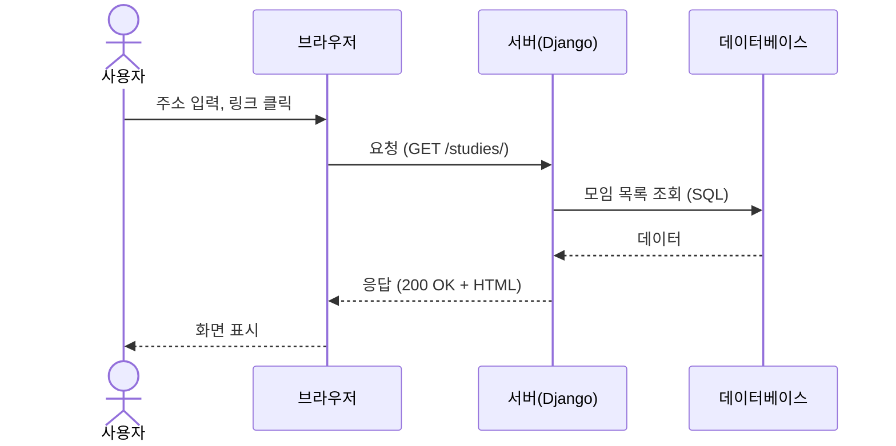
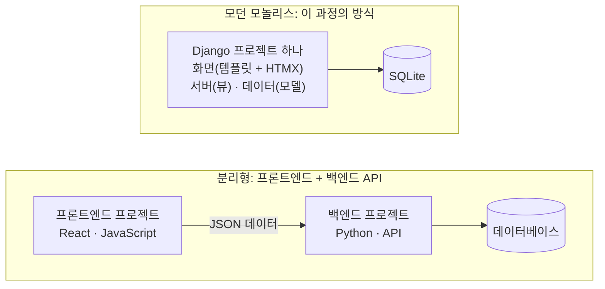
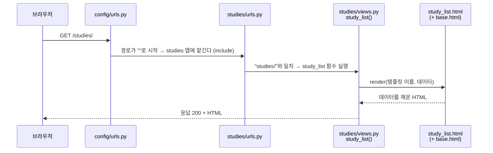
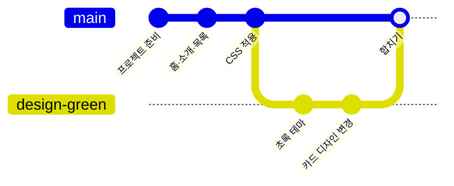

# 3장. 웹 서비스의 구조와 Django

> 이 장에서는 브라우저와 서버가 **요청과 응답**으로 대화하는 웹 서비스의 기본 구조를 배운다. Streamlit과 Django가 어떻게 다른지, 화면을 그리는 코드·요청을 처리하는 코드·데이터를 다루는 코드를 하나의 Django 프로젝트로 관리하고 배포하는 **모던 모놀리스**가 왜 1인 개발자에게 유리한지 이해한다. Django 프로젝트를 만들고 **URL → 뷰 → 템플릿** 흐름으로 페이지를 하나씩 추가하며, Git **브랜치**에서 디자인을 마음껏 실험하는 방법도 익힌다. 실습으로 3~6장 내내 발전시킬 스터디 모임 사이트의 첫 모습을 만든다. 아직 데이터베이스는 쓰지 않고, 파이썬 리스트에 담은 임시 데이터를 서버가 HTML로 만들어 보여 준다.

## 이 장에서 배울 것

- 브라우저·서버·데이터베이스가 **요청**과 **응답**으로 어떻게 대화하는지 설명한다.
- URL을 부분별로 읽고, 요청 방법(`GET`·`POST`)과 상태 코드(`200`·`404` 등)의 뜻을 안다.
- Streamlit과 Django의 차이, **모던 모놀리스**가 무엇이고 왜 1인 개발에 유리한지 설명한다.
- Django의 **프로젝트**와 **앱**을 구분하고, `urls.py` → `views.py` → `templates/` 흐름으로 페이지를 추가한다.
- 공통 레이아웃(`base.html`)과 템플릿 상속으로 모든 페이지의 머리말·메뉴를 한 곳에서 관리한다.
- **Git 브랜치**에서 디자인을 실험하고, 마음에 들면 합치고 아니면 버린다.
- CLAUDE.md에 **프레임워크 규칙**을 적어 AI가 일관된 방식으로 코드를 만들게 한다.

### 이 장의 결과물

```
http://localhost:8000/studies/
┌──────────────────────────────────────────────────────────────┐
│ 📚 함께 공부해요                              소개   모임 목록 │
├──────────────────────────────────────────────────────────────┤
│ 모임 목록                                                     │
│ 전체 3개 모임                                                  │
│                                                              │
│ ┌──────────────────┐ ┌──────────────────┐ ┌──────────────────┐ │
│ │[프로그래밍][모집 중]│ │ [독서] [마감]     │ │[외국어][모집 중]  │ │
│ │ 파이썬 첫걸음      │ │ 한 달에 한 권     │ │ 출근 전 영어 회화 │ │
│ │ 🗓 매주 화 저녁 7시 │ │ 독서 모임        │ │ 🗓 월·수·금 아침  │ │
│ │ 📍 온라인(Zoom)    │ │ 🗓 마지막 토요일   │ │ 📍 온라인(Meet)   │ │
│ │ 👥 5 / 8명        │ │ 👥 10 / 10명     │ │ 👥 3 / 6명       │ │
│ └──────────────────┘ └──────────────────┘ └──────────────────┘ │
├──────────────────────────────────────────────────────────────┤
│ © 2026 함께 공부해요 스터디                                     │
└──────────────────────────────────────────────────────────────┘
```

홈·소개·모임 목록 세 페이지가 공통 레이아웃(메뉴·바닥글)을 함께 쓰고, CSS 프레임워크로 꾸며진 스터디 모임 사이트 `study-club` 프로젝트. 이 장에서는 모임 정보를 파이썬 코드 안의 임시 데이터로 보여 주고, 4장에서 데이터베이스로 옮긴다.

---

## 1. 지난 과제 돌아보기

2장 과제(월별 읽은 권수, 장르별 비율 차트)를 공유하면서 다음 질문에 답해 본다.

| 질문 | 생각해 볼 점 |
|---|---|
| "연-월"을 어떻게 꺼냈나? | `strftime('%Y-%m', finished_on)`과 `substr(finished_on, 1, 7)` 중 무엇이 쓰였나? 날짜를 `'YYYY-MM-DD'` 글자로 저장했기 때문에 둘 다 동작한다. |
| 세 가지 결정(읽는 중 기록, 두 번 읽은 책, 0권인 달)을 어떻게 내렸나? | 같은 데이터라도 결정에 따라 숫자가 달라진다. 내 결정을 화면의 제목이나 설명에 밝혀 두었나? |
| 원형 차트에 어떤 패키지가 쓰였나? | `altair`나 `plotly`처럼 처음 보는 코드가 나왔을 때 설명을 요청해 보았나? |
| 친구도 이 앱을 쓰고 싶다고 하면? | 친구가 내 컴퓨터 주소로 들어올 수 있나? 친구의 독서 기록과 내 기록이 섞이지 않게 하려면 무엇이 필요한가? |

마지막 질문이 이 장의 출발점이다. 지금의 독서 기록 앱은 **나 혼자, 내 컴퓨터에서** 쓰는 도구다. 여러 사람이 각자 가입하고, 자기 데이터만 보고, 페이지마다 고유한 주소가 있는 **서비스**가 되려면 웹이 어떻게 동작하는지 알고, 그런 서비스를 만들기 위한 도구를 써야 한다. 이 장에서 그 도구인 **Django**를 시작한다.

---

## 2. 웹 서비스의 구조

### 2-1. 요청과 응답

웹 서비스는 **브라우저**(손님)와 **서버**(가게)가 주고받는 대화로 이루어진다.

| 단계 | 웹에서 | 식당에 비유하면 |
|---|---|---|
| 1 | 사용자가 주소창에 주소를 입력하거나 링크를 누른다 | 손님이 메뉴를 고른다 |
| 2 | 브라우저가 서버에 **요청**(request)을 보낸다 | 주문서를 주방에 건넨다 |
| 3 | 서버가 요청을 보고 필요한 데이터를 데이터베이스에서 꺼낸다 | 주방이 냉장고에서 재료를 꺼낸다 |
| 4 | 서버가 HTML을 만들어 **응답**(response)으로 돌려준다 | 요리를 완성해 내보낸다 |
| 5 | 브라우저가 HTML을 화면으로 그린다 | 손님이 요리를 받아 먹는다 |



기억할 점은 세 가지다.

- **대화는 항상 브라우저가 먼저 시작한다.** 서버는 요청이 오기 전에는 아무것도 보내지 않는다.
- **요청 하나에 응답 하나.** 응답을 보내면 그 대화는 끝난다. 다음 페이지로 가면 새 요청이 시작된다.
- **서버는 기본적으로 손님을 기억하지 않는다.** 그래서 "로그인한 사람이 누구인지" 같은 정보는 요청마다 따로 알려 줘야 한다. 이 방법은 5장의 로그인에서 다룬다.

이 장에서는 데이터베이스 없이 3단계를 건너뛰고, 4장에서 데이터베이스를 연결한다.

### 2-2. URL 읽기

**URL**은 "어느 서버의 어떤 자원을 원하는지" 적은 주소다. 부분별로 나눠 읽는다.

```
http://localhost:8000/studies/?category=독서
└─┬─┘  └───┬───┘ └┬─┘└───┬───┘ └─────┬─────┘
 방식     호스트   포트   경로      쿼리 문자열
```

| 부분 | 예 | 뜻 |
|---|---|---|
| 방식(scheme) | `http`, `https` | 대화하는 약속. `https`는 내용을 암호화한다. 배포한 서비스는 `https`를 쓴다. |
| 호스트(host) | `localhost`, `www.naver.com` | 어느 컴퓨터(서버)인가. `localhost`는 **내 컴퓨터**다. |
| 포트(port) | `8000`, `8501` | 그 컴퓨터의 몇 번 문으로 들어가는가. 한 컴퓨터에서 여러 프로그램이 각자 다른 포트를 쓴다. |
| 경로(path) | `/studies/`, `/about/` | 서버 안의 어떤 페이지인가. **Django에서 가장 중요하게 보는 부분**이다. |
| 쿼리 문자열(query) | `?category=독서` | 페이지에 덧붙이는 조건. 검색어, 페이지 번호, 필터 등에 쓴다. |

> 💡 기본 과정 8장의 Streamlit 앱은 `http://localhost:8501`에서 열렸다. Django 개발 서버는 기본으로 **8000번** 포트를 쓴다. 포트가 다르기 때문에 두 앱을 동시에 켜 둘 수도 있다.

### 2-3. 요청 방법과 상태 코드

요청에는 **"무엇을 하고 싶은지"** 를 나타내는 방법(method)이 붙는다. 이 과정에서는 두 가지만 알면 된다.

| 방법 | 뜻 | 언제 쓰이나 |
|---|---|---|
| `GET` | 보여 줘 | 주소창에 주소 입력, 링크 클릭, 검색 |
| `POST` | 이것을 처리해 줘(저장·수정·삭제) | 글쓰기 폼 제출, 로그인, 좋아요 |

> 💡 `GET` 요청은 데이터를 **바꾸지 않는** 것이 원칙이다. 링크만 눌렀는데 글이 지워지면 안 된다. 데이터를 바꾸는 일은 `POST`로 한다. 4장의 글쓰기 폼에서 이 규칙을 다시 만난다.

응답에는 **결과가 어땠는지** 알려 주는 세 자리 숫자, **상태 코드**(status code)가 붙는다.

| 상태 코드 | 뜻 | 언제 보나 |
|---|---|---|
| `200` OK | 성공 | 페이지가 정상으로 열렸다 |
| `301`, `302` | 다른 주소로 가세요(이동) | `/about`처럼 끝의 `/`를 빼고 들어가면 `/about/`로 옮겨 준다. 글을 저장한 뒤 목록으로 보낼 때도 쓰인다 |
| `304` Not Modified | 바뀐 것 없음. 갖고 있는 것을 쓰세요 | 새로고침할 때 CSS·이미지 파일이 전과 같으면, 서버는 내용을 다시 보내지 않고 브라우저가 저장해 둔 파일(캐시)을 쓰게 한다. **정상 응답**이다 |
| `404` Not Found | 그런 페이지 없음 | 주소를 잘못 입력했거나, 없는 모임 번호로 들어갔다 |
| `403` Forbidden | 권한 없음 | 남의 글을 수정하려고 했다(5장) |
| `500` Server Error | 서버 내부 오류 | 내 코드에 오류가 있다 |

첫 자리만 봐도 대략 알 수 있다. **2**는 성공, **3**은 이동하거나 저장해 둔 것을 쓰라는 안내, **4**는 요청한 쪽(주소·권한)의 문제, **5**는 서버(내 코드)의 문제다.

### 2-4. 서버가 돌려주는 것: HTML, CSS, JavaScript

서버가 응답으로 돌려주는 페이지는 세 가지 언어로 이루어진다.

| 언어 | 역할 | 비유 |
|---|---|---|
| **HTML** | 내용과 구조. 제목, 문단, 목록, 링크, 입력 칸 | 건물의 뼈대 |
| **CSS** | 모양. 색, 글꼴, 여백, 배치 | 인테리어 |
| **JavaScript** | 움직임. 클릭하면 일부만 바뀌기 등 | 전기 배선과 자동문 |

HTML은 `<태그>내용</태그>` 모양으로 쓴다. 코드를 직접 쓰지는 않더라도 읽을 수는 있어야 한다.

```html
<h1>모임 목록</h1>                             <!-- 큰 제목 -->
<p>전체 3개 모임</p>                            <!-- 문단 -->
<a href="/about/">소개</a>                      <!-- 링크: 누르면 /about/ 으로 GET 요청 -->
<ul>                                           <!-- 목록 -->
  <li>파이썬 첫걸음</li>
  <li>한 달에 한 권 독서 모임</li>
</ul>
```

> 💡 이 과정에서는 JavaScript를 거의 직접 쓰지 않는다. 5장에서 배우는 **HTMX**는 HTML 속성 몇 개만으로 "일부만 바뀌는 화면"을 만들게 해 준다. 그래서 파이썬과 HTML만으로 현대적인 서비스를 만들 수 있다.

### 2-5. Streamlit과 Django의 차이

기본 과정과 2장에서 쓴 Streamlit도 웹 앱이다. 그런데 왜 도구를 바꿀까? 두 도구는 **잘하는 일이 다르다.**

| 구분 | Streamlit | Django |
|---|---|---|
| 잘하는 일 | 데이터 대시보드, 혼자 쓰는 도구 | 회원이 있는 서비스, 여러 화면과 데이터 |
| 화면 만들기 | 파이썬 코드만으로 | HTML 템플릿 + 파이썬 |
| 페이지와 주소 | 여러 페이지를 만들고 페이지마다 주소를 줄 수 있다(`st.navigation`) | 주소 규칙을 자유롭게 설계한다. `/studies/3/`처럼 **번호가 든 주소**도 만든다 |
| 동작 방식 | 버튼을 누르면 **그 페이지의 스크립트를 처음부터 다시 실행** | 요청이 오면 **그 주소를 맡은 함수 하나만 실행** |
| 로그인 | 구글 같은 외부 로그인 서비스를 연결하는 기능을 제공한다(`st.login`) | 사용자 모델, 로그인·로그아웃을 처리하는 뷰, 비밀번호 해시 저장을 기본 제공. 로그인 화면의 템플릿은 직접 작성하고, 회원가입 화면은 Django가 제공하는 폼을 활용해 만든다(5장) |
| 서비스 안의 권한 관리 | 직접 구현해야 함 | 사용자·그룹·권한 체계를 기본 제공 |
| 관리자 화면 | 없음 | 기본 제공 |
| 시작하기 | 아주 쉽다 | 파일과 규칙이 많아 처음엔 낯설다 |

2장에서 `st.rerun()`이 왜 필요했는지 떠올려 보자. Streamlit은 한 페이지를 하나의 스크립트로 보고, 무언가 누를 때마다 위에서부터 다시 실행한다. 그래서 간단하지만, 화면과 데이터가 많아지고 "이 글은 작성자만 고칠 수 있다" 같은 서비스 규칙이 생기면 그런 구조를 직접 만들어야 한다. Django는 **주소마다 담당 함수를 정해 두고**, 요청이 올 때마다 그 함수가 HTML을 만들어 응답한다. 처음 설정할 것은 많지만, 서비스가 커져도 구조가 무너지지 않는다.

> 💡 Streamlit이 나쁜 도구라는 뜻이 아니다. **혼자 쓰는 분석 도구나 대시보드라면 여전히 Streamlit이 더 빠르다.** "여러 사람이 가입해서 쓰는 서비스"를 만들 때 Django를 고른다.

### 2-6. 모던 모놀리스

웹 서비스를 만드는 방식은 크게 두 가지로 나뉜다.



| 구분 | 분리형 (프론트엔드 + API) | 모던 모놀리스 |
|---|---|---|
| 프로젝트 수 | 2개 이상 (화면용, 서버용) | 1개 |
| 쓰는 언어 | JavaScript(React 등) + Python | Python + HTML (+ 약간의 HTMX 속성) |
| 서버가 돌려주는 것 | 데이터(JSON). 화면은 브라우저의 JavaScript가 그린다 | 완성된 HTML |
| 배포 | 두 프로젝트를 따로 배포하고 서로 연결 | 한 번에 배포 |
| 잘 맞는 상황 | 큰 팀, 모바일 앱과 웹이 같은 서버를 써야 할 때 | 1인·소규모 팀, 빠르게 만들고 고쳐야 할 때 |

**모놀리스**(monolith)는 "하나의 큰 돌"이라는 뜻이다. 화면을 그리는 코드(템플릿), 요청을 처리하는 코드(뷰), 데이터를 다루는 코드(모델)를 **하나의 Django 애플리케이션으로** 관리하고 **한 번에 배포**한다. 데이터베이스는 이 애플리케이션이 연결해 쓰는 저장소다. 이 과정에서는 파일 하나로 된 SQLite를 고르지만, 같은 구조에 다른 데이터베이스를 연결할 수도 있다. 예전에는 "화면이 투박하다"는 단점이 있었지만, HTMX 같은 도구로 새로고침 없이 일부만 바뀌는 현대적인 화면을 만들 수 있게 되면서 다시 주목받고 있다. 그래서 앞에 **모던**(modern)을 붙인다.

**1인 개발자에게 유리한 이유**

1. **배울 것이 적다.** 파이썬과 HTML만 알면 된다. React와 그 주변 도구를 따로 배우지 않아도 된다.
2. **고칠 곳이 한 곳이다.** "모임에 장소 항목 추가" 같은 변경이 한 프로젝트 안에서 끝난다. 분리형이라면 데이터베이스·API·화면 프로젝트를 모두 고치고 서로 맞춰야 한다.
3. **배포가 한 번이다.** 6장에서 서버 하나만 배포하면 된다.
4. **AI가 전체를 본다.** Claude Code가 한 폴더 안에서 URL·뷰·템플릿·모델을 모두 읽을 수 있다. 화면과 서버가 다른 저장소에 있으면 AI도 절반만 보고 짐작해야 한다.

> ⚠️ AI에게 "웹 서비스 만들어 줘"라고만 하면 React 프론트엔드와 API 서버를 따로 만드는 분리형을 제안하는 경우가 많다. 그래서 4-4에서 **"이 프로젝트는 Django + HTMX 모던 모놀리스야. React 같은 별도 프론트엔드는 쓰지 않아"** 라는 규칙을 CLAUDE.md에 적어 둔다.

### 2-7. 요청과 응답을 눈으로 보기

요청과 응답은 눈에 보이지 않는 것 같지만, 두 곳에서 확인할 수 있다. 6절 실습에서 직접 본다.

**① 개발 서버의 로그**: Django 개발 서버를 켠 터미널에는 요청이 올 때마다 한 줄씩 기록이 남는다.

```
[28/Nov/2026 14:05:12] "GET /studies/ HTTP/1.1" 200 1899
```

| 부분 | 뜻 |
|---|---|
| `[28/Nov/2026 14:05:12]` | 요청이 온 시각 |
| `GET` | 요청 방법 |
| `/studies/` | 경로 |
| `HTTP/1.1` | 대화 약속의 버전 (신경 쓰지 않아도 된다) |
| `200` | 상태 코드 |
| `1899` | 응답의 크기(바이트) |

**② 브라우저 개발자 도구**: 브라우저에서 `F12`(macOS는 `Cmd+Option+I`)를 누르고 **네트워크**(Network) 탭을 연 뒤 페이지를 새로고침하면, 페이지 하나를 그리기 위해 오간 요청이 모두 보인다.

> 💡 페이지 **하나**를 열었는데 요청은 **여러 개**가 보인다. 브라우저는 먼저 HTML을 받고, HTML 안에 적힌 CSS·이미지 파일을 **각각 따로** 요청한다. 5장에서는 이 네트워크 탭에 보이는 오류를 복사해 Claude Code에게 전달하는 방법을 배운다.

---

## 3. Django 구조 읽기

### 3-1. 프레임워크와 Django

**프레임워크**(framework)는 "뼈대"라는 뜻이다. 웹 서비스마다 반복되는 일(주소 나누기, HTML 만들기, 데이터베이스 연결, 로그인, 보안)을 미리 만들어 두고, 개발자는 정해진 자리에 **내 서비스만의 내용**을 채운다.

| 직접 만든다면 | Django가 해 주는 것 |
|---|---|
| 요청을 받아 주소를 해석하는 코드 | URL 설정(`urls.py`)에 적기만 하면 된다 |
| HTML에 데이터를 끼워 넣는 코드 | 템플릿 언어(`{{ }}`, ``) |
| SQL을 쓰고 연결을 관리하는 코드 | 모델과 ORM (4장) |
| 로그인·로그아웃, 비밀번호 저장, 권한 관리 | 인증 기능 기본 제공. 비밀번호는 원래 값으로 되돌릴 수 없게 **해시**로 바꿔 저장한다. 회원가입 화면은 제공되는 폼으로 만든다(5장) |
| 데이터 관리 화면 | 관리자 페이지 기본 제공 (4장) |
| 공격 방어 | CSRF 방어, HTML 자동 이스케이프 등 기본으로 켜져 있음 |

정해진 자리가 있다는 것은 **규칙을 따라야 한다**는 뜻이기도 하다. 파일 이름과 위치에 의미가 있으므로, 처음에는 구조를 읽는 연습이 필요하다. 이 교재는 **Django 6.1**을 기준으로 하고, 실습에서도 6.1 버전대를 설치한다(6-1).

### 3-2. 프로젝트와 앱

Django에는 **프로젝트**와 **앱**이라는 두 단위가 있다.

| 단위 | 뜻 | 이 장의 예 | 비유 |
|---|---|---|---|
| **프로젝트** | 사이트 전체. 설정과 최상위 주소를 관리한다 | `config` | 쇼핑몰 건물 전체(관리 사무소) |
| **앱** | 기능 하나를 맡는 묶음. 프로젝트 안에 여러 개 둘 수 있다 | `studies` (모임 기능) | 건물 안의 매장 하나 |

나중에 회원 기능을 따로 묶고 싶다면 `accounts` 앱을, 봇 기능은 `bot` 앱을 추가하는 식이다. 이 장에서는 앱 하나(`studies`)로 시작한다.

> 💡 프로젝트 이름을 `config`로 짓는 이유: `django-admin startproject` 명령이 만드는 폴더에는 **설정 파일**만 들어 있다. 그래서 `config`(설정)라고 이름 지으면 폴더의 역할이 바로 보인다. 많은 Django 개발자가 쓰는 관례다.

### 3-3. 만들어지는 폴더와 파일

6절 실습에서 프로젝트를 만들면 다음과 같은 구조가 생긴다. 이 장에서 **직접 다루는 파일은 굵게** 표시했다.

```
study-club/
├── manage.py              ← Django 명령을 실행하는 입구
├── pyproject.toml         ← uv 프로젝트 정보 (패키지 목록)
├── uv.lock                ← 설치된 패키지의 정확한 버전 기록
├── .python-version        ← 이 프로젝트가 쓰는 파이썬 버전 (3.13)
├── config/                ← 프로젝트: 사이트 전체 설정
│   ├── settings.py        ← 설정 파일
│   ├── urls.py            ← 최상위 주소록
│   ├── wsgi.py, asgi.py   ← 배포할 때 서버가 Django를 부르는 입구 (6장)
│   └── __init__.py
├── studies/               ← 앱: 모임 기능
│   ├── views.py           ← 요청을 처리하는 함수들
│   ├── urls.py            ← (직접 만든다) 이 앱의 주소록
│   ├── templates/studies/ ← (직접 만든다) 이 앱의 HTML 템플릿
│   ├── models.py          ← 데이터 설계도 (4장)
│   ├── admin.py           ← 관리자 페이지 설정 (4장)
│   ├── tests.py           ← 자동 테스트 (6장)
│   ├── migrations/        ← 데이터베이스 구조 변경 기록 (4장)
│   └── apps.py, __init__.py
├── templates/             ← (직접 만든다) 여러 앱이 함께 쓰는 템플릿 (base.html)
├── static/                ← (직접 만든다) CSS, 이미지 같은 정적 파일
└── db.sqlite3             ← 데이터베이스 파일 (서버를 처음 켤 때 생긴다)
```

| 파일 | 역할 | 언제 다루나 |
|---|---|---|
| **`manage.py`** | `runserver`(서버 켜기), `startapp`(앱 만들기) 같은 명령을 실행한다. 직접 고치지 않는다 | 이 장부터 계속 |
| **`config/settings.py`** | 설치한 앱 목록, 템플릿 위치, 언어·시간대, 데이터베이스 등 사이트 전체 설정 | 이 장, 6장 |
| **`config/urls.py`** | 최상위 주소록. 어떤 주소를 어느 앱에 맡길지 정한다 | 이 장 |
| **`studies/urls.py`** | 앱의 주소록. 주소와 뷰 함수를 짝짓는다 | 이 장 |
| **`studies/views.py`** | 뷰 함수. 요청을 받아 응답(HTML)을 돌려준다 | 이 장부터 계속 |
| **`templates/`** | HTML 틀. 빈칸에 데이터를 채워 완성한다 | 이 장부터 계속 |
| `studies/models.py` | 테이블 설계도 | 4장 |
| `db.sqlite3` | 1~2장에서 다룬 것과 같은 SQLite 파일. Django가 만들고 관리한다 | 4장 |

> 💡 `db.sqlite3`는 아직 비어 있지만, 4장부터 데이터가 쌓인다. 1장의 `ledger.db`와 마찬가지로 처음부터 `.gitignore`에 넣는다.

### 3-4. 요청이 화면이 되기까지: URL → 뷰 → 템플릿

브라우저에서 `http://localhost:8000/studies/`에 들어가면 Django 안에서 다음 순서로 일이 일어난다.



각 단계의 코드를 읽어 보자. 6절 실습에서 실제로 만들게 될 코드다.

**① 최상위 주소록: `config/urls.py`**

```python
from django.contrib import admin
from django.urls import include, path

urlpatterns = [
    path("admin/", admin.site.urls),     # /admin/ 으로 시작하면 관리자 페이지 (4장)
    path("", include("studies.urls")),   # 나머지 주소는 studies 앱의 주소록에 맡긴다
]
```

Django는 `urlpatterns` 목록을 **위에서부터 차례로** 비교해 처음 맞는 것을 고른다. `include()`는 "이 뒤의 주소는 다른 주소록에서 찾아라"라는 뜻이다. 회사 대표 번호로 전화하면 "모임 문의는 1번" 하고 담당 부서로 넘겨 주는 것과 같다.

**② 앱 주소록: `studies/urls.py`**

```python
from django.urls import path

from . import views

app_name = "studies"   # 이 앱의 URL 이름 앞에 붙는 이름표 (studies:home)

urlpatterns = [
    path("", views.home, name="home"),                      # /
    path("about/", views.about, name="about"),              # /about/
    path("studies/", views.study_list, name="study_list"),  # /studies/
]
```

| 부분 | 의미 |
|---|---|
| `path("studies/", ...)` | 경로가 `studies/`이면. 맨 앞의 `/`는 쓰지 않고 **끝에는 `/`를 붙인다**(Django 관례). |
| `views.study_list` | 이 함수를 실행한다. **괄호 없이** 함수 이름만 적는다. 실행은 요청이 왔을 때 Django가 한다. |
| `name="study_list"` | 이 주소의 **이름**. 템플릿에서 주소를 직접 쓰지 않고 이름으로 부른다(3-5의 ``). |
| `app_name = "studies"` | 다른 앱에도 `home`이라는 이름이 있을 수 있으므로, `studies:home`처럼 앱 이름을 붙여 구분한다. |

**③ 뷰 함수: `studies/views.py`**

```python
from django.shortcuts import render

STUDIES = [   # 4장에서 데이터베이스로 옮기기 전까지 쓰는 임시 데이터
    {"id": 1, "title": "파이썬 첫걸음", "category": "프로그래밍", "is_open": True},
    {"id": 2, "title": "한 달에 한 권 독서 모임", "category": "독서", "is_open": False},
]


def study_list(request):
    return render(request, "studies/study_list.html", {"studies": STUDIES})
```

| 부분 | 의미 |
|---|---|
| `def study_list(request):` | 뷰 함수는 항상 **요청(`request`)을 첫 번째로** 받는다. 요청 방법, 쿼리 문자열, 로그인한 사용자 같은 정보가 들어 있다. |
| `render(...)` | 템플릿에 데이터를 채워 HTML을 만들고, 그것을 **응답으로 포장**해 돌려준다. |
| `"studies/study_list.html"` | 사용할 템플릿 파일 |
| `{"studies": STUDIES}` | 템플릿에 넘길 데이터(**컨텍스트**). 템플릿 안에서는 `studies`라는 이름으로 쓴다. |

뷰 함수는 **반드시 응답을 돌려줘야** 한다. `return`을 빠뜨리면 `didn't return an HttpResponse object` 오류가 난다.

**④ 템플릿: `studies/templates/studies/study_list.html`**

```html



<h1>모임 목록</h1>
<p>전체 {{ studies|length }}개 모임</p>
<ul>
  
    <li>{{ study.title }} ({{ study.category }})</li>
  
</ul>

```

HTML 안에 `{{ }}`와 ``로 **빈칸과 반복**을 표시해 둔 틀이다. 뷰가 넘긴 데이터가 빈칸에 채워져 완성된 HTML이 된다. 문법은 3-5에서 정리한다.

> 💡 **템플릿 폴더가 왜 `studies/templates/studies/`처럼 이름이 두 번 나올까?** Django는 모든 앱의 `templates/` 폴더를 **한데 모아서** 찾는다. 다른 앱에도 `list.html`이 있으면 어느 것인지 헷갈린다. 그래서 앱 이름 폴더를 한 번 더 만들어 `studies/list.html`처럼 구분한다. 귀찮아 보여도 Django의 표준 관례다.

### 3-5. 템플릿 문법 읽기

| 문법 | 뜻 | 예 |
|---|---|---|
| `{{ 변수 }}` | 값을 출력한다 | `{{ study.title }}` → `파이썬 첫걸음` |
| `{{ 변수.키 }}` | 딕셔너리의 값이나 객체의 속성을 꺼낸다. 파이썬의 `study["title"]`을 템플릿에서는 `study.title`로 쓴다 | `{{ study.members }}` |
| `{{ 변수\|필터 }}` | 값을 바꿔서 출력한다 | `{{ studies\|length }}` → `3`(개수) |
| `` ... `` ... `` | 반복한다. 목록이 비어 있으면 `` 부분을 보여 준다 | 모임 카드 반복 |
| `` ... `` ... `` | 조건에 따라 다르게 보여 준다 | 모집 중 / 마감 표시 |
| `` | 공통 레이아웃을 이어받는다. **템플릿의 맨 첫 줄**에 쓴다 | 모든 페이지 |
| `` ... `` | 이어받은 레이아웃의 빈자리를 채운다 | `` |
| `` | URL 이름으로 실제 주소를 만든다 | `` → `/about/` |
| ``, `` | 정적 파일(CSS·이미지)의 주소를 만든다 | `` → `/static/css/site.css` |
| `{# 메모 #}` | 템플릿 주석. 화면에 나오지 않는다 | `{# 4장에서 DB로 교체 #}` |

**주소를 직접 쓰지 않고 ``을 쓰는 이유**

```html
<a href="/studies/">모임 목록</a>                       <!-- ❌ 주소를 직접 쓴다 -->
<a href="">모임 목록</a>  <!-- ✅ 이름으로 부른다 -->
```

나중에 주소를 `/studies/`에서 `/groups/`로 바꾸고 싶다고 하자. 직접 쓴 방식이라면 모든 템플릿에서 `/studies/`를 찾아 고쳐야 한다. 이름으로 부르면 `urls.py` **한 곳만** 고치면 된다. 2장에서 "같은 정보를 두 군데 적지 않는다"고 배운 것과 같은 원리다.

**템플릿 상속: `base.html`**

모든 페이지에 똑같은 머리말·메뉴·바닥글이 있다. 이것을 페이지마다 복사해 두면, 메뉴 하나를 추가할 때 모든 파일을 고쳐야 한다. 그래서 공통 부분은 `base.html` 한 곳에 두고, 각 페이지는 **빈자리(block)만 채운다.**

```
base.html (공통 레이아웃)                 study_list.html (페이지)
┌──────────────────────────┐            
│ <head> CSS 연결 </head>   │
│ 메뉴: 홈 · 소개 · 모임 목록 │            
├──────────────────────────┤     ←──    <h1>모임 목록</h1>
│        │            ... 모임 카드 ...
│   (각 페이지가 채우는 자리)  │            
│             │
├──────────────────────────┤
│ 바닥글                     │
└──────────────────────────┘
```

> ⚠️ 상속받은 템플릿에서 `` **바깥**에 쓴 내용은 화면에 나오지 않는다. "분명히 썼는데 안 보인다"면 그 내용이 블록 안에 있는지 확인한다.

> 💡 **템플릿은 HTML을 자동으로 무해하게 만든다.** 누군가 모임 이름을 `<script>나쁜 코드</script>`로 저장해도, `{{ study.title }}`은 이것을 실행하지 않고 **글자 그대로** 보여 준다. 이것을 자동 이스케이프(escape)라고 한다. 2장의 SQL 인젝션처럼, 사용자 입력이 "명령"이 되지 않게 막는 장치가 Django에는 기본으로 켜져 있다. AI가 `|safe` 필터나 `mark_safe()`로 이 장치를 끄는 코드를 만들면 이유를 물어본다.

### 3-6. MTV: Django의 역할 나누기

Django는 일을 세 가지 역할로 나눈다. 앞 글자를 따서 **MTV**라고 부른다.

| 역할 | 파일 | 하는 일 | 식당 비유 | 다루는 장 |
|---|---|---|---|---|
| **M**odel (모델) | `models.py` | 데이터를 어떤 테이블에 어떻게 저장할지 정한다 | 냉장고와 재료 목록 | 4장 |
| **T**emplate (템플릿) | `templates/*.html` | 데이터를 어떤 모양으로 보여 줄지 정한다 | 접시와 플레이팅 | 이 장 |
| **V**iew (뷰) | `views.py` | 요청을 받아 데이터를 꺼내고, 템플릿에 채워 응답한다 | 요리사 | 이 장 |

여기에 **URL**(`urls.py`)이 "주문을 받아 담당 요리사에게 넘기는 직원" 역할을 한다. 역할이 나뉘어 있어서 "화면 모양만 바꿔 줘"라고 하면 템플릿만, "목록 순서를 바꿔 줘"라고 하면 뷰만 고치면 된다. Claude Code에게 요청할 때도 **어느 역할을 바꾸는 일인지** 알면 더 정확하게 말할 수 있다.

> 💡 1~2장에서 만든 테이블이 Django에서는 **모델**이 된다. 이 장에서는 아직 모델 없이 `views.py`의 임시 데이터(`STUDIES` 리스트)를 쓴다. 4장에서 이 리스트를 데이터베이스 테이블로 바꾸면, 템플릿은 거의 그대로 둔 채 뷰만 조금 고치면 된다. 역할을 나눠 둔 덕분이다.

### 3-7. `settings.py`에서 알아 둘 것

`settings.py`에는 설정이 많지만, 이 장에서 알아 둘 것은 다음 정도다.

| 설정 | 기본값 | 이 장에서 | 뜻 |
|---|---|---|---|
| `INSTALLED_APPS` | Django 기본 앱 6개 | `"studies"` 추가 | 이 프로젝트가 쓰는 앱 목록. **앱을 만들면 여기에 등록해야** Django가 그 앱의 템플릿 등을 찾는다 |
| `TEMPLATES`의 `DIRS` | `[]` | `[BASE_DIR / "templates"]` | 앱 바깥의 공통 템플릿 폴더 위치(`base.html`) |
| `STATICFILES_DIRS` | 없음 | `[BASE_DIR / "static"]` | 앱 바깥의 공통 정적 파일 폴더 위치 |
| `LANGUAGE_CODE` | `"en-us"` | `"ko-kr"` | 오류 메시지, 관리자 페이지 등에 쓰이는 언어 |
| `TIME_ZONE` | `"UTC"` | `"Asia/Seoul"` | 시간대. 4장부터 글 쓴 시각을 저장할 때 중요하다 |
| `DEBUG` | `True` | 그대로 | 오류가 나면 자세한 정보를 화면에 보여 준다. **개발할 때만** `True` (6장) |
| `SECRET_KEY` | 무작위 글자 | 그대로 (**개발 전용**) | 로그인 정보 등을 보호하는 비밀 열쇠. 6장에서 **운영용 키를 새로 만들어** 환경 변수에 둔다 |
| `DATABASES` | `db.sqlite3` | 그대로 | 사용할 데이터베이스. 기본으로 SQLite다 |

> ⚠️ `SECRET_KEY`의 기본값은 `django-insecure-`로 시작한다. "안전하지 않음"이라는 뜻이다. 이 값을 아는 사람은 로그인 정보를 위조할 수 있다. 이 장에서는 Django가 만든 키를 `settings.py`에 둔 채 커밋하므로, 이 키는 **이미 노출된 개발 전용 키**로 취급한다.
> - 저장소는 **비공개**로 만든다.
> - 이 키는 내 컴퓨터에서 개발할 때만 쓰고, **배포한 사이트에는 절대 쓰지 않는다.**
> - 6장 배포 때는 **운영용 키를 새로 만들어** 배포 서비스의 환경 변수에 둔다. Git 기록에 한 번 올라간 키는 파일에서 지워도 기록에 남으므로, 지금 키를 환경 변수로 "옮기는" 것으로는 안전해지지 않는다. 고급 과정 README의 원칙대로 노출된 키는 **폐기하고 새로 발급**한다.

---

## 4. Claude Code 기능 익히기: Git 브랜치와 프레임워크 규칙

### 4-1. 브랜치란?

기본 과정 5장에서 Git의 커밋을 **게임의 세이브 포인트**에 비유했다. **브랜치**(branch, 가지)는 세이브 파일을 **복사해서 다른 길로 플레이해 보는 것**과 같다. 원래 세이브(`main`)는 그대로 두고, 복사본에서 마음껏 실험한다.



| 용어 | 뜻 |
|---|---|
| **브랜치** | 커밋이 이어지는 하나의 줄기. 여러 줄기를 동시에 가질 수 있다 |
| **`main`** | 기본 브랜치. "지금 잘 동작하는 버전"을 둔다 |
| **브랜치 바꾸기** (switch) | 다른 브랜치로 옮겨 간다. **폴더 안의 파일이 그 브랜치의 상태로 바뀐다** |
| **합치기** (merge) | 실험 브랜치의 커밋을 `main`에 가져온다 |
| **버리기** (delete) | 실험 브랜치를 지운다. `main`은 아무 영향을 받지 않는다 |

**언제 브랜치를 쓰나?**

- 결과가 마음에 들지 확신이 없는 실험: 디자인 바꾸기, 다른 CSS 프레임워크 써 보기
- 여러 파일을 크게 바꾸는 작업: 페이지 구조 바꾸기, 새 기능 추가
- 11장 최종 프로젝트에서는 **기능마다 브랜치**를 만드는 것을 기본 작업 방식으로 삼는다.

> 💡 기본 과정에서 배운 `/rewind`나 "커밋으로 되돌리기"는 **실패한 뒤에** 돌아가는 방법이다. 브랜치는 **처음부터** 실험 공간을 따로 만들어 두는 방법이다. 실험이 실패해도 `main`은 한 번도 망가진 적이 없다.

### 4-2. 브랜치 작업 흐름

Claude Code에게 말로 요청하면 된다. 실제로 실행되는 Git 명령도 함께 알아 두면 AI가 무엇을 했는지 읽을 수 있다.

| 하고 싶은 일 | Claude Code에게 | 실행되는 Git 명령 |
|---|---|---|
| 지금 어느 브랜치인지 보기 | `지금 어느 브랜치야?` | `git branch --show-current` |
| 브랜치 목록 보기 | `브랜치 목록을 보여 줘.` | `git branch` |
| 새 브랜치를 만들고 옮겨 가기 | `design-green 브랜치를 만들어서 옮겨 가 줘.` | `git switch -c design-green` |
| `main`으로 돌아가기 | `main 브랜치로 돌아가 줘.` | `git switch main` |
| 실험을 `main`에 합치기 | `design-green 브랜치를 main에 --no-ff로 합쳐 줘.` | `git switch main` → `git merge --no-ff design-green` |
| 합친 브랜치 정리하기 | `합친 design-green 브랜치는 지워 줘.` | `git branch -d design-green` |
| 실험을 버리기 | `design-green 브랜치는 합치지 않고 지워 줘.` | `git branch -D design-green` |
| 커밋 기록을 흐름으로 보기 | `최근 커밋 기록을 브랜치 흐름이 보이게 보여 줘.` | `git log --oneline --graph` |

**기본 흐름**

1. `main`에서 지금 상태를 **커밋**한다.
2. 실험용 브랜치를 만들고 옮겨 간다.
3. 실험 브랜치에서 마음껏 바꾸고, 중간중간 커밋한다.
4. 결과를 확인한다. 필요하면 `main`으로 돌아가 **이전 모습과 비교**해 본다.
5. 마음에 들면 `main`에 합치고, 아니면 버린다.

> 💡 **왜 `--no-ff`를 붙이나?** 실험하는 동안 `main`에 새 커밋이 없었다면, Git은 기본으로 `main`의 위치 표시만 실험 브랜치의 끝으로 옮긴다. 이것을 **fast-forward**(빨리 감기)라고 한다. 파일 결과는 같지만 커밋 기록이 일직선이 되어, 실험 브랜치를 지우고 나면 **어디서 갈라져 언제 합쳤는지**가 기록에 보이지 않는다. `--no-ff`(fast-forward 하지 않기)를 붙이면 병합 커밋이 따로 생겨, 4-1의 그림처럼 갈라졌다 합쳐진 흐름이 남는다. 이 과정에서는 실험의 흔적을 돌아볼 수 있도록 **`--no-ff`로 합친다.** 6-1에서 이것을 CLAUDE.md 규칙으로 적어 둔다.

### 4-3. 브랜치를 쓸 때 주의할 점

> ⚠️ **브랜치를 만들기 전에 커밋한다.** 커밋하지 않은 변경은 어느 브랜치에도 속하지 않은 채 **따라다닌다.** 실험 브랜치에서 만든 변경을 커밋하지 않고 `main`으로 돌아가면, 그 변경이 `main`에서도 보여 헷갈린다. 경우에 따라서는 Git이 브랜치 바꾸기를 거부하기도 한다.

- **지금 어느 브랜치인지 항상 확인한다.** VS Code 왼쪽 아래 상태 표시줄에 현재 브랜치 이름이 보인다. 터미널에서 Claude Code를 쓴다면 `지금 어느 브랜치야?`라고 묻는다.
- **브랜치를 바꾸면 작업 폴더의 파일이 선택한 브랜치의 상태로 바뀐다.** 개발 서버는 파일 변경을 스스로 감지한다. 템플릿이 바뀌면 저장해 둔 템플릿(캐시)을 비우고, `views.py` 같은 파이썬 파일이 바뀌면 서버가 다시 시작한다(5절). CSS 파일은 요청이 올 때마다 디스크에서 그대로 읽어 보낸다. 그래서 브랜치를 바꾸고 1~2초 뒤 브라우저를 새로고침하면 **그 브랜치의 화면**이 보인다. 서버를 직접 껐다 켤 필요가 없으므로, 두 디자인을 번갈아 비교할 수 있다.
- **`-d`와 `-D`는 다르다.** `git branch -d`는 이미 합친 브랜치만 지운다(안전). `-D`는 합치지 않았어도 강제로 지운다. 실험을 버릴 때만 `-D`를 쓴다. Claude Code가 `-D`를 실행하겠다고 승인을 요청하면, 정말 버려도 되는 브랜치인지 확인한다.
- **합칠 때 충돌이 날 수 있다.** 두 브랜치에서 **같은 파일의 같은 부분**을 서로 다르게 고쳤다면 Git이 어느 쪽을 택할지 묻는다(merge conflict). 이 장의 흐름대로 `main`을 건드리지 않고 실험 브랜치에서만 작업하면 충돌은 거의 생기지 않는다. 충돌이 나면 `충돌이 난 부분을 보여 주고, 각각 어떤 변경인지 설명해 줘`라고 요청한 뒤 어느 쪽을 남길지 정한다.

### 4-4. CLAUDE.md에 프레임워크 규칙 쓰기

Django로 같은 기능을 만드는 방법은 여러 가지다. 함수로 뷰를 만들 수도, 클래스로 만들 수도 있다. 템플릿을 앱 안에 둘 수도, 한 폴더에 모을 수도 있다. AI는 이 방법들을 모두 알고 있어서, **요청할 때마다 다른 방식**으로 만들 수 있다. 오늘은 함수, 내일은 클래스로 만들면 초보자는 코드를 읽기가 훨씬 어려워진다.

그래서 프로젝트의 방식을 **CLAUDE.md에 규칙으로 정해 둔다.**

| 규칙이 막아 주는 문제 | 규칙 예 |
|---|---|
| React 프론트엔드를 따로 만드는 분리형 제안 | `이 프로젝트는 Django + HTMX 기반의 모던 모놀리스야. React 같은 별도 프론트엔드는 쓰지 않아.` |
| 오래된 Django 문법 (예: 지금은 없어진 `url()` 함수) | `Django 6.1 기준으로 작성해. URL은 path()로 만들어.` |
| 요청마다 다른 코드 스타일 | `뷰는 함수형 뷰로 만들어. 클래스형 뷰는 쓰지 마.` |
| 템플릿 위치가 제각각 | `공통 레이아웃은 templates/base.html, 앱 템플릿은 앱이름/templates/앱이름/ 아래에 둬.` |
| 템플릿에 주소를 직접 쓰기 | `템플릿에서 주소는 직접 쓰지 말고  태그를 사용해.` |
| `pip`나 `python` 명령을 그냥 쓰기 | `파이썬 실행은 uv run, 패키지 설치는 uv add를 사용해.` |

> 💡 함수형 뷰를 고른 이유: 클래스형 뷰는 코드가 짧아지지만, 실제로 무슨 일이 일어나는지 **코드에 드러나지 않는다.** 함수형 뷰는 "요청을 받는다 → 데이터를 준비한다 → 템플릿으로 응답한다"가 위에서 아래로 그대로 읽힌다. 코드를 읽으며 배우는 이 과정에는 함수형이 낫다.

**프로젝트가 바뀌면 규칙도 바꾼다.** 4장에서 데이터베이스를 쓰기 시작하면 마이그레이션 규칙을, 5장에서 로그인을 넣으면 권한 규칙을 더한다. CLAUDE.md를 고치는 방법은 기본 과정 4장에서 배운 것과 같다.

| 방법 | 터미널(CLI) | VS Code 확장 |
|---|---|---|
| 직접 고치기 | `/memory` 입력 → 프로젝트 메모리(`./CLAUDE.md`) 선택 → 편집기에서 고친다 | VS Code에서 `CLAUDE.md`를 열어 고친다 |
| AI에게 맡기기 | `CLAUDE.md에 "..." 규칙을 추가해 줘.` | 같은 방법 |

> 💡 규칙을 추가한 뒤에는 **새 대화**에서 확인한다. 이미 진행 중인 대화는 예전 규칙을 기준으로 작업하고 있을 수 있다. `/clear`로 새로 시작하고 `CLAUDE.md의 규칙을 요약해 줘`라고 물어보면 AI가 규칙을 제대로 읽었는지 알 수 있다.

### 4-5. 터미널(CLI)과 VS Code 확장의 사용법 비교

| 기능 | 터미널(CLI) | VS Code 확장 |
|---|---|---|
| 현재 브랜치 확인 | `지금 어느 브랜치야?`라고 묻거나 `!git branch --show-current` | VS Code 왼쪽 아래 상태 표시줄 |
| 브랜치 만들기·바꾸기·합치기 | 입력창에 요청 | 입력창에 요청, 또는 상태 표시줄의 브랜치 이름을 눌러 고르기 |
| CLAUDE.md 고치기 | `/memory` 또는 AI에게 요청 | 파일을 열어 직접 고치기 또는 AI에게 요청 |
| 개발 서버 켜기 | 두 번째 터미널에서 `uv run python manage.py runserver` | VS Code 터미널(`` Ctrl+` ``)에서 같은 명령 |

> 💡 `!`로 시작하면 Claude Code를 거치지 않고 셸 명령을 바로 실행한다(고급 과정 부록 A). `!git branch --show-current`처럼 결과만 보면 되는 간단한 명령에 편리하다.

---

## 5. 개발 서버와 localhost

기본 과정 8장에서 Streamlit 앱을 켜면 `http://localhost:8501`이 나왔고, 10장에서 이 주소는 **내 컴퓨터에서만** 열린다는 것을 확인했다. Django도 마찬가지다.

```bash
uv run python manage.py runserver
```

```
Watching for file changes with StatReloader
Performing system checks...

System check identified no issues (0 silenced).

You have 18 unapplied migration(s). Your project may not work properly until you apply the migrations for app(s): admin, auth, contenttypes, sessions.
Run 'python manage.py migrate' to apply them.
November 28, 2026 - 14:00:00
Django version 6.1.3, using settings 'config.settings'
Starting WSGI development server at http://127.0.0.1:8000/
Quit the server with CONTROL-C.

WARNING: This is a development server. Do not use it in a production setting. Use a production WSGI or ASGI server instead.
```

| 메시지 | 뜻 |
|---|---|
| `Watching for file changes` | 파이썬 파일(`.py`)을 고치면 서버가 **자동으로 다시 시작**된다(`... changed, reloading.`). 템플릿은 변경이 감지되면 저장해 둔 템플릿(캐시)을 비우는 것으로 반영되고, CSS는 요청할 때마다 파일을 그대로 읽어 보낸다. 둘 다 서버 재시작 로그는 남지 않는다. 어느 쪽이든 서버를 껐다 켤 필요 없이, 고친 뒤 1~2초 기다렸다가 브라우저만 새로고침하면 된다 |
| `System check identified no issues` | 설정에 문제가 없다 |
| `You have 18 unapplied migration(s)` | 관리자·로그인 기능이 쓸 테이블이 아직 데이터베이스에 없다는 **경고**다. 데이터베이스를 쓰지 않는 이 장의 페이지와는 상관없다. 4장에서 `migrate`로 해결한다 |
| `http://127.0.0.1:8000/` | 서버 주소. `127.0.0.1`은 `localhost`와 같은 뜻(내 컴퓨터)이다 |
| `Quit the server with CONTROL-C` | 서버를 끄려면 `Ctrl+C`를 누른다 |
| `This is a development server` | **개발용 서버**다. 실제 서비스(배포)에는 쓰지 않는다. 6장에서 운영용 설정을 배운다 |

> 💡 **"내 컴퓨터에서 되는데 친구는 안 열려요"** 는 정상이다. `localhost`는 "지금 이 주소를 입력한 그 컴퓨터"를 뜻한다. 친구가 `localhost:8000`을 입력하면 **친구 컴퓨터**에서 서버를 찾는다. 다른 사람이 쓰게 하려면 6장에서 인터넷에 배포해야 한다.

> ⚠️ 개발 서버를 다른 컴퓨터에서 접속할 수 있게 여는 방법(`runserver 0.0.0.0:8000`)을 인터넷 예제에서 볼 수 있다. 개발 서버는 보안과 성능을 고려하지 않고 만들어졌고, `DEBUG = True` 상태에서는 오류 화면에 내부 정보가 그대로 보인다. 수업 중에는 쓰지 않는다.

---

## 6. 실습: 스터디 모임 사이트 시작하기

이 실습에서 만드는 `study-club` 프로젝트는 **6장까지 계속 발전시킨다.** 단계마다 커밋하고, 마지막에 GitHub에 올려 둔다.

| 장 | 이 프로젝트에 더하는 것 |
|---|---|
| 3장 (이 장) | 홈·소개·모임 목록 페이지, 공통 레이아웃, CSS |
| 4장 | 모임·게시글·댓글을 데이터베이스에 저장, 관리자 페이지, 글쓰기 |
| 5장 | HTMX로 즉시 반응하는 화면, 회원가입·로그인·권한 |
| 6장 | 자동 테스트, 인터넷에 배포 |

**90분 실습의 완료 기준**

설치나 GitHub 인증에서 시간이 걸릴 수 있으므로, 단계를 세 묶음으로 나눈다. **기본 완료**까지는 모두가 수업 시간 안에 마치는 것을 목표로 한다.

| 묶음 | 단계 | 내용 |
|---|---|---|
| ✅ **기본 완료** | 6-1 ~ 6-6 | 홈·소개·모임 목록 세 페이지, 공통 레이아웃(`base.html`), CSS 적용 |
| ➕ 이어서 하기 | 6-7 ~ 6-8 | 브랜치 실험은 **색 테마 바꾸기 한 가지**를 기본으로 한다. 그다음 GitHub에 올린다. 수업 시간이 모자라면 과제를 시작하기 전에 마친다 |
| ⭐ 먼저 마친 사람 | 6-7의 추가 디자인 실험, 6-9 | 홈 소개 영역·카드 효과 같은 추가 디자인, 모임 상세 페이지 |

### 6-1. 프로젝트 준비

1장의 `vibe-advanced` 폴더 안에 `study-club` 프로젝트 폴더를 만든다.

**macOS**
```bash
mkdir -p ~/vibe-advanced/study-club
cd ~/vibe-advanced/study-club
code .
```

**Windows (PowerShell)**
```powershell
mkdir ~\vibe-advanced\study-club
cd ~\vibe-advanced\study-club
code .
```

Claude Code를 시작하고 Django 프로젝트를 만든다.

```
이 폴더를 uv init --no-package --python 3.13으로 uv 프로젝트로 만들고, django 패키지를 "django>=6.1,<6.2" 범위로 추가해 줘. uv init이 만든 main.py는 필요 없으니 지워 줘.
Git 저장소의 현재 브랜치 이름이 main인지 확인하고, master라면 main으로 바꿔 줘.
그다음 uv로 Django 프로젝트를 만들어 줘. 프로젝트 이름은 config, 앱 이름은 studies로 해 줘.
프로젝트는 지금 폴더에 바로 만들어 줘(django-admin startproject config .).
만들어진 폴더와 파일이 각각 무슨 역할인지 표로 정리해 줘. 개발 서버는 아직 켜지 마.
```

> 💡 **버전과 브랜치 이름을 정해 두는 이유**: 그냥 `uv add django`라고 하면 설치하는 날의 최신 버전이 들어온다. 교재와 버전이 다르면 화면이나 오류 메시지가 달라질 수 있으므로, 모두 **Python 3.13**과 **Django 6.1.x**로 맞춘다. `"django>=6.1,<6.2"`는 "6.1 버전대 안에서 가장 최신(버그 수정판)"이라는 뜻이다. 컴퓨터에 Python 3.13이 없으면 uv가 알아서 내려받는다. 브랜치 이름은 Git 설정에 따라 `main`이 아니라 `master`로 만들어질 수 있는데, 이 교재의 브랜치 실습(4절, 6-7)과 GitHub 업로드(6-8)는 `main`을 기준으로 한다.

> 💡 **`startproject config .`의 마지막 점(`.`)** 은 "지금 폴더에 만들어라"라는 뜻이다. 점을 빼면 `study-club/config/config/`처럼 같은 이름의 폴더가 한 겹 더 생겨 헷갈린다. 이미 그렇게 만들어졌다면 `폴더가 한 겹 더 생겼어. manage.py가 study-club 바로 아래에 오도록 정리해 줘`라고 요청한다.

Claude Code가 정리한 표를 3-3의 표와 비교한다. 설명이 이해되지 않는 파일이 있으면 그 자리에서 묻는다.

```
config/urls.py와 나중에 만들 studies/urls.py는 무엇이 달라? 왜 두 개가 필요해?
```

**CLAUDE.md 만들기**

4-4의 프레임워크 규칙을 담아 CLAUDE.md를 만든다. 고급 과정 README에 있는 Django 프로젝트용 규칙에, 이 장에서 정한 규칙을 더했다.

```
/init으로 CLAUDE.md를 만들고 아래 규칙을 추가해 줘.
- 나는 코딩 초보자야. 설명은 쉬운 한국어로 해 줘.
- 이 프로젝트는 Django + HTMX 기반의 모던 모놀리스야. React 같은 별도 프론트엔드는 쓰지 않아.
- Django 6.1 기준으로 작성해. URL은 path()로 만들고, 뷰는 함수형 뷰로 만들어. 클래스형 뷰는 쓰지 마.
- 공통 레이아웃은 templates/base.html에, 앱 템플릿은 studies/templates/studies/ 아래에 둬.
- 템플릿에서 주소는 직접 쓰지 말고  태그를 사용해.
- 파이썬 실행은 uv run, 패키지 설치는 uv add를 사용해.
- 개발 서버(uv run python manage.py runserver)는 내가 두 번째 터미널에서 직접 켤게. 너는 서버를 켜지 말고, 확인이 필요하면 uv run python manage.py check를 실행하거나 내가 켜 둔 서버에 curl로 요청해.
- 브랜치를 main에 합칠 때는 git merge --no-ff로 병합 커밋을 남겨.
- settings.py의 SECRET_KEY는 개발 전용이야. 배포 설정이나 다른 파일에 복사하지 마. 운영용 키는 6장에서 새로 만들어 환경 변수에 둘 거야.
- 모델을 바꾸면 마이그레이션 파일도 함께 만들고, 어떤 변경인지 설명해 줘.
- SQL을 직접 쓸 때는 반드시 파라미터 바인딩을 사용해.
```

> 💡 마지막 두 규칙은 4장부터 쓰인다. 미리 적어 두어도 괜찮다. 규칙에 적힌 HTMX는 5장에서 배운다.

> 💡 **왜 서버를 내가 켜는가?** 개발 서버는 `Ctrl+C`로 끌 때까지 계속 실행되는 프로그램이다. 2장의 Streamlit처럼 내가 두 번째 터미널에서 켜 두어야 서버 로그(요청 기록, 오류 메시지)를 직접 볼 수 있다.

이어서 `.gitignore`를 점검하고 첫 커밋을 만든다.

```
.gitignore에 db.sqlite3를 추가해 줘. 4장부터 이 파일에 데이터가 쌓이는데, 회원 정보 같은 개인 데이터가 들어가니까 Git에 올리면 안 돼.
uv.lock과 .python-version은 무시하지 말고 함께 커밋해 줘. 다른 컴퓨터에서 같은 버전을 설치하는 데 필요해.
커밋하기 전에 현재 브랜치가 main인지 한 번 더 확인하고, 지금 상태를 "Django 프로젝트 준비"로 커밋해 줘.
```

> 💡 **`uv.lock`** 에는 설치된 패키지의 **정확한 버전**(Django 6.1.3 등)이 기록된다. 이 파일이 저장소에 있으면, 다른 컴퓨터에서 `uv sync` 한 번으로 지금과 똑같은 버전을 설치할 수 있다.

### 6-2. 1단계: 첫 실행과 설정

VS Code에서 두 번째 터미널을 열고(터미널 패널의 `+` 버튼) 개발 서버를 켠다.

```bash
uv run python manage.py runserver
```

브라우저에서 `http://localhost:8000`을 연다. 로켓 그림과 함께 **"The install worked successfully! Congratulations!"** 가 보이면 성공이다. 5절의 서버 메시지 표를 보며 터미널에 나온 내용도 읽어 본다.

> 💡 이 로켓 페이지는 Django가 `DEBUG = True`이고 **아직 내가 만든 주소가 하나도 없을 때만** 보여 주는 환영 페이지다. 6-3에서 홈 페이지를 만들면 사라진다.

서버를 켜 둔 채로 첫 번째 터미널의 Claude Code에게 설정을 요청한다.

```
config/settings.py를 다음과 같이 고쳐 줘. 각 설정이 무엇을 하는지도 설명해 줘.
- INSTALLED_APPS에 studies 앱을 등록해 줘.
- LANGUAGE_CODE는 ko-kr, TIME_ZONE은 Asia/Seoul로 바꿔 줘.
- 공통 템플릿 폴더(templates)와 공통 정적 파일 폴더(static)를 프로젝트 맨 위에 만들고, settings.py에 그 위치를 등록해 줘.
```

**검증하기**

1. 두 번째 터미널을 보면 설정 파일을 고친 순간 서버가 **스스로 다시 시작**된 기록이 보인다(`... changed, reloading.`).
2. 브라우저를 새로고침하면 환영 페이지의 문구가 **"설치가 성공적으로 완료되었습니다! 축하합니다!"** 로 바뀐다. `LANGUAGE_CODE`가 적용된 것이다.
3. `config/settings.py`를 열어 3-7의 표와 비교한다. `INSTALLED_APPS`의 맨 아래에 `"studies"`가 있는지, `TEMPLATES`의 `DIRS`가 `[BASE_DIR / "templates"]`인지 확인한다.

확인이 끝나면 커밋한다.

```
"기본 설정"으로 커밋해 줘.
```

### 6-3. 2단계: 첫 페이지 만들기

**홈 페이지** 하나를 URL → 뷰 → 템플릿 순서로 만든다. 아직 공통 레이아웃 없이 가장 단순하게 만들어 흐름만 익힌다.

```
홈 페이지를 만들어 줘. 주소는 / 이고, "함께 공부해요"라는 제목과 한 줄 소개가 보이면 돼.
- config/urls.py에서 나머지 주소를 studies 앱의 urls.py에 맡겨 줘(include).
- studies/urls.py를 새로 만들고 app_name은 studies, URL 이름은 home으로 해 줘.
- 뷰 함수 home과 템플릿 studies/templates/studies/home.html을 만들어 줘.
만든 다음, 브라우저가 / 를 요청했을 때 어떤 파일이 어떤 순서로 실행되는지 알려 줘.
```

브라우저를 새로고침한다. 로켓 페이지 대신 내가 만든 홈 페이지가 보여야 한다. 두 번째 터미널에는 다음과 같은 줄이 새로 생긴다.

```
[28/Nov/2026 14:10:31] "GET / HTTP/1.1" 200 312
```

2-7의 표를 보며 이 줄을 읽어 본다. **방법은 `GET`, 경로는 `/`, 상태 코드는 `200`(성공)** 이다.

**서버가 돌려준 것이 정말 HTML인지 확인하기**

```
내가 켜 둔 서버에 curl로 / 를 요청해서 상태 코드와 서버가 돌려준 내용을 그대로 보여 줘.
```

Claude Code가 보여 주는 결과는 3-4의 템플릿에서 `{{ }}`와 ``가 **사라지고** 실제 값이 채워진 순수한 HTML이다. 브라우저는 이 글자를 받아 화면으로 그린 것뿐이다. 브라우저에서 마우스 오른쪽 버튼 → **페이지 소스 보기**를 눌러도 같은 내용이 보인다.

> 💡 서버 안에서는 템플릿 문법이 쓰이지만, 브라우저에 도착하는 것은 **완성된 HTML**이다. 브라우저는 Django가 무엇인지 모른다. 이것이 2-6에서 말한 "서버가 완성된 HTML을 돌려준다"의 실제 모습이다.

**일부러 404 만들어 보기**

브라우저 주소창에 `http://localhost:8000/hello/`처럼 만들지 않은 주소를 입력한다. 노란 화면에 **Page not found (404)** 와 함께 Django가 **찾아본 주소 목록**이 보인다. 내가 만든 주소 중 어느 것과도 맞지 않았다는 뜻이다. 서버 로그에도 `404`가 찍힌다.

> 💡 이렇게 자세한 오류 화면은 `DEBUG = True`일 때만 보인다. 개발할 때는 원인을 찾는 데 큰 도움이 되지만, 배포한 사이트에서 보이면 내부 구조가 노출된다. 6장에서 `DEBUG = False`로 바꾸는 이유다.

확인이 끝나면 커밋한다.

```
"홈 페이지"로 커밋해 줘.
```

### 6-4. 3단계: 공통 레이아웃과 소개 페이지

페이지가 두 개 이상이 되면 메뉴가 필요하다. 메뉴를 페이지마다 복사하지 않도록 `base.html`부터 만든다.

```
모든 페이지가 함께 쓰는 공통 레이아웃 templates/base.html을 만들어 줘.
- 위쪽에 사이트 이름(누르면 홈으로)과 메뉴(소개, 모임 목록)를 두고, 아래쪽에 바닥글을 둬.
- 페이지 제목(title)과 본문(content)은 block으로 비워 둬서 각 페이지가 채우게 해 줘.
- 메뉴의 주소는  태그로 만들어 줘. 모임 목록 페이지는 아직 없으니까 이 단계에서는 메뉴에 이름만 넣고 링크는 6-5에서 연결할게.
그다음 소개 페이지를 /about/ 주소로 만들고(URL 이름 about), 홈과 소개 페이지 모두 base.html을 이어받게 바꿔 줘.
```

> 💡 아직 없는 URL 이름을 ``로 부르면 `NoReverseMatch` 오류가 나서 **모든 페이지가** 열리지 않는다. 그래서 모임 목록 링크는 페이지를 만든 뒤에 연결한다. 이 오류를 일부러 한 번 보고 싶다면, 연결한 뒤 `studies/urls.py`에서 `name`을 잠깐 바꿔 보고 다시 되돌린다.

**검증하기**

1. 홈과 소개 페이지를 메뉴로 오가며, 두 페이지의 메뉴와 바닥글이 **똑같이** 보이는지 확인한다.
2. 브라우저 탭에 보이는 제목이 페이지마다 다른지 확인한다(``).
3. 주소창에 끝의 `/`를 빼고 `http://localhost:8000/about`을 입력해 본다. 주소가 `/about/`으로 **바뀌며** 열린다. 서버 로그에는 `301`(이동)과 `200`이 차례로 찍힌다. Django가 끝의 `/`를 붙여 다시 요청하도록 안내한 것이다(2-3의 상태 코드 표).
4. `base.html`의 바닥글 문구를 하나 고치고 새로고침한다. **두 페이지 모두** 바뀌어야 한다. 이것이 템플릿 상속의 효과다.

확인이 끝나면 커밋한다.

```
"공통 레이아웃과 소개 페이지"로 커밋해 줘.
```

### 6-5. 4단계: 모임 목록 페이지

이 장의 핵심 페이지다. 4장에서 데이터베이스를 쓰기 전까지는 **뷰 안의 임시 데이터**로 목록을 보여 준다.

**공통 임시 데이터**

2장과 마찬가지로 모두 **같은 데이터**로 시작한다. 4장에서 이 데이터를 그대로 데이터베이스에 옮긴다.

| id | title | category | schedule | place | members | capacity | is_open |
|---|---|---|---|---|---|---|---|
| 1 | 파이썬 첫걸음 | 프로그래밍 | 매주 화요일 저녁 7시 | 온라인(Zoom) | 5 | 8 | True |
| 2 | 한 달에 한 권 독서 모임 | 독서 | 매월 마지막 토요일 오전 10시 | 강남역 근처 카페 | 10 | 10 | False |
| 3 | 출근 전 영어 회화 | 외국어 | 매주 월·수·금 아침 7시 | 온라인(Google Meet) | 3 | 6 | True |

각 모임의 소개 문장(`description`)은 다음과 같다.

| id | description |
|---|---|
| 1 | 파이썬 기초 문법을 함께 공부하고 매주 작은 프로그램을 만든다. |
| 2 | 한 달 동안 같은 책을 읽고 만나서 이야기를 나눈다. |
| 3 | 출근 전 30분 동안 주제 하나를 정해 영어로 대화한다. |

위 두 표를 붙여 넣고 요청한다.

```
(위의 두 표를 붙여 넣고)
모임 목록 페이지를 /studies/ 주소로 만들어 줘(URL 이름 study_list).
- 아직 데이터베이스는 쓰지 말고, 위 표의 데이터를 views.py 안에 STUDIES라는 딕셔너리 리스트로 그대로 넣어 줘. 값은 표와 똑같아야 해.
- 모임마다 카테고리, 모집 중/마감 표시, 제목, 일정, 장소, "현재 인원 / 정원"을 보여 줘.
- 맨 위에 전체 모임 수를 보여 주고, 모임이 하나도 없으면 "아직 등록된 모임이 없습니다"를 보여 줘.
- base.html의 "모임 목록" 메뉴를 이 페이지에 연결해 줘.
- 홈 페이지에는 "지금 ○개 모임이 멤버를 모집하고 있어요" 문구와 모임 목록으로 가는 버튼을 추가해 줘. 모집 중인 모임 수는 뷰에서 세서 넘겨 줘.
```

이 단계까지 만들면 코드는 대략 다음과 같다. AI마다 조금씩 다르게 만들기 때문에 똑같지 않아도 괜찮다.

**`studies/urls.py`**

```python
from django.urls import path

from . import views

app_name = "studies"   # 이 앱의 URL 이름 앞에 붙는 이름표 (studies:home)

urlpatterns = [
    path("", views.home, name="home"),
    path("about/", views.about, name="about"),
    path("studies/", views.study_list, name="study_list"),
]
```

**`studies/views.py`**

```python
from django.shortcuts import render

# 4장에서 데이터베이스로 옮기기 전까지 사용할 임시 데이터
STUDIES = [
    {
        "id": 1,
        "title": "파이썬 첫걸음",
        "category": "프로그래밍",
        "schedule": "매주 화요일 저녁 7시",
        "place": "온라인(Zoom)",
        "members": 5,
        "capacity": 8,
        "is_open": True,
        "description": "파이썬 기초 문법을 함께 공부하고 매주 작은 프로그램을 만든다.",
    },
    {
        "id": 2,
        "title": "한 달에 한 권 독서 모임",
        "category": "독서",
        "schedule": "매월 마지막 토요일 오전 10시",
        "place": "강남역 근처 카페",
        "members": 10,
        "capacity": 10,
        "is_open": False,
        "description": "한 달 동안 같은 책을 읽고 만나서 이야기를 나눈다.",
    },
    {
        "id": 3,
        "title": "출근 전 영어 회화",
        "category": "외국어",
        "schedule": "매주 월·수·금 아침 7시",
        "place": "온라인(Google Meet)",
        "members": 3,
        "capacity": 6,
        "is_open": True,
        "description": "출근 전 30분 동안 주제 하나를 정해 영어로 대화한다.",
    },
]


def home(request):
    open_count = sum(1 for study in STUDIES if study["is_open"])   # 모집 중인 모임 수
    return render(request, "studies/home.html", {"open_count": open_count})


def about(request):
    return render(request, "studies/about.html")


def study_list(request):
    return render(request, "studies/study_list.html", {"studies": STUDIES})
```

**`templates/base.html`**

```html
<!doctype html>
<html lang="ko">
<head>
  <meta charset="utf-8">
  <meta name="viewport" content="width=device-width, initial-scale=1">
  <title>스터디 모임 | 함께 공부해요</title>
</head>
<body>
  <header>
    <nav>
      <a href=""><strong>📚 함께 공부해요</strong></a>
      <a href="">소개</a>
      <a href="">모임 목록</a>
    </nav>
  </header>

  <main>
    
  </main>

  <footer>
    <small>© 2026 함께 공부해요 스터디</small>
  </footer>
</body>
</html>
```

**`studies/templates/studies/home.html`**

```html


홈


<section>
  <h1>같이 하면 끝까지 갑니다</h1>
  <p>혼자서는 작심삼일이던 공부, 스터디 모임에서 함께 이어 가세요.</p>
  <p>지금 <strong>{{ open_count }}개</strong> 모임이 멤버를 모집하고 있어요.</p>
  <a href="">모임 둘러보기</a>
</section>

```

**`studies/templates/studies/about.html`** (6-4에서 만든 것)

```html


소개


<h1>소개</h1>
<p>"함께 공부해요"는 관심사가 같은 사람들이 모여 꾸준히 공부할 수 있도록 돕는 스터디 모임 사이트입니다.</p>
<h2>이렇게 운영해요</h2>
<ol>
  <li>모임 목록에서 관심 있는 모임을 고릅니다.</li>
  <li>모임장에게 참가를 신청합니다.</li>
  <li>정해진 시간에 만나 함께 공부합니다.</li>
</ol>

```

**`studies/templates/studies/study_list.html`**

```html


모임 목록


<h1>모임 목록</h1>
<p>전체 {{ studies|length }}개 모임</p>

<div class="study-grid">
  
    <article>
      <header>
        <span class="badge">{{ study.category }}</span>
        
          <span class="badge open">모집 중</span>
        
          <span class="badge closed">마감</span>
        
      </header>
      <h3>{{ study.title }}</h3>
      <p>🗓 {{ study.schedule }}<br>📍 {{ study.place }}</p>
      <footer>👥 {{ study.members }} / {{ study.capacity }}명</footer>
    </article>
  
    <p>아직 등록된 모임이 없습니다.</p>
  
</div>

```

#### 코드에서 개념 찾기

| 개념 | 코드 | 하는 일 |
|---|---|---|
| 주소 맡기기 | `path("", include("studies.urls"))` | 최상위 주소록이 나머지 주소를 앱 주소록에 넘긴다. |
| 주소와 뷰 짝짓기 | `path("studies/", views.study_list, name="study_list")` | `/studies/` 요청이 오면 `study_list` 함수를 실행한다. |
| URL 이름표 | `app_name = "studies"` | 템플릿에서 `studies:study_list`처럼 앱 이름을 붙여 부른다. |
| 뷰 함수 | `def study_list(request):` | 요청을 받아 응답을 돌려준다. |
| 응답 만들기 | `render(request, "studies/study_list.html", {...})` | 템플릿에 데이터를 채워 HTML 응답을 만든다. |
| 컨텍스트 | `{"studies": STUDIES}` | 템플릿에서 `studies`라는 이름으로 쓸 데이터 |
| 데이터 준비는 뷰에서 | `sum(1 for study in STUDIES if study["is_open"])` | 계산은 뷰가 하고, 템플릿은 결과(`open_count`)만 보여 준다. |
| 템플릿 상속 | `` | 공통 레이아웃을 이어받는다. |
| 빈자리 채우기 | `` ... `` | `base.html`의 같은 이름 블록 자리에 들어간다. |
| 값 출력 | `{{ study.title }}` | 딕셔너리의 `"title"` 값을 출력한다. |
| 필터 | `{{ studies\|length }}` | 리스트의 개수를 출력한다. |
| 반복 | `` ... `` | 모임마다 카드를 만들고, 없으면 안내 문구를 보여 준다. |
| 조건 | `` ... `` | 모집 중 / 마감을 다르게 보여 준다. |
| 주소 만들기 | `` | URL 이름으로 `/studies/`를 만든다. |

> 💡 **계산은 뷰에서, 보여 주기는 템플릿에서.** 모집 중인 모임 수를 템플릿 안에서 세려고 하면 코드가 복잡해진다. Django 템플릿은 일부러 기능을 단순하게 만들어 두었다. "데이터 준비 = 뷰, 모양 = 템플릿"이라는 MTV의 역할 나누기(3-6)를 지키게 하려는 것이다.

**검증하기**

1. `/studies/`에서 모임 **3개**가 보이고, 전체 모임 수가 `3개`로 나오는지 확인한다.
2. `한 달에 한 권 독서 모임`만 **마감**, 나머지 둘은 **모집 중**으로 보이는지 확인한다.
3. 홈 페이지의 문구가 **"지금 2개 모임이 멤버를 모집하고 있어요"** 인지 확인한다(모집 중 2개).
4. 홈의 "모임 둘러보기"와 메뉴의 "모임 목록"이 모두 `/studies/`로 이동하는지 확인한다.
5. ``가 동작하는지 확인한다. Claude Code에게 `STUDIES를 잠깐 빈 리스트로 바꿔 줘`라고 요청하고 새로고침한다. 안내 문구가 보이고 전체 모임 수가 `0개`면 성공이다. 확인한 뒤 `방금 바꾼 STUDIES를 원래대로 되돌려 줘`라고 요청하고, 3개가 다시 보이는지 확인한다.

아직 CSS가 없어서 화면이 투박하다. 6-6에서 꾸민다.

**흐름을 그림으로 남기기**

이제 URL → 뷰 → 템플릿 흐름이 실제로 동작한다. 고급 과정 README의 프롬프트로 흐름을 설명받고, 그림을 프로젝트 문서로 남긴다.

```
브라우저에서 /studies/ 주소로 들어갔을 때 화면이 나오기까지 어떤 파일들이 어떤 순서로 실행되는지 그림으로 설명해 줘.
그림은 mermaid sequenceDiagram으로 그리고, docs/structure.md 파일에 단계별 설명과 함께 저장해 줘.
```

Claude Code가 그린 그림을 3-4의 그림과 비교한다. `config/urls.py` → `studies/urls.py` → `views.study_list` → `study_list.html` + `base.html` 순서가 빠짐없이 들어 있는지 확인한다. 2장의 `docs/erd.md`처럼, 이 문서도 구조가 바뀔 때마다 함께 고치게 하면 나와 AI 모두 프로젝트의 흐름을 한눈에 볼 수 있다. 12장 발표에서 "서비스 구조를 그림으로 설명하기"에도 그대로 쓸 수 있다.

> 💡 mermaid 그림을 보는 방법은 2장 5-3과 같다. VS Code 미리보기(`Cmd+Shift+V` / `Ctrl+Shift+V`)나 GitHub에서 연다.

확인이 끝나면 커밋한다.

```
"모임 목록 페이지와 구조 문서"로 커밋해 줘.
```

### 6-6. 5단계: CSS 프레임워크로 꾸미기

**CSS 프레임워크**는 미리 만들어 둔 디자인 모음이다. CSS를 한 줄씩 쓰지 않아도, 파일 하나를 연결하면 글꼴·여백·버튼·표가 깔끔하게 바뀐다.

| CSS 프레임워크 | 특징 | 이 실습에서 |
|---|---|---|
| **Pico CSS** | HTML 태그만 잘 쓰면 클래스 이름 없이도 자동으로 꾸며진다. 배울 것이 거의 없다 | **기본으로 사용** |
| Bootstrap | 가장 널리 쓰인다. 버튼·카드·메뉴 등 부품이 많지만 클래스 이름을 많이 붙여야 한다 | 6-7 브랜치 실험에서 선택 |
| Tailwind CSS | 작은 클래스를 조합해 세밀하게 꾸민다. 자유도가 높은 대신 HTML이 길어진다 | 이 과정에서는 쓰지 않는다 |

```
CSS 프레임워크 Pico CSS(버전 2)를 CDN으로 base.html에 연결해 줘.
- 메뉴는 Pico의 nav 모양으로, 본문과 머리말·바닥글은 가운데 정렬된 container 안에 넣어 줘.
- 모임 목록은 카드(article)를 화면 너비에 맞춰 여러 칸으로 배치해 줘. 휴대폰처럼 좁은 화면에서는 한 줄에 하나씩 보이게 해 줘.
- 카테고리와 모집 상태는 작은 배지로 보여 줘. 모집 중은 초록색, 마감은 회색으로.
- 홈의 소개 영역(section)은 가운데 정렬하고 위아래 여백을 넉넉히 줘. "모임 둘러보기" 링크는 버튼 모양으로 바꿔 줘.
- Pico로 안 되는 부분은 static/css/site.css에 따로 쓰고, base.html에서 과  태그로 연결해 줘.
```

바뀐 `base.html`의 `<head>`와 `<body>` 윗부분은 대략 다음과 같다.

```html

<!doctype html>
<html lang="ko">
<head>
  <meta charset="utf-8">
  <meta name="viewport" content="width=device-width, initial-scale=1">
  <title>스터디 모임 | 함께 공부해요</title>
  <link rel="stylesheet" href="https://cdn.jsdelivr.net/npm/@picocss/pico@2/css/pico.min.css">
  <link rel="stylesheet" href="">
</head>
<body>
  <header class="container">
    <nav>
      <ul>
        <li><a href=""><strong>📚 함께 공부해요</strong></a></li>
      </ul>
      <ul>
        <li><a href="">소개</a></li>
        <li><a href="">모임 목록</a></li>
      </ul>
    </nav>
  </header>
  ...
```

**`static/css/site.css`**

```css
.hero { text-align: center; padding: 4rem 0; }
.study-grid { display: grid; grid-template-columns: repeat(auto-fill, minmax(260px, 1fr)); gap: 1rem; }
.badge { display: inline-block; padding: 0.1rem 0.6rem; border-radius: 1rem; font-size: 0.8rem; background: #e8eaf0; color: #333; }
.badge.open { background: #d1f2dc; color: #116329; }
.badge.closed { background: #eee; color: #888; }
```

| 코드 | 하는 일 |
|---|---|
| `https://cdn.jsdelivr.net/npm/@picocss/pico@2/...` | **CDN**(파일을 대신 배포해 주는 인터넷 서버)에 있는 Pico CSS 파일을 불러온다. 내 프로젝트에 파일을 넣지 않아도 된다. |
| `` | `` 태그를 쓰겠다고 알린다. **템플릿 맨 위**에 둔다. |
| `` | 내 정적 파일의 주소(`/static/css/site.css`)를 만든다. |
| `class="container"` | Pico가 제공하는 클래스. 내용을 화면 가운데에 적당한 너비로 놓는다. |
| `grid-template-columns: repeat(auto-fill, minmax(260px, 1fr))` | 카드 한 장의 최소 너비를 260px로 정하고, 화면에 들어가는 만큼 여러 칸으로 놓는다. 좁은 화면에서는 저절로 한 칸이 된다. |

> 💡 **정적 파일**(static file)은 요청할 때마다 내용이 바뀌지 않는 파일(CSS, 이미지, JavaScript)이다. 템플릿처럼 데이터를 채우지 않고 그대로 보낸다. 개발 서버는 정적 파일도 알아서 보내 주지만, 배포할 때는 따로 모으는 작업(`collectstatic`)이 필요하다. 6장에서 다룬다.

**검증하기**

1. 세 페이지 모두 같은 디자인이 적용됐는지 확인한다. `base.html` **한 곳**만 고쳤는데 모든 페이지가 바뀌었다.
2. 브라우저 창의 너비를 줄여 본다. 모임 카드가 세 칸 → 두 칸 → 한 칸으로 바뀌어야 한다.
3. 개발자 도구(`F12`)의 **네트워크** 탭을 열고 **캐시 사용 중지**(Disable cache)에 체크한 뒤 `/studies/`를 새로고침한다. `studies/`(HTML), `pico.min.css`, `site.css` 세 요청이 보이고, 모두 상태가 `200`인지 확인한다(2-7). 서버 로그에도 `"GET /static/css/site.css HTTP/1.1" 200`이 찍힌다. `pico.min.css`는 내 서버가 아니라 CDN에서 받았으므로 서버 로그에는 없다. 확인이 끝나면 캐시 사용 중지 체크를 해제한다.

> 💡 캐시 사용 중지에 체크하지 않고 새로고침하면 `site.css`의 상태가 `304`로 보이거나, `(메모리 캐시)`·`(디스크 캐시)`처럼 서버에 요청하지 않고 저장해 둔 파일을 썼다고 표시될 수 있다. 둘 다 **정상**이다(2-3). 캐시 사용 중지는 개발자 도구가 열려 있는 동안에만 적용된다.

화면이 마음에 들지 않으면 2장처럼 **스크린샷**을 붙여 넣고 고쳐 달라고 한다. 확인이 끝나면 커밋한다.

```
"Pico CSS 적용"으로 커밋해 줘.
```

### 6-7. 6단계: 브랜치에서 디자인 실험하기

지금 디자인은 잘 동작한다. 다른 디자인도 시도해 보고 싶지만, 지금 상태를 망가뜨리고 싶지는 않다. 이때 **브랜치**를 쓴다(4-1).

**① 실험 브랜치 만들기**

```
지금 커밋하지 않은 변경이 있는지 확인해 줘. 없으면 새 브랜치 design-green을 만들어서 옮겨 가 줘.
```

VS Code 왼쪽 아래 상태 표시줄의 브랜치 이름이 `main`에서 `design-green`으로 바뀌었는지 확인한다.

**② 실험 브랜치에서 디자인 바꾸기**

```
새 브랜치에서 사이트의 색 테마를 초록색 계열로 바꿔 봐 줘. Pico CSS의 색상 버전 파일을 쓰면 돼.
바꾼 다음 "초록 테마 실험"으로 커밋해 줘.
```

**⭐ 먼저 마친 사람: 추가 디자인 실험**

같은 브랜치에서 디자인을 더 바꿔 본다. 바꿀 때마다 커밋한다.

```
홈 화면 위쪽에 배경색이 있는 큰 소개 영역을 만들고, 모임 카드에 마우스를 올리면 살짝 떠오르는 효과를 넣어 줘. 바꾼 다음 "홈 소개 영역과 카드 효과"로 커밋해 줘.
```

> 💡 다른 CSS 프레임워크를 써 보고 싶다면 `Pico CSS 대신 Bootstrap 5로 사이트 전체 디자인을 바꿔 봐 줘`라고 요청해도 좋다. 템플릿 여러 개가 크게 바뀌는 작업일수록 브랜치의 가치가 크다.

**③ 두 디자인 비교하기**

브라우저를 새로고침해 바뀐 디자인을 본다. 그다음 `main`으로 돌아가 이전 디자인과 비교한다.

```
main 브랜치로 돌아가 줘.
```

1~2초 뒤 브라우저를 새로고침하면 **원래 디자인**이 보인다. 개발 서버를 껐다 켜지 않았는데도 바뀐다. 브랜치를 바꾸면 작업 폴더의 파일이 `main`의 상태로 바뀌고, 개발 서버가 템플릿의 변경을 감지해 저장해 둔 템플릿(캐시)을 비우기 때문이다. CSS 파일은 요청할 때마다 디스크에서 읽어 보낸다(4-3).

이 실험은 **브라우저에 브랜치에 맞는 화면이 보이는지**로 확인한다. 템플릿과 CSS만 바꿨으므로 두 번째 터미널에 `reloading` 기록이 없어도 정상이다. 서버가 다시 시작되는 것은 파이썬 파일이 바뀌었을 때뿐이다(5절). 화면이 그대로라면 잠시 기다렸다가 다시 새로고침하고, CSS만 이전 상태로 보이면 아래의 강력 새로고침을 한다.

다시 실험 브랜치로 가서 비교해도 된다.

```
design-green 브랜치로 옮겨 가 줘.
```

> ⚠️ `base.html`이나 `site.css`만 바뀌었는데 브라우저가 예전 디자인을 보여 준다면, 브라우저가 CSS 파일을 저장해 두고 다시 쓰는 것(캐시)일 수 있다. **강력 새로고침**(`Cmd+Shift+R` / `Ctrl+Shift+R`)을 한다.

**④ 결정하기: 합치거나 버리거나**

마음에 들면 `main`에 합친다.

```
design-green 브랜치를 main에 --no-ff로 합쳐 줘. 합친 다음 design-green 브랜치는 지워 주고, 지금 브랜치와 최근 커밋 기록을 브랜치 흐름이 보이게(git log --oneline --graph) 보여 줘.
```

마음에 들지 않으면 버린다.

```
main 브랜치로 돌아가서, design-green 브랜치는 합치지 않고 지워 줘.
```

어느 쪽이든 마지막에 확인한다.

- [ ] 현재 브랜치가 `main`인가?
- [ ] 브라우저에 보이는 디자인이 내가 선택한 것인가?
- [ ] `브랜치 목록을 보여 줘`라고 했을 때 `main`만 남아 있는가?
- [ ] (합쳤다면) 커밋 기록에 갈라졌다 합쳐진 흐름과 `Merge branch 'design-green'` 커밋이 보이는가?

> 💡 실험이 **반쯤** 마음에 들 수도 있다. 예를 들어 초록 테마는 좋은데 메뉴 글자가 잘 안 보인다면, 실험 브랜치에서 `메뉴 글자 색만 더 진하게 고치고 커밋해 줘`라고 고친 뒤 합친다. 합치기 전에는 실험 브랜치에서 얼마든지 더 고칠 수 있다.

### 6-8. 7단계: GitHub에 올리기

```
db.sqlite3가 Git에서 무시되는지 확인해 줘. 그다음 지금 main 브랜치를 GitHub에 비공개 저장소 study-club을 만들어서 올려 줘.
```

GitHub 저장소 페이지에서 다음을 확인한다.

- [ ] `manage.py`, `config/`, `studies/`, `templates/`, `static/`, `CLAUDE.md`가 보인다.
- [ ] `pyproject.toml`, `uv.lock`, `.python-version`이 보인다. 다른 컴퓨터에서 같은 버전을 설치하는 데 필요하다.
- [ ] **`db.sqlite3`는 보이지 않는다.**
- [ ] `docs/structure.md`를 열면 흐름 그림이 **그림으로** 보인다.
- [ ] 저장소가 **비공개**(Private)로 되어 있다. `settings.py`에 개발 전용 `SECRET_KEY`가 들어 있기 때문이다. 이 키는 운영에 쓰지 않는다(3-7).

> 💡 4장은 이 저장소에서 이어서 시작한다. 4장 전에 다른 컴퓨터에서 작업하게 되면, 이 저장소를 내려받아(clone) `uv sync`로 패키지를 설치하면 `uv.lock`에 기록된 버전 그대로 같은 상태로 시작할 수 있다. `db.sqlite3`는 저장소에 없지만 이 장에서는 데이터베이스를 쓰지 않으므로 문제없다.

### 6-9. 확장 실습: 모임 상세 페이지

> 💡 이 단계는 **강사 시연**으로 보거나, 6-8까지 **먼저 마친 학습자**가 해 보는 확장 실습이다. 4장에서 게시판의 "글 상세 페이지"를 만들 때 같은 방법을 쓰므로, 직접 해 보지 않더라도 **주소에 번호를 담는 방법**은 읽어 둔다.

지금까지의 주소는 모두 고정되어 있었다(`/about/`, `/studies/`). 모임마다 상세 페이지를 만들려면 `/studies/1/`, `/studies/2/`처럼 **주소 안에 번호**가 들어가야 한다. 모임이 100개라고 주소 100개를 따로 적을 수는 없다.

```
모임 상세 페이지를 만들어 줘.
- 주소는 /studies/<번호>/ 이고 URL 이름은 study_detail이야.
- 모임의 모든 정보(소개 문장 포함)를 보여 주고, 모임 목록으로 돌아가는 링크를 넣어 줘.
- 모임 목록의 카드 제목을 누르면 그 모임의 상세 페이지로 가게 해 줘.
- 없는 번호로 들어오면 404 오류를 돌려줘.
```

만들어지는 코드의 핵심은 다음과 같다.

```python
# studies/urls.py
path("studies/<int:study_id>/", views.study_detail, name="study_detail"),
```

```python
# studies/views.py
from django.http import Http404


def study_detail(request, study_id):
    for study in STUDIES:
        if study["id"] == study_id:
            return render(request, "studies/study_detail.html", {"study": study})
    raise Http404("그런 모임은 없습니다.")
```

```html
<!-- study_list.html: 카드 제목에 링크 -->
<h3><a href="">{{ study.title }}</a></h3>
```

| 코드 | 하는 일 |
|---|---|
| `<int:study_id>` | 주소의 이 자리에 오는 **정수**를 꺼내 `study_id`라는 이름으로 뷰에 넘긴다. 숫자가 아니면(`/studies/abc/`) 주소가 맞지 않아 404가 된다. |
| `def study_detail(request, study_id):` | 주소에서 꺼낸 값을 두 번째 매개변수로 받는다. 이름이 `urls.py`의 `study_id`와 같아야 한다. |
| `raise Http404(...)` | 맞는 모임이 없으면 "그런 페이지 없음"(404)으로 응답한다. |
| `` | URL 이름 뒤에 값을 주면 그 값이 들어간 주소(`/studies/1/`)를 만든다. |

**검증하기**

1. 목록에서 카드 제목을 누르면 그 모임의 상세 페이지가 열리고, 주소가 `/studies/1/`처럼 바뀌는지 확인한다.
2. 주소창에 `/studies/99/`를 입력한다. **404** 화면이 나와야 한다. 서버 로그에도 `404`가 찍힌다.
3. 주소창에 `/studies/abc/`를 입력한다. 역시 404가 나온다. 이때 Django의 오류 화면에는 맞는 주소가 없었다는 안내와 함께 등록된 주소 목록이 보인다. 2번과 화면이 어떻게 다른지 비교해 본다.

> 💡 **없는 데이터를 요청받으면 404를 돌려준다.** 오류(500)가 나거나 빈 페이지를 보여 주면 안 된다. 4장에서 데이터베이스를 쓰면 Django의 `get_object_or_404()` 함수가 이 일을 한 줄로 해 준다.

확장 실습을 마쳤다면 커밋하고 GitHub에 올린다.

```
"모임 상세 페이지"로 커밋하고 GitHub에 올려 줘.
```

---

## 7. 문제가 생겼을 때

| 증상 | 해결 방법 |
|---|---|
| `ModuleNotFoundError: No module named 'django'` | `uv run` 없이 `python manage.py ...`를 실행했다. 항상 `uv run python manage.py ...`로 실행한다. |
| `Error: That port is already in use.` | 다른 터미널에서 개발 서버가 이미 켜져 있다. 그 터미널에서 `Ctrl+C`로 끄거나, 이미 켜진 서버를 그대로 쓴다. |
| `localhost:8000`에 접속이 안 된다(연결 거부) | 개발 서버가 꺼져 있다. 두 번째 터미널에서 서버가 켜져 있는지, 코드 오류로 멈추지 않았는지 확인한다. |
| `Page not found (404)` | 주소가 `urls.py`의 어느 것과도 맞지 않는다. 오류 화면에 Django가 찾아본 주소 목록이 나오므로, 내가 입력한 주소와 비교한다. `config/urls.py`의 `include()`를 빠뜨리지 않았는지도 확인한다. |
| `TemplateDoesNotExist` | 템플릿 파일의 위치나 이름이 다르다. 앱 템플릿은 `studies/templates/studies/파일.html`, 뷰에서는 `"studies/파일.html"`로 부른다(3-4). `base.html`을 못 찾는다면 `TEMPLATES`의 `DIRS` 설정을, 앱 템플릿을 못 찾는다면 `INSTALLED_APPS`에 `studies`가 등록되었는지 확인한다. |
| `NoReverseMatch` | ``에 쓴 이름이 `urls.py`의 `name`과 다르거나, 아직 없는 주소를 불렀다. `studies:` 앞부분을 빠뜨렸거나 `app_name`이 없어도 난다. 상세 페이지처럼 번호가 필요한 주소에 번호를 주지 않아도 난다. |
| `Invalid block tag ... 'static'. Did you forget to register or load this tag?` | 템플릿 맨 위에 ``이 없다. `base.html`에 넣었더라도 ``을 쓰는 **모든 템플릿**에 각각 있어야 한다. |
| `The view studies.views.xxx didn't return an HttpResponse object` | 뷰 함수에 `return render(...)`가 빠졌다. |
| CSS가 적용되지 않는다 | ① 개발자 도구 네트워크 탭에서 CSS 요청이 `404`인지 확인한다. `404`면 `static/css/site.css`의 위치와 `STATICFILES_DIRS` 설정을 확인한다. ② CDN 주소에 오타가 있거나 인터넷 연결이 끊겼다. ③ 브라우저 캐시 때문일 수 있다. 강력 새로고침(`Cmd+Shift+R` / `Ctrl+Shift+R`)을 한다. |
| 네트워크 탭에서 CSS 요청이 `304`로 보이거나 `(메모리 캐시)`로 표시된다 | 정상이다. 브라우저가 저장해 둔 파일을 다시 쓴 것이다(2-3). `200`과 서버 로그를 직접 보고 싶으면 **캐시 사용 중지**에 체크하고 새로고침한다(6-6). |
| 브랜치를 바꿨는데 서버 터미널에 `reloading`이 없다 | 정상이다. 템플릿은 개발 서버가 변경을 감지해 캐시를 비우는 것으로, CSS는 요청할 때마다 파일을 읽는 것으로 반영되므로 서버가 다시 시작하지 않는다. 1~2초 뒤 새로고침해서 그 브랜치의 화면이 보이는지로 확인한다. CSS만 이전 상태면 강력 새로고침을 한다(6-7). |
| 템플릿에 쓴 내용이 화면에 안 보인다 | ``를 쓴 템플릿에서 `` 바깥에 썼다. 블록 안으로 옮긴다(3-5). |
| 고쳤는데 화면이 그대로다 | 파일을 저장했는지 확인한다. 서버가 오류로 멈춰 있지 않은지 두 번째 터미널을 본다. 새로 만든 파일이 반영되지 않으면 서버를 `Ctrl+C`로 끄고 다시 켠다. |
| `You have 18 unapplied migration(s)` 경고 | 이 장에서는 무시해도 된다. 4장에서 `migrate`로 해결한다(5절). |
| `config/config/` 처럼 폴더가 한 겹 더 생겼다 | `startproject`에서 마지막 `.`을 빠뜨렸다. `manage.py`가 프로젝트 폴더 바로 아래에 오도록 정리해 달라고 요청한다(6-1). |
| 현재 브랜치 이름이 `main`이 아니라 `master`다 | Git 설정에 따라 기본 이름이 다르다. `현재 브랜치 이름을 main으로 바꿔 줘`라고 요청한다(`git branch -m main`). GitHub에 올리기 전에 바꾸는 것이 편하다(6-1). |
| 합쳤는데 커밋 기록이 일직선이고 병합 커밋이 없다 | `--no-ff` 없이 합쳐 fast-forward가 되었다. 결과 파일은 같으므로 동작에는 문제가 없다. 다음부터 `--no-ff`로 합친다(4-2). |
| `Your local changes ... would be overwritten by checkout` (브랜치 바꾸기 실패) | 커밋하지 않은 변경이 있다. 먼저 커밋한 뒤 브랜치를 바꾼다(4-3). 버려도 되는 변경인지 모르겠으면 `커밋하지 않은 변경 내용을 보여 줘`라고 요청해 확인한다. |
| 합칠 때 `CONFLICT (content): Merge conflict in ...` | 두 브랜치에서 같은 부분을 다르게 고쳤다. `충돌이 난 부분을 보여 주고, 각각 어떤 변경인지 설명해 줘`라고 요청한 뒤 남길 쪽을 정한다(4-3). |
| 실험 브랜치의 변경이 `main`에서도 보인다 | 실험 브랜치에서 커밋하지 않고 `main`으로 돌아왔다. 다시 실험 브랜치로 옮겨 가서 커밋한 뒤 돌아온다. |
| AI가 React, `fetch()`, API 서버를 만들려고 한다 | CLAUDE.md에 모던 모놀리스 규칙이 있는지 확인하고, 규칙을 읽었는지 물어본다(4-4). |
| AI가 `url()`이나 `from django.conf.urls import url`을 쓴다 | 지금 Django에는 없는 옛날 문법이다. `path()`로 바꿔 달라고 하고, CLAUDE.md에 Django 버전 규칙이 있는지 확인한다. |

> 💡 노란 Django 오류 화면은 무섭게 생겼지만 **가장 친절한 안내서**다. 맨 위의 오류 이름과 첫 줄 설명, 그리고 "어느 파일 몇 번째 줄"인지가 핵심이다. 화면 전체를 복사하거나, 두 번째 터미널의 오류 메시지를 복사해 Claude Code에게 붙여 넣는다.

---

## 8. 정리

### 핵심 요약

1. 웹 서비스는 **브라우저의 요청**과 **서버의 응답**으로 이루어진다. 대화는 항상 브라우저가 먼저 시작하고, 요청 하나에 응답 하나다.
2. URL은 방식·호스트·포트·**경로**·쿼리 문자열로 나뉜다. Django는 주로 **경로**를 보고 어떤 함수를 실행할지 정한다.
3. `GET`은 "보여 줘", `POST`는 "처리해 줘"다. 상태 코드의 첫 자리는 **2 성공, 3 이동·저장해 둔 것 쓰기(304), 4 요청 쪽 문제, 5 서버(내 코드) 문제**를 뜻한다.
4. Streamlit은 혼자 쓰는 도구에, Django는 **회원이 있는 여러 화면의 서비스**에 알맞다.
5. **모던 모놀리스**는 화면을 그리는 코드·요청을 처리하는 코드·데이터를 다루는 코드를 하나의 Django 애플리케이션으로 관리하고 한 번에 배포하는 방식이다. 데이터베이스(이 과정에서는 SQLite)는 그 애플리케이션이 연결해 쓰는 저장소다. 배울 것·고칠 곳·배포가 하나라서 1인 개발에 유리하고, AI도 프로젝트 전체를 볼 수 있다.
6. Django의 **프로젝트**(`config`)는 사이트 전체 설정을, **앱**(`studies`)은 기능 하나를 맡는다. 앱은 `INSTALLED_APPS`에 등록한다.
7. 요청은 **`urls.py` → `views.py` → 템플릿** 순서로 처리된다. 뷰는 데이터를 준비하고, 템플릿은 그것을 보여 준다(MTV).
8. 공통 부분은 **`base.html`** 에 두고 ``와 ``으로 이어받는다. 주소는 직접 쓰지 않고 **``** 로 부른다.
9. 개발 서버(`localhost:8000`)는 **내 컴퓨터에서만** 열린다. 다른 사람이 쓰게 하려면 배포해야 한다(6장).
10. 결과를 확신할 수 없는 실험은 **브랜치**에서 한다. 브랜치를 만들기 전에 커밋하고, 마음에 들면 `--no-ff`로 합치고 아니면 버린다.
11. 이 장의 `SECRET_KEY`는 Git에 올라간 **개발 전용 키**다. 배포할 때는 운영용 키를 새로 만들어 환경 변수에 둔다(6장).
12. CLAUDE.md에 **프레임워크 규칙**(모던 모놀리스, Django 버전, 함수형 뷰, 템플릿 위치)을 적어 AI가 일관된 방식으로 코드를 만들게 한다.

### 요청문 템플릿

**구조 설명 요청**
```
브라우저에서 [주소]로 들어갔을 때 화면이 나오기까지 어떤 파일들이 어떤 순서로 실행되는지 그림으로 설명해 줘.
```

**페이지 추가**
```
[페이지 이름] 페이지를 [주소] 주소로 만들어 줘(URL 이름 [이름]).
- 화면에는 [보여 줄 내용]이 보이게 해 줘.
- base.html을 이어받고, 메뉴에 이 페이지 링크를  태그로 추가해 줘.
만든 다음, 어떤 파일을 어떻게 바꿨는지 URL → 뷰 → 템플릿 순서로 설명해 줘.
```

**서버 응답 확인**
```
내가 켜 둔 서버에 curl로 [주소]를 요청해서 상태 코드와 서버가 돌려준 내용을 보여 줘.
```

**오류 해결**
```
[주소]에 들어가면 아래 오류가 나. 원인을 URL·뷰·템플릿 중 어디의 문제인지 먼저 알려 주고 고쳐 줘.
(오류 화면 또는 서버 터미널의 오류 메시지 붙여넣기)
```

**브랜치에서 실험**
```
지금 커밋하지 않은 변경이 있는지 확인하고, 없으면 새 브랜치 [브랜치 이름]을 만들어서 옮겨 가 줘.
그 브랜치에서 [바꾸고 싶은 것]을 해 보고 커밋해 줘.
```

**실험 결과 정리**
```
[브랜치 이름] 브랜치를 main에 --no-ff로 합치고 지워 줘.   ← 마음에 들 때
main으로 돌아가서 [브랜치 이름] 브랜치는 합치지 않고 지워 줘.   ← 마음에 들지 않을 때
```

### 용어 사전

| 용어 | 뜻 |
|---|---|
| 요청(request) | 브라우저가 서버에 "이것을 보여 줘/처리해 줘"라고 보내는 메시지 |
| 응답(response) | 서버가 요청에 대해 돌려주는 결과. 상태 코드와 내용(주로 HTML)으로 이루어진다 |
| HTTP | 브라우저와 서버가 요청과 응답을 주고받는 약속. `https`는 암호화된 HTTP다 |
| URL | 웹에서 자원의 위치를 나타내는 주소 |
| 경로(path) | URL에서 서버 안의 페이지를 가리키는 부분(`/studies/`) |
| 쿼리 문자열 | URL의 `?` 뒤에 붙는 조건(`?category=독서`) |
| `GET` / `POST` | "보여 줘" / "처리해 줘"를 뜻하는 요청 방법 |
| 상태 코드 | 응답 결과를 나타내는 세 자리 숫자(200, 301, 404, 500 등) |
| HTML / CSS | 웹 페이지의 내용과 구조 / 모양을 정하는 언어 |
| localhost | 내 컴퓨터를 가리키는 주소. `127.0.0.1`과 같다 |
| 포트 | 한 컴퓨터 안에서 프로그램을 구분하는 번호. Django 개발 서버는 기본 8000번 |
| 프레임워크 | 반복되는 일을 미리 만들어 두고 정해진 자리에 내용을 채우게 하는 뼈대 |
| 모놀리스 | 화면·요청 처리·데이터 접근 코드를 하나의 애플리케이션으로 만들고 배포하는 방식 |
| 모던 모놀리스 | HTMX 같은 도구로 현대적인 화면을 갖춘 모놀리스 |
| 프로젝트(Django) | 사이트 전체. 설정과 최상위 주소록을 가진다(`config`) |
| 앱(Django) | 기능 하나를 맡는 묶음(`studies`). `INSTALLED_APPS`에 등록한다 |
| URLconf | 주소와 뷰를 짝지어 둔 목록(`urls.py`의 `urlpatterns`) |
| 뷰(view) | 요청을 받아 응답을 돌려주는 함수(`views.py`) |
| 템플릿 | 빈칸(`{{ }}`)과 반복·조건(``)을 표시해 둔 HTML 틀 |
| 컨텍스트 | 뷰가 템플릿에 넘기는 데이터 묶음(딕셔너리) |
| 템플릿 상속 | 공통 레이아웃(`base.html`)을 이어받아 빈자리(block)만 채우는 방법 |
| MTV | Model(데이터)·Template(모양)·View(처리)로 역할을 나누는 Django의 구조 |
| 정적 파일 | 요청할 때마다 바뀌지 않는 파일(CSS, 이미지, JavaScript) |
| CSS 프레임워크 | 미리 만들어 둔 디자인 모음(Pico CSS, Bootstrap 등) |
| CDN | 자주 쓰는 파일을 대신 배포해 주는 인터넷 서버 |
| 개발 서버 | 개발할 때 내 컴퓨터에서 쓰는 Django 서버(`runserver`). 실제 서비스에는 쓰지 않는다 |
| 자동 이스케이프 | 템플릿이 출력하는 값 속 HTML 태그를 글자로 바꿔 실행되지 않게 하는 기능 |
| 브랜치 | 커밋이 이어지는 줄기. 원래 줄기를 건드리지 않고 실험할 수 있다 |
| `main` | 기본 브랜치. 잘 동작하는 버전을 둔다 |
| 병합(merge) | 다른 브랜치의 커밋을 지금 브랜치로 가져와 합치는 것 |
| fast-forward | 합칠 브랜치에 새 커밋이 없을 때, 병합 커밋 없이 브랜치 위치만 앞으로 옮기는 합치기 방식 |
| `--no-ff` | fast-forward를 하지 않고 병합 커밋을 남기도록 하는 `git merge` 옵션 |
| 충돌(conflict) | 두 브랜치가 같은 부분을 다르게 고쳐서 자동으로 합칠 수 없는 상태 |
| 캐시(cache) | 브라우저가 한 번 받은 파일을 저장해 두고 다시 쓰는 것. 이때 서버는 `304`로 답할 수 있다 |
| 해시(hash) | 원래 값으로 되돌릴 수 없게 바꾼 값. Django는 비밀번호를 해시로 바꿔 저장한다 |
| `uv.lock` | 설치된 패키지의 정확한 버전을 기록한 파일. `uv sync`로 같은 버전을 설치한다 |

### 스스로 점검하기

- [ ] 브라우저에 주소를 입력했을 때 요청과 응답이 오가는 과정을 그림으로 설명할 수 있다.
- [ ] `http://localhost:8000/studies/?category=독서`를 부분별로 나눠 설명할 수 있다.
- [ ] 상태 코드 200, 301, 404, 500이 각각 무엇을 뜻하는지 말할 수 있다.
- [ ] 서버 로그 한 줄(`"GET /studies/ HTTP/1.1" 200 1899`)을 읽고 설명할 수 있다.
- [ ] Streamlit과 Django가 각각 어떤 일에 알맞은지 예를 들어 설명할 수 있다.
- [ ] 모던 모놀리스가 무엇이고 1인 개발에 유리한 이유를 두 가지 이상 말할 수 있다.
- [ ] Django의 프로젝트와 앱의 차이를 설명할 수 있다.
- [ ] `/studies/` 요청이 어떤 파일들을 거쳐 화면이 되는지 순서대로 말할 수 있다.
- [ ] 템플릿에서 `{{ }}`와 ``의 차이를 설명할 수 있다.
- [ ] `base.html`을 쓰는 이유와 ``을 쓰는 이유를 설명할 수 있다.
- [ ] `localhost:8000`을 친구가 열 수 없는 이유를 설명할 수 있다.
- [ ] 브랜치를 만들어 실험하고, 합치거나 버려 보았다.
- [ ] `--no-ff`로 합쳤을 때와 그냥 합쳤을 때 커밋 기록이 어떻게 다른지 설명할 수 있다.
- [ ] 이 장의 `SECRET_KEY`를 배포한 사이트에 그대로 쓰면 안 되는 이유를 설명할 수 있다.
- [ ] 브랜치를 만들기 전에 커밋해야 하는 이유를 설명할 수 있다.
- [ ] CLAUDE.md에 프레임워크 규칙을 적어 두는 이유를 설명할 수 있다.

---

## 9. 과제

스터디 모임 사이트에 **자주 묻는 질문(FAQ)** 페이지를 추가하고, URL부터 화면까지의 흐름을 **내 말로** 설명해 온다.

### 진행 방법

FAQ 코드와 구조 문서를 **모두 `faq-page` 브랜치에서** 만들고 커밋한 뒤에 합친다. 합치기를 먼저 하면 그 뒤에 고친 문서가 `main`에 직접 커밋되거나 병합에서 빠진다.

1. **브랜치를 만든다.** `main`에 커밋하지 않은 변경이 없는지 확인하고, `faq-page` 브랜치를 만들어 옮겨 간다(4-2).
   ```
   지금 main에 커밋하지 않은 변경이 있는지 확인해 줘. 없으면 faq-page 브랜치를 만들어서 옮겨 가 줘.
   ```
2. **페이지를 만든다.** 주소는 `/faq/`, URL 이름은 `faq`로 한다.
   - 질문과 답을 **5개 이상** 보여 준다. 예: "참가비가 있나요?", "중간에 들어가도 되나요?", "모임을 직접 만들 수 있나요?"
   - 질문과 답은 템플릿에 직접 쓰지 말고, `views.py`에 **리스트로** 만들어 템플릿에 넘긴다(6-5의 `STUDIES`처럼). 템플릿에서는 ``로 반복한다.
   - `base.html`을 이어받고, 메뉴에 FAQ 링크를 ``로 추가한다.
3. **흐름을 글로 설명한다.** Claude Code에게 설명을 요청하기 **전에**, 먼저 아래 양식을 내 힘으로 채운다.
4. **구조 문서를 고치고 내 글과 비교한다.** `docs/structure.md`에 FAQ 페이지의 요청 흐름을 반영하게 요청한 뒤, 3단계에서 쓴 내 글과 비교해 틀린 부분을 고친다.
   ```
   docs/structure.md에 /faq/ 페이지의 요청 흐름을 추가해 줘. 아직 커밋하지는 마.
   ```
5. **`faq-page`에서 함께 커밋한다.** FAQ 코드(`urls.py`, `views.py`, 템플릿, `base.html`)와 `docs/structure.md`를 한 번에 커밋한다.
   ```
   지금 브랜치가 faq-page인지 확인하고, FAQ 페이지와 docs/structure.md 변경을 "FAQ 페이지 추가"로 커밋해 줘. 커밋한 다음 커밋하지 않은 변경이 남아 있지 않은지 확인해 줘.
   ```
6. **`main`에 합친다.** `main`으로 옮겨 간 뒤 `git merge --no-ff faq-page`로 합친다. `--no-ff`를 빼면 커밋 기록이 일직선이 되어 제출물 4번의 흐름이 보이지 않는다.
   ```
   main 브랜치로 옮겨 가서 faq-page를 --no-ff로 합쳐 줘. 합친 다음 faq-page 브랜치는 지워 주고, 커밋 기록을 브랜치 흐름이 보이게(git log --oneline --graph) 보여 줘.
   ```
7. **GitHub에 올린다.** 합친 `main`을 올리고(`git push origin main`), GitHub 저장소 페이지의 `main` 브랜치에서 확인한다. `studies/urls.py`에 `faq` 주소가 있고, `studies/templates/studies/` 안에 FAQ 템플릿이 있으며, `docs/structure.md`에 FAQ 흐름이 들어 있어야 한다.
   ```
   main 브랜치를 GitHub에 올려 줘. 올린 다음 GitHub의 main에 FAQ 페이지와 docs/structure.md 변경이 반영됐는지 확인해 줘.
   ```

**흐름 설명 양식**

```markdown
# /faq/ 페이지가 화면에 나오기까지

1. 사용자가 브라우저에서 ______을 한다.
2. 브라우저가 서버에 ______ 방법으로 ______ 경로를 요청한다.
3. config/urls.py는 ______ 때문에 이 요청을 ______에 맡긴다.
4. studies/urls.py에서 ______와 일치하므로 ______ 함수가 실행된다.
5. 뷰 함수는 ______ 데이터를 준비해서 ______ 템플릿에 넘긴다.
6. 템플릿은 ______을 이어받고, ______ 블록에 질문과 답을 ______로 반복해서 채운다.
7. 완성된 HTML이 상태 코드 ______와 함께 브라우저로 돌아간다.
8. 브라우저는 HTML 안의 ______ 파일들을 추가로 요청해서 화면을 꾸민다.
9. 서버 터미널에는 다음 로그가 남는다: ______
```

> 💡 9번은 직접 `/faq/`에 접속한 뒤 두 번째 터미널에서 복사해 온다.

### 도전 과제 (선택)

- **접었다 펴는 FAQ**: 질문을 누르면 답이 펼쳐지게 만든다. HTML의 `<details>`와 `<summary>` 태그를 쓰면 JavaScript 없이 만들 수 있고, Pico CSS가 자동으로 꾸며 준다.
- **카테고리별 FAQ**: 질문을 "참가", "운영", "기타"처럼 나눠 제목 아래에 묶어 보여 준다. 데이터 구조를 어떻게 바꿔야 할지 먼저 생각해 보고 요청한다.

### 제출할 것

1. GitHub 저장소 주소 (GitHub의 `main`에 FAQ 페이지가 합쳐져 있어야 한다. `db.sqlite3`는 없어야 한다)
2. FAQ 페이지 스크린샷
3. 흐름 설명 양식을 채운 글 (처음에 내가 쓴 것과, 비교 후 고친 부분을 함께)
4. `faq-page` 브랜치에서 갈라졌다 합쳐진 기록 (`git log --oneline --graph` 결과를 복사. `Merge branch 'faq-page'` 커밋이 보여야 한다)
